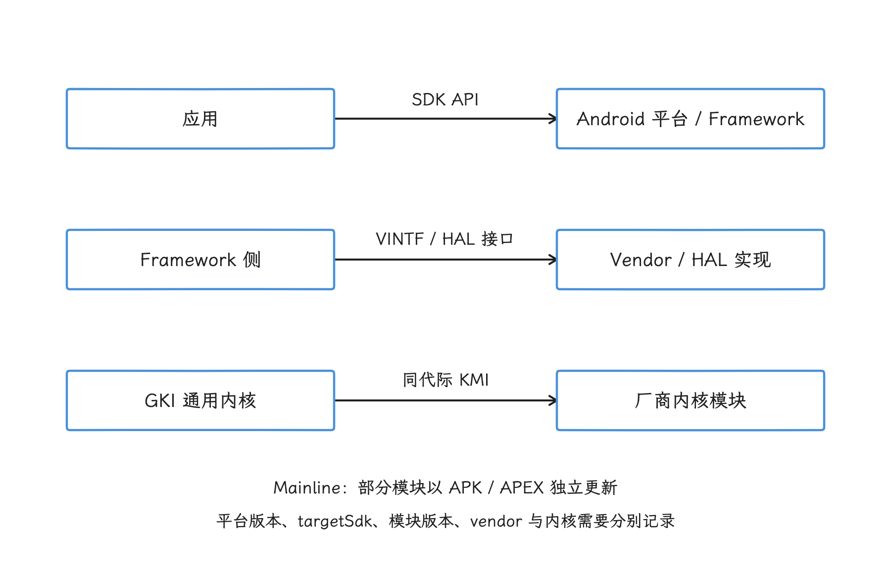
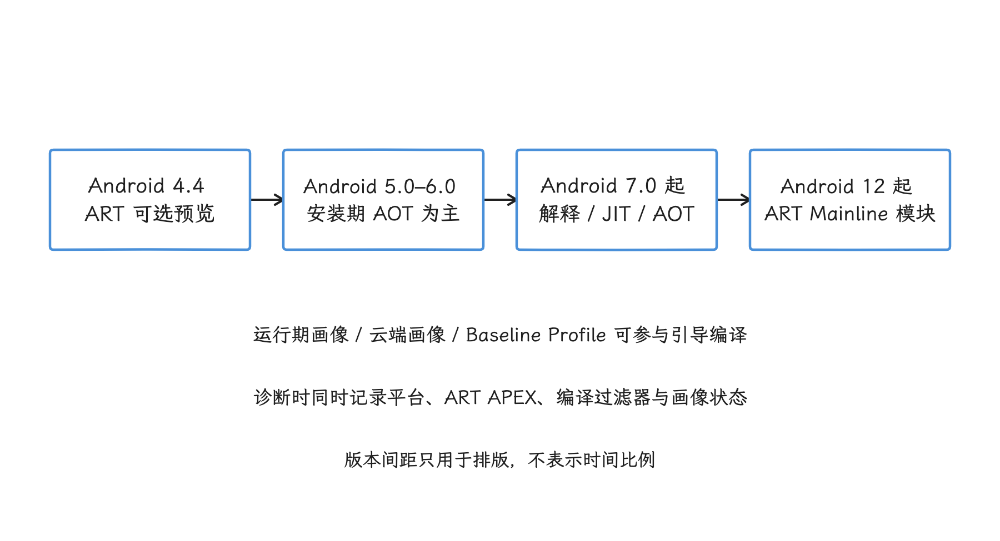

# Android 版本演进中的架构变化

分析 Android 问题时，“这是 Android 17 设备”只是一个起点。我们实际要面对的版本变量至少有五个：

1. 平台版本和具体系统构建（build）；
2. 应用的 `targetSdkVersion`，以及按目标版本等条件切换的兼容性变更（compat change）；
3. ART、Media、Permission 等 Mainline 模块的版本，这些模块可以脱离整机更新；
4. 厂商侧的 system 分区、vendor 分区与 HAL 实现；
5. 内核分支、内核模块接口（KMI）代际（generation）和设备调度配置。

同一平台版本的两台设备，可能运行不同的 Mainline 模块和不同代际的受支持内核。反过来，同一个应用安装在同一台设备上，只改变目标 SDK 版本（`targetSdk`），也可能触发不同的 `MessageQueue`、权限或后台执行行为。

## 一张时间表先抓住主线

先把这条时间线拉直，后面各节再逐层展开：

| 版本 | 主要架构变化 | 分析问题时的影响 |
|---|---|---|
| Android 4.4 / API 19 | ART 作为可选运行时预览 | ART 与 Dalvik 并存，不能把后来的 ART 行为套回所有 4.4 设备 |
| Android 5.0 / API 21 | ART 成为平台运行时；支持 64 位 ABI | 安装期编译、垃圾回收（GC）、Zygote 位数和原生 ABI 成为重要变量 |
| Android 7.0 / API 24 | ART 采用即时编译（JIT）、提前编译（AOT）和解释执行的混合策略 | 首次运行、代码使用画像积累和后台 DEX 优化（dexopt）会改变后续性能 |
| Android 8.0 / API 26 | Project Treble、VINTF、HIDL、VNDK | 系统框架与厂商实现的边界受到稳定接口、ABI 与测试套件约束 |
| Android 10 / API 29 | Project Mainline 与 APEX | 一部分系统组件可以脱离整机 OTA 更新 |
| Android 12 / API 31 | ART 进入 Mainline；GKI 2.0 成为关键内核架构 | 同一 Android 大版本的 ART 行为可能随模块更新变化 |
| Android 15 / API 35 | 平台支持 16 KB 内存页；VNDK 开始废弃 | 原生二进制对齐和厂商依赖模型需要重新检查 |
| Android 16 / API 36 | GBL 支持、16 KB 兼容模式、系统触发性能剖析（profiling）、`JobScheduler` 配额调整 | 引导链、原生代码兼容和线上诊断出现新的可选能力 |
| Android 17 / API 37 | 无锁 `MessageQueue`、更多性能剖析触发条件、`JobScheduler` 等待原因统计 | 目标 SDK 版本与 API 37 新接口直接改变性能诊断路径 |

Material You 是 Android 12 在产品与界面上的重要变化；系统与厂商分区的划分、运行时（Android Runtime，ART）与厂商实现的关系，在这一代维持原样。版本表列出的，是会改变系统分层、二进制兼容或性能分析方法的节点。

## 从 Treble 到 GKI：更新边界的分层变化

Android 的模块化沿着几条兼容边界一层层推进，每条边界是一份稳定契约，差别只在建成时间。

```text
App / SDK API
    |
Framework 与可更新 Mainline 模块
    |  VINTF + stable HAL
Vendor / HAL 实现
    |  KMI
GKI 核心内核 + vendor modules
    |
Boot firmware / 可选 GBL
```

我们先看这张分层图怎么读：SDK API 约束应用与平台，厂商接口（VINTF）约束系统框架与厂商实现，KMI 约束通用内核镜像（Generic Kernel Image，GKI）与厂商内核模块。三者各管一层，合起来支撑起整套分层结构的独立更新。

<!-- gracker-diagram: ch01-02-update-contracts -->


图：SDK API、VINTF 和 KMI 分别约束不同组合。Mainline 为部分模块提供独立更新路径，VNDK 的废弃也没有移除所有原生库隔离机制。

### Treble、VINTF 与 HAL

Treble 在 Android 8.0 把系统框架（framework）和厂商（vendor）实现分进明确的分区。新版 system 想搭配旧版 vendor 单独升级，前提是双方都满足声明的兼容契约；契约成立，升级才能减少同步修改。

VINTF 就是这份契约的载体：设备一侧的 manifest 声明本机提供哪些 HAL 及版本，系统框架一侧的兼容性矩阵（FCM）声明框架要求哪些 HAL 能力，OTA、启动和兼容性测试再按匹配规则判断组合是否合法。

Android 8.0 初期的跨分区 HAL 主要用硬件接口定义语言（HIDL）描述，新的 HAL 已改用带 VINTF 稳定性的 AIDL。旧设备和旧 HAL 仍可能保留 HIDL，所以我们读 trace 前要先确认接口类型。

`/dev/hwbinder` 承载的是独立进程形式的 HIDL HAL 通信。在 trace 里看到它，我们还要记得硬件访问有多条路径：AIDL HAL、同进程 HAL、socket、共享内存和厂商自定义路径，各有自己的调用形态。至于延迟，硬件操作和系统框架 Binder 谁更快，取决于具体服务、设备和工作内容。

### GSI 的验证用途

通用系统映像（GSI）是一份接近纯 AOSP 的 system 映像。Android 9 及以上的相关设备可以用它启动，运行厂商测试套件（VTS）和基于 GSI 的兼容性测试 CTS-on-GSI，验证厂商接口（Vendor Interface，VINTF）是否满足当前系统框架的要求。

GSI 能启动，只说明分区与接口的组合满足了最低启动条件；完整合规还要看 VTS、CTS-on-GSI 以及设备类型要求的其他测试。性能方面同理：量产系统还包含厂商服务、HAL、调度参数和功耗策略，要评估量产表现，我们以量产系统上的采集为准。

### VNDK 与链接器命名空间（linker namespace）的历史位置

Treble 还要解决原生 ABI 的可见性：厂商原生开发套件（VNDK）曾提供一组 framework 原生库供 vendor 依赖，链接器命名空间则限制不同进程和模块能看到哪些库。

Android 15 起废弃 VNDK：在以 Android 15 构建的 `vendor`/`product` 分区上，原来的 VNDK 库与分区可用的其他库一样安装；VNDK APEX、相关版本属性和厂商快照（vendor snapshot）等机制被移除或缩减。用于兼容旧版 vendor 映像的早期 VNDK APEX 仍可能存在，向 vendor 提供稳定底层原生接口的 LL-NDK 也不在这次废弃范围内。

原生代码的隔离如今仍靠分区边界、稳定 AIDL/HIDL、链接器命名空间、LL-NDK 和构建依赖检查共同维持。我们排查库加载问题时，以设备实际的 `ld.config.txt`、APEX 列表和已加载 `.so` 路径为准；至于依赖是否进了 Vendor APEX，同样看这台设备的实际情况。

### Mainline 与 APEX

Android 10 的 Project Mainline 把一部分系统组件划为可独立更新的模块。模块可以采用 APK 或 APEX 两种形态：APK 适合普通系统框架组件和权限控制器这类模块；APEX 面向底层系统组件，可以携带原生库，并在启动早期由 `apexd` 验证、激活和挂载。

Mainline 让安全修复和组件更新有了脱离整机 OTA 的通道。模块集合是逐代扩大的：ART 到 Android 12 才进入 Mainline，一台 Android 10 设备能更新哪些模块，要看它实际启用的模块清单。

这会直接改变我们的复现方法。遇到 ART、加密与安全提供程序 Conscrypt、Media 或 Permission 的行为差异时，构建指纹（build fingerprint）只能说明系统版本，还要把它和当前启用的 APEX/APK 模块版本一起记下；只对比 `Build.VERSION.SDK_INT`，很容易漏掉这层变量。

### GKI 与 KMI

GKI 把通用内核主体和设备相关模块分开；KMI 规定 GKI 向厂商内核模块（vendor kernel modules）开放哪些接口，并在对应代际内维持兼容。

稳定的 KMI 管的是同一代际内的接口兼容。不同 GKI 内核或 KMI 代际之间不承诺模块兼容，厂商模块、设备树、启动配置和厂商功能仍需匹配；同一个 Android 平台还可能同时支持多个历史分支的 Android 通用内核（ACK）。

Android 17 的新内核基线是 `android17-6.18`，本书固定使用 `android17-6.18-2026-06_r6` 这份源码。官方兼容表同时列出 Android 17 可支持的若干较早 GKI 分支；所以看到 Android 17 用户空间时，设备内核要单独确认，6.18 之外还有更早的候选。

### Android 16 的 GBL

通用引导加载程序（GBL）是一个标准化、可更新的 UEFI 应用，里面包含通用的 Android 引导逻辑、Fastboot 和厂商扩展接口。Android 16 引入平台支持，并建议符合条件的新 ARM64 设备集成。

GBL 仍依赖设备启动固件（boot firmware）提供 UEFI、AVB 和必要协议，也允许厂商扩展。它是一套可部署的标准化方案，各台 Android 16 设备实际用什么 Bootloader，以设备自己的启动链为准。我们分析启动时间时，把实际启动链记录下来，再下判断。

## 从 Dalvik 到 ART：编译策略如何改变

DEX 代码在哪个阶段编译、编译多少，在不同 Android 版本上的答案并不一样。这条演变线从 Android 4.4 的 ART 预览开始，经过安装期编译和混合编译，一直延续到 ART 成为可单独更新的模块。我们先沿时间线把每个阶段的做法看清楚。

### Android 4.4：ART 预览

Android 4.4 中，ART 是可选运行时，Dalvik 仍是常见默认路径。ART 尝试把更多 DEX 代码提前编译为机器码，这是一个用安装时间和存储空间换取运行期收益的早期尝试。

这段变化的关键在编译时机。成本可以落在安装期、首次运行、后台空闲期或运行时，不同策略就是在这些阶段之间重新分配 CPU、存储和延迟。我们判断一种策略，就看它把成本挪到了哪个阶段、换来了什么。

### Android 5.0 到 6.0：以安装期 AOT 为主

Android 5.0 用 ART 取代 Dalvik 成为平台运行时，并正式支持 64 位 ABI。这个阶段 ART 主要通过 `dex2oat` 做安装期 AOT 编译，产物由几个因素共同决定：编译过滤器（compiler filter）决定编译范围和优化级别，系统应用会被预编译，类加载上下文决定类加载时能看到哪些代码和依赖，设备配置也会改变结果。要判断一个包的实际状态，直接查它的编译状态，比凭版本印象推测可靠。

64 位带来的是更多通用寄存器和新的 ABI；与此同时，指针、对象或原生数据结构可能变大，性能结果取决于代码、编译器和内存访问模式。64 位设备上的 Zygote 形态同样由产品配置决定：`zygote64`、`zygote64_32`、`zygote32_64` 等配置决定主、辅 Zygote 的位数，init 服务名仍常见 `zygote` 与 `zygote_secondary`。一台设备上到底有几个 Zygote，以它的产品配置为准。

### Android 7.0 以后：JIT、AOT 与解释执行混合

Android 7.0 引入带代码使用画像的 JIT，并与 AOT、解释执行组合：

1. 未编译代码可以先解释执行；
2. JIT 编译运行期频繁执行的热点代码；
3. ART 在画像（Profile）中记录常用方法与类；
4. 后台 DEX 优化按画像做 `speed-profile` 编译；
5. 已编译代码和画像会随更新、空间压力或校验条件变化。

画像引导编译（Profile-Guided Compilation）下，应用第一次运行是慢是快，很大程度上取决于画像从哪里来。云端画像（Cloud Profile）可能由安装来源下发，它根据用户使用数据生成；应用和库也可以自带开发阶段准备好的基准画像（Baseline Profile），让 ART 在用户首次运行前就编译关键路径。这里分发的是代码使用画像；设备上的编译流程生成 `.odex` 等 AOT 产物；`.vdex` 主要保存验证相关数据，具体内容随 ART 版本变化，不能统称为机器码，参见 [ART 编译产物说明](https://source.android.com/docs/core/runtime/configure)。

Android 16 的无缝应用更新优化走的是另一条路：把 `dexopt`/`dex2oat` 移到安装流程更早的阶段，缩短应用包在代码和资源切换期间的停摆时间。

### Android 12 以后：ART 作为 Mainline 模块独立更新

ART 从 Android 12 起成为 Mainline 模块，Android 12 及以上的设备可以通过 Google Play 系统更新获得运行时和编译器修复。这之后我们分析 JIT、垃圾回收、DEX 优化或验证器行为时，要同时记录：

- 平台构建版本；
- ART APEX 版本；
- 应用包的编译过滤器、代码使用画像和 DEX 优化原因（dexopt reason）；
- 是否刚经历安装、OTA 或 Mainline 更新。

<!-- gracker-diagram: ch01-02-art-evolution -->


图：Android 4.4 的 ART 为可选预览；5.0 成为默认运行时；7.0 引入带画像的混合执行；12 起 ART 模块可独立更新。箭头表示版本演进，不表示每个方法都依次经历这些阶段。

`adb shell cmd package art dump <package>` 可以查看 ART Service 维护的应用包编译状态。命令输出属于诊断接口，字段可能随版本变化，自动化脚本应针对目标构建验证。

## Android 15 到 17：当前需要适配的变化

### 16 KB 内存页（page size）

Android 15 开始支持把平台构建成 16 KB 内存页。更大的页面能扩大地址转换缓存（Translation Lookaside Buffer，TLB）的覆盖范围、减少部分页表遍历，但也可能增加页面内部未被利用的空间和小块映射成本。官方基准给出的收益来自特定设备与工作负载，我们把它当参考；自己的应用能拿到多少，还要在目标设备上重新测。

应用兼容性主要取决于原生代码：

- 纯 Java/Kotlin 代码通常不直接依赖页大小，但 SDK 或依赖库可能携带 `.so`；
- ELF 文件的 `LOAD` 加载段和 APK 内未压缩的原生库都需要正确对齐；
- 内存映射函数 `mmap()`、共享内存、页掩码和写死的常量 `4096` 都要检查；
- 应使用当前 NDK 和 AGP 重新构建，并在 16 KB 设备或模拟器上验证。

Android 16 加入 16 KB 向后兼容模式（backcompat mode），让一部分只按 4 KB 对齐的应用先过渡运行，能覆盖到哪些二进制要以实测为准。Android 17 又提供测试属性，可把兼容模式设为 `fatal`，让不兼容二进制立即终止：

```bash
adb shell setprop bionic.linker.16kb.app_compat.enabled fatal
adb shell setprop pm.16kb.app_compat.disabled true
```

这两个是设备级测试开关，普通应用不要在生产环境设置。Google Play 当前要求目标版本为 Android 15 / API 35 或更高的应用支持 64 位设备上的 16 KB 页；从 2027 年 2 月 1 日起，不满足要求的应用更新会被拒绝发布。

`basename()`/`dirname()` 用到的线程局部存储（TLS）缓冲区，Android 16 改成首次使用时才单独分配。官方发布说明给出的结果，是在 16 KB 系统上释放初始线程页中约 8 KB 的空间。这是 Android C 库 bionic 在初始线程页上的实现优化；每个线程的总内存变化，还要按线程自己的用量看。

### Android 16：系统触发性能剖析与 Job 配额

Android 15 / API 35 引入 `ProfilingManager` 的应用主动请求接口。Android 16 / API 36 增加系统触发的性能剖析：应用注册关注的触发类型，系统在 `reportFullyDrawn()` 或 ANR 等事件附近采集数据，再把结果交给应用。

Android 16 还调整了 `JobScheduler` 的普通任务和加急任务（expedited job）的运行时配额。配额会考虑应用待机分组（standby bucket）、任务启动时应用是否处于顶层（top）状态，以及任务是否在前台服务运行期间执行；前台服务期间执行的任务，同样计入这份配额的考量。所以我们排查任务未运行时，直接读待执行原因（pending reason）、停止原因（stop reason）和约束，比只看是否启动过前台服务可靠得多。

### Android 17：MessageQueue、ProfilingTrigger 与 Job 诊断

以 API 37 为目标版本的应用在 Android 17 上默认使用新的无锁 `MessageQueue`。目标版本较低的应用可以通过兼容性变更开关测试：

```bash
adb shell am compat enable USE_NEW_MESSAGEQUEUE <package>
adb shell am compat disable USE_NEW_MESSAGEQUEUE <package>
```

它改变的是 `MessageQueue` 内部实现，主线程上的业务、布局和 Binder 等待该怎么走还是怎么走。依赖 `mMessages` 等私有字段的反射代码需要迁移；具体实现见 §1.8。

API 37 扩展了 `ProfilingTrigger`，新增或公开一批触发类型，覆盖冷启动（cold start）、内存不足（OOM）、因 CPU 使用过量被终止、异常和应用兼容性等场景。不同触发器产生的采集结果（artifact）和停止条件各不相同，我们逐类确认之后再下结论。应用仍需注册触发器、接收结果，并遵守系统限额。

`JobScheduler.getPendingJobReasonStats(jobId)` 返回各项待执行原因及其累计等待时长。多个原因可以同时成立，所以各项时长之和可能超过任务实际等待时间。它适合回答“哪类约束长期阻止任务运行”；要还原过程，我们再看 `getPendingJobReasonsHistory()`、`JobParameters.getStopReason()` 和用于识别重复执行的业务日志。

`android-17.0.0_r1` 源码里，部分新增接口和触发器仍由功能开关系统 `aconfig` 和 `@FlaggedApi` 注解管理。应用侧以最终的 API 37 SDK、设备构建和接口可用性为准；预览版或单一产品上的开关状态，只代表那一台设备。

### Android 17 没有统一的“机器学习任务调度器”

固定源码标签（tag）里没有面向所有应用、名为 `MLScheduler` 或等价名称的统一任务调度器。常被混写成“机器学习调度”的能力分属不同层次：

- `JobScheduler` 根据约束、配额、应用待机分组和截止时间（deadline）决定后台任务何时可运行；
- `AppStandbyController` 可以把仅供系统使用的预测结果作为输入，但这不代表 `JobScheduler` 自己运行一个公开的机器学习模型；
- `OomAdjuster` 与 `ProcessStateController` 计算进程重要性，再把内存回收优先级 `oom_score_adj` 交给低内存终止守护进程 `lmkd`；
- Android 动态性能框架（ADPF）的 `PerformanceHintManager` 让应用报告工作时长目标，由系统和设备实现选择资源策略；
- ACK 6.18 的 EEVDF 公平任务选择算法、CPU 利用率上下限（uclamp）、CPU 集合（cpuset）与任务配置（task profile）仍是内核和系统策略机制，也不是 Android 17 新增的通用机器学习调度 API。

如果设备厂商（OEM）的产品确有预测式调度扩展，结论至少要包含：组件或包名；模型输入与控制输出；进入任务配置、uclamp 或其他执行机制的调用链；在固定构建指纹下采集的对照跟踪数据。只有营销名称、版本号或一组没有原始数据的百分比，还证明不了平台存在统一调度器。

## 隐私与后台限制也会改变性能工具

系统架构不仅由分区和内核组成，权限与后台策略同样会改变采集工具能看到什么、任务能运行多久。

### 包可见性

Android 11 对以 API 30 及以上为目标的应用限制包可见性。`PackageManager` 查询通常只返回自动可见和通过 `<queries>` 声明的包；`QUERY_ALL_PACKAGES` 只适用于少数核心场景，并受 Google Play 政策限制。

性能 SDK 要推断竞争负载，走的不是枚举所有安装包、申请全量查询权限这条路；系统级工具、普通应用和可调试（debuggable）构建能看到的权限各不相同，所以我们的测试结论要注明由哪种身份采集。

### 后台执行时间线

| 版本 | 主要约束 | 设计影响 |
|---|---|---|
| Android 8.0 | 后台 Service 和隐式广播受限 | 持久延迟工作迁移到 `JobScheduler`/`WorkManager` |
| Android 12 | 后台启动前台服务受限；精确闹钟进入特殊权限模型 | 区分用户可见即时任务、持久任务和闹钟 |
| Android 14 | 面向新版本的前台服务必须声明类型和相应权限；多数新安装应用默认不再预授权精确闹钟能力 | Manifest 类型、运行时权限和 Play 政策一起检查 |
| Android 15 | `dataSync`、`mediaProcessing` 前台服务引入时间配额 | 长任务需要保存进度并处理超时（timeout）回调 |
| Android 16 | `JobScheduler` 任务的运行时配额限制继续趋严 | 不把前台服务当作任务配额豁免手段 |

`WorkManager` 适合需要持久调度且允许系统选择执行时机的任务。音频播放、导航、用户发起的数据传输、精确闹钟和短暂进程内任务，各有自己的 API 与政策边界，选型时按任务类型对号入座。

## 诊断时怎样识别实际的版本变量

遇到“旧版本正常，新版本变慢”这类问题时，我们按下面的顺序收集信息：

1. 记录构建指纹、API 级别、应用版本、编译 SDK 版本（`compileSdk`）和目标 SDK 版本（`targetSdk`）；
2. 查询相关兼容性变更，确认行为是否由目标 SDK 版本门槛触发；
3. 对 ART、Media、Conscrypt 等问题记录当前启用的 Mainline 模块版本；
4. 用 `uname -r` 确认真实内核，不从 Android 大版本反推内核分支；
5. 涉及 HAL 时确认 HIDL/AIDL、服务进程和 Binder 域；
6. 涉及原生代码崩溃或内存问题时，记录 `getconf PAGE_SIZE`、ABI 和 ELF 对齐；
7. 涉及 Job 或前台服务时，记录待执行原因、停止原因、应用待机分组和约束变化；
8. 在两台设备上使用相同工作负载（workload）与采集配置，再比较系统性能跟踪工具 Perfetto 的数据。

Perfetto 里的进程名或 slice 名称只提供线索，我们要用它定位，再顺着具体路径确认。例如出现 `hwbinder` 线程，说明某条独立进程形式的 HIDL HAL 路径仍在使用，据此能定位到接口类型，但整台设备是否迁移 AIDL 还要继续查；看到 `dex2oat`，还要区分这次运行是安装、OTA、Mainline 更新还是后台 DEX 优化。

## 常见误区

### “Android 17 设备一定运行 6.18 内核”

Android 17 支持多个历史 GKI 分支。`android17-6.18` 是当前新基线和本书使用的固定源码版本，不是所有升级设备的强制内核版本。

### “Treble 以后 framework 和 vendor 可以任意组合”

组合必须满足 VINTF、FCM、KMI、强制访问控制机制 SELinux 和测试要求。稳定接口减少的是同步修改，兼容约束本身仍在。

### “Mainline 让所有系统组件都能通过 Play 更新”

只有纳入 Mainline 的模块具备对应更新路径，而且模块集合随版本演进。ART 进入 Mainline 的时间点是 Android 12，不是 Android 10。

### “Profile-Guided Compilation 会让第一次启动必然很慢”

云端画像和基准画像可以让关键路径提前完成 AOT 编译。是否生效仍取决于分发渠道、代码使用画像、安装状态和 ART 配置。

### “16 KB 内存页只影响 NDK 应用”

应用自身没有 C/C++ 代码，也可能通过 SDK、数据库或图形库打包原生 `.so` 文件。应检查最终 APK/AAB，别只检查业务源码。

### “Android 17 用机器学习统一调度 Job、进程与 CPU”

这些职责分别由 `JobScheduler`/App Standby、ActivityManagerService（AMS）/`OomAdjuster`、ADPF 和内核调度器承担。除非目标设备能给出明确的 OEM 组件和控制链路，否则应把这类说法记录为待验证的产品假设。

分析版本演进时，要把“平台发布了什么”“设备启用了什么”“应用因目标 SDK 版本得到了什么行为”分开。这三层对得上之后，才能用版本差异解释性能现象。
