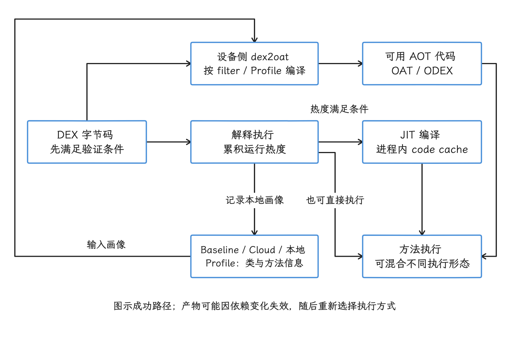
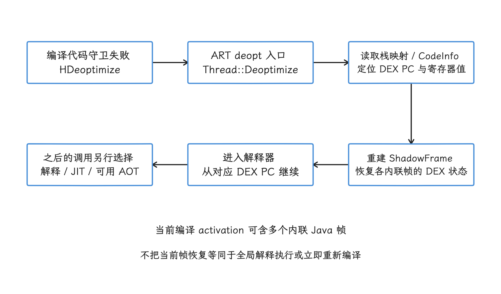
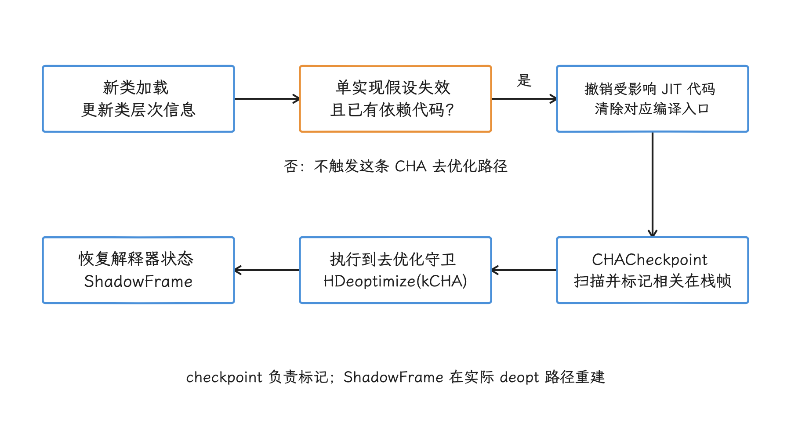

# ART 编译、验证与去优化机制

一个方法在 Android 上运行时（Android Runtime，ART），可能同时存在几种执行形态：ART 可以解释 DEX 字节码，可以在运行期用 JIT（运行时即时编译） 处理热点代码，也可以加载 `dex2oat` 预先生成的 AOT（提前编译） 代码。

分析启动性能时，我们先把“AOT 还是 JIT 更快”这类笼统问题拆开，依次确认：

1. 启动路径上的方法当前有没有可用的 AOT 代码？
2. 没有 AOT 代码时，是解释执行，还是已经被 JIT 编译？
3. AOT 产物为什么不存在、失效，或者没有覆盖这条路径？
4. 为了得到更多机器码，安装时间、存储和后台编译成本增加了多少？

这四个问题都能落到具体工具上。`pm art dump` 看设备上的最终状态；编译过滤器（compiler filter）决定 AOT 编译范围；代码使用画像（Profile）记录常用方法与类，决定谁参与 AOT；解释执行、JIT 与 `dex2oat` 各自的成本，用 Perfetto 或 Macrobenchmark 量化。

ODEX 文件存在、一条 JIT slice、Profile 文件打包成功，各自都只是链路上的一环；启动性能有没有受益，要沿这条链路逐段确认。

全文主线也在这里：ART 从 DEX 验证和编译开始，靠 AOT、JIT 与 Profile 选择执行代码；运行时假设失效时，再进入去优化和解释执行。我们沿这条产物与状态链，依次看安装、首启和动态调试。

## DEX 执行、AOT/JIT 与 Profile

### 从 DEX 到执行代码

应用构建后携带 DEX 字节码。安装、系统构建或后台维护期间，dex2oat 可以产生 ART 编译产物。文件名和位置会随版本与安装方式变化，常见职责是：

- `.odex`/`.oat`：保存 AOT 编译的机器码和相关元数据；
- `.vdex`：保存验证依赖等信息，某些情况下也包含未压缩 DEX；
- `.art`：可选的应用映像（app image），保存 ART 内部的类和对象表示。

这些产物的生命周期独立于 APK。类加载器上下文（class loader context）描述类加载时可见的代码及依赖；它和 DEX 校验和、启动映像（boot image）、指令集、ART 版本任一项对不上，旧产物就可能被判定为不可用，随后改用解释执行或 JIT，也可能重新进行 DEX 优化（dexopt）。

```text
DEX
 ├─ verification
 ├─ interpreter ────────────────────┐
 ├─ JIT compile -> code cache  ├─> 执行
 └─ dex2oat -> OAT/ODEX/VDEX ──┘
                ^
                └─ Baseline / Cloud / local profile
```

`.odex` 文件存在，只说明产物在；哪些方法有机器码，还要看编译过滤器和代码使用画像。

<!-- gracker-diagram: ch01-05-execution-modes -->


图：执行方式按方法、产物有效性与运行状态选择。解释执行可产生热度并触发 JIT；Profile 可参与设备侧 dex2oat，云端或基准画像本身不携带适用于所有设备的机器码。

### 编译策略为什么经历多次反转

| 版本 | 主要策略 | 代价落点 |
|---|---|---|
| Android 4.4 | ART 作为可选运行时，尝试安装期 AOT | 安装和存储成本增加 |
| Android 5.0-6.0 | ART 成为平台运行时，以较完整的 AOT 为主 | 更新、首次开机和安装期编译较重 |
| Android 7.0+ | 解释器 + JIT + 画像引导 AOT | 运行时热身和后台编译换取更小产物 |
| Android 9+ | Google Play 可在安装时交付基准或云端画像 | 安装时就能按真实或预设热点做部分 AOT |
| Android 12+ | ART 成为可独立更新的 Mainline 模块 | 运行时和编译器行为可随模块更新变化 |
| Android 14+ | ART Service 管理应用在设备上执行的 DEX 优化 | 编译原因、优先级和产物管理集中到 ART 模块 |
| Android 17 | 延续混合执行与 ART Service 架构 | 仍应以代码使用画像、编译过滤器和设备状态解释结果 |

云端画像（Cloud Profile）分发的是代码使用画像；机器码仍由设备按本机指令集、运行时和依赖生成，谈不上“云端机器码”或“全量 AOT”。

### 编译过滤器决定 AOT 范围

`art/libartbase/base/compiler_filter.h` 定义了当前的编译过滤器集合：

```cpp
// @ android-17.0.0_r1，节选
enum Filter {
  kAssumeVerified,
  kVerify,
  kSpaceProfile,
  kSpace,
  kSpeedProfile,
  kSpeed,
  kEverythingProfile,
  kEverything,
};
```

应用诊断最常遇到三种：

| 过滤器 | 行为 | 适合怎样理解 |
|---|---|---|
| `verify` | 验证 DEX，不为应用方法生成 AOT 机器码 | 运行主要依赖解释器与 JIT |
| `speed-profile` | AOT 编译代码使用画像中的方法，并优化画像中类的加载 | 在启动、交互性能、存储和编译时间之间取平衡 |
| `speed` | 尽可能 AOT 编译应用方法 | 运行期热身少，但编译时间和产物更大 |

`space*` 与 `everything*` 也存在于当前源码，但主要面向系统和产品配置。过滤器的名称顺序与执行速度的先后是两回事：代码使用画像的质量、代码布局、存储 I/O、类加载和实际执行路径都会影响最终结果。

Android 14 及以上版本的 ART Service 会按不同的 DEX 优化原因（dexopt reason）配置过滤器。AOSP 的标准默认值包括：

```properties
pm.dexopt.first-boot=verify
pm.dexopt.boot-after-ota=verify
pm.dexopt.boot-after-mainline-update=verify
pm.dexopt.bg-dexopt=speed-profile
pm.dexopt.inactive=verify
pm.dexopt.cmdline=verify
```

设备厂商（OEM）可以调整这些属性，ART Service 也会根据代码使用画像、共享代码、存储压力和编译原因选择或降低过滤器级别。所以设备上落到哪个级别，要以 `pm art dump` 的实际输出为准；“Android 17 安装后一定是 `speed-profile`（current profile）”只是想当然。

### dex2oat 做了什么

`dex2oat` 是 ART 在设备上运行的 AOT 编译器入口。对于过滤器选中的方法，主要流程可以概括为：

1. 打开 DEX、启动映像和类加载器上下文；
2. 验证字节码及类型约束；
3. 为需要编译的方法构建中间表示；
4. 运行内联、常量传播、死代码消除、循环和寄存器分配等优化；
5. 针对目标指令集架构（ISA）生成机器码，以及垃圾回收、异常和去优化（deopt）所需的元数据；
6. 写出 OAT/ODEX、VDEX 和可选应用映像。

源码里的 `HGraph` 是优化编译器使用的静态单赋值（Static Single Assignment，SSA）形式中间表示；每个变量只在一个位置赋值，便于追踪值的定义与使用。至于哪些优化真的发生，还要看方法大小、异常控制流、类加载假设、代码使用画像和编译资源预算的限制，SSA 只是提供了做这些优化的表示基础。

#### AOT 产物为什么会失效

编译代码既依赖 APK 本身，也依赖：

- DEX 校验和与拆分包集合；
- 启动类路径（boot class path）与启动映像；
- 类加载器上下文和 `<uses-library>` 顺序；
- ART/APEX 与编译产物格式；
- 目标指令集架构、运行时特性和编译选项。

ART 会校验这些依赖。把另一台设备或另一版本的 `.odex` 硬拷过来，即使文件名相同也未必能加载，Play 也就没有一份适用于所有设备的通用 ODEX 可发。

#### ART Service 与编译并发

Android 14 起，应用在设备上的 DEX 优化由 ART Service 负责。`pm.dexopt.<reason>.concurrency` 控制可并发的 `dex2oat` 进程数，`dalvik.vm.*dex2oat-threads` 控制单个 `dex2oat` 的线程数。两者共同决定并行规模。

提高并发可能缩短批处理总时间，也可能增加峰值内存、上下文切换、温升和与前台任务争用资源的时间。所以产品调优要在目标设备上实测首次启动、OTA、后台维护和交互延迟，只盯 DEX 优化完成时间，会把上面这些代价漏掉。

### JIT：用运行时热度换取机器码

当方法没有可用 AOT 代码时，ART 可以先解释执行并记录执行热度。方法进入（method entry）、循环跳回起点的次数和线程权重等信息会影响热度计数；达到相应阈值后，ART 把编译任务交给 JIT。

JIT 源码里有快速（`fast`）、基线（`baseline`）、优化（`optimized`）与栈上替换（On-Stack Replacement，OSR）等编译路径，具体启用哪些层级、阈值是多少，受运行时选项和产品属性影响。`dalvik.vm.jitthreshold` 等属性由 `AndroidRuntime.cpp` 转换为 ART 参数，属于系统侧配置，第三方应用不要依赖它，更不要去改它。

JIT 的典型过程是：

```text
解释执行
  -> 累积 hotness / 类型反馈
  -> JIT 编译任务
  -> 写入进程内 JIT code cache
  -> 更新方法入口
  -> 后续调用执行机器码
```

OSR 允许长循环在方法尚未返回时就切换到编译后的代码。JIT 还能利用运行时类型反馈做去虚化——把虚方法调用改成更直接的调用——并执行方法内联；代价是编译本身会消耗 CPU 和内存。

#### JIT 代码缓存的默认容量

固定标签 `android-17.0.0_r1` 的源码默认值是：

```cpp
// art/runtime/jit/jit_code_cache.h
// @ android-17.0.0_r1，节选
static constexpr size_t kMaxCapacity = 64 * MB;

static size_t GetInitialCapacity() {
  const size_t page_size = GetPageSizeSlow();
  return std::max(kIsDebugBuild ? 8 * KB : 64 * KB, 2 * page_size);
}
```

这段代码给出的是默认初始容量和上限；上限是 64 MB，进程一启动的实际占用是另一回事：

- 初始容量在 16 KB 内存页系统上至少是两个页面；
- `dalvik.vm.jitinitialsize` 和 `dalvik.vm.jitmaxsize` 可以覆盖默认值；
- 容量上限、虚拟地址空间、常驻集大小（RSS）和按共享页比例分摊的内存（PSS）不是同一个指标；
- 进程中的真实机器码、用于描述栈内容的栈映射（stack map）与性能剖析数据会随工作负载增长。

空间压力下，`JitCodeCache::DoCollection(Thread*)` 扫描活动栈和代码缓存状态，保留仍然需要的代码并回收可移除项。

是否允许回收还受模式影响：调试信息、Java 虚拟机工具接口（JVMTI）、首次使用即编译（JIT-at-first-use）等模式都会改变回收行为。固定的最近最少使用（LRU）策略，或“大型应用通常稳定在 4 MB”这类简化说法，在这里都立不住。

#### 去优化用于撤销不再成立的投机优化

JIT/AOT 可能根据当前类层次、记录调用点常见目标的内联缓存（inline cache）或只有一种实现的方法做优化。如果后来加载的新类型、类重定义、调试器或插桩工具（instrumentation）破坏这些假设，ART 必须丢弃代码、改用不依赖该假设的执行入口，或去优化栈帧。

看到去优化（deoptimization）活动时，我们先确认原因和 CPU 时间：一次去优化可能只是类加载带来的正常修正；持续反复的失效和重编译，才值得去查动态代理、热修复、JVMTI 或插件化。

触发原因、栈帧恢复和观测手段在「去优化触发、栈重建与诊断」一节展开。

### 四类代码使用画像不要混在一起

#### 本地 JIT 画像

ART 在应用运行时收集热点方法、类和部分调用点类型信息，由 `ProfileSaver` 持久化。常见内部路径形如：

```text
/data/misc/profiles/cur/<user>/<package>/primary.prof
/data/misc/profiles/ref/<package>/primary.prof
```

这些是系统内部目录，读取权限和路径布局都随设备而定，公开 SDK 对此也没有稳定性承诺。诊断时优先使用 ART Service 或 Package Manager 提供的 shell 命令。

本地画像只反映这台设备、这个用户实际执行过的路径。后台 DEX 优化可以把它与外部画像合并，用于下一轮 `speed-profile`（reference profile） 编译。

#### 基准画像（Baseline Profile）

基准画像由开发者为启动和关键使用流程生成。开发者可读的规则在构建时被转换为二进制画像，常见打包位置是 `assets/dexopt/baseline.prof`。

通过 Google Play 安装时，Play 可以处理画像，并随 APK 或 DEX 元数据（DM）文件交付，让 ART 在安装期 AOT 编译标记的方法。非 Play 分发或较老平台可以依赖 `ProfileInstaller` 把内置画像放到 ART 可读取的位置，随后由 DEX 优化使用。

基准画像只是“应该优先编译哪些代码”的提示：它本身没有机器码，生效范围也只到画像命中的方法，画像之外的业务逻辑仍按原来的方式执行。

#### 云端画像（Cloud Profile）

云端画像由 Google Play 根据历史用户实际执行过的路径汇总，并用于之后的安装或更新。它支持 Android 9/API 28 及以上，需要足够的用户样本，而且新版本发布后可能要经过数小时到数天才能覆盖。

基准画像用于改善新版本和小样本阶段的冷启动；云端画像补充真实用户覆盖。两者可以共同影响安装时编译，但机器码仍在各自的设备上生成，中间没有跨设备复制 `.odex` 这一环。

#### 启动画像（Startup Profile）

启动画像是构建期输入，由 R8 用来调整 DEX 布局，让启动关键类和方法尽量集中在首个 DEX 和更连续的位置。它不参与设备上的编译过滤器选择，也不会作为一份独立的运行时画像留在 APK 中。

```text
Baseline Profile -> ART on-device AOT 范围
Startup Profile  -> R8/D8 构建期 DEX 布局
```

启动画像只能由应用的启动场景生成，库自己出的画像当不了最终启动画像；启动代码超出主 DEX 容量时，布局收益也会受限。验证时要看 APK Analyzer 或构建产物中的 R8 元数据，`startup-prof.txt` 是否存在只是第一步。

### 应用侧怎样生成和验证画像

基准画像生成器（Baseline Profile Generator）应覆盖真实、稳定且对用户重要的路径：

```kotlin
@RunWith(AndroidJUnit4::class)
@LargeTest
class BaselineProfileGenerator {
    @get:Rule
    val rule = BaselineProfileRule()

    @Test
    fun generate() = rule.collect(
        packageName = "com.example.app",
        includeInStartupProfile = true,
    ) {
        pressHome()
        startActivityAndWait()
        // 再执行首页首帧所需的稳定交互。
    }
}
```

生成画像后还需要验证：

1. 用发布版（release）代码、R8 和与线上一致的拆分包（split）构建；
2. 确认 APK/AAB 内有 ART 可读取的基准画像；
3. 确认启动画像已经改变 DEX 布局；
4. 用 Macrobenchmark 对比无预编译与基准画像模式；
5. 分别统计启动、关键交互、安装耗时和包/产物体积。

画像的规模要有节制：覆盖所有代码会增加安装期编译和存储成本，还会削弱“关键路径”的区分作用。每次大规模重构、混淆规则或入口变化后，都应重新生成并检查覆盖范围。

### 用命令确认设备的编译状态

Android 14 及以上版本可以通过 ART Service 查看应用包的 DEX 优化状态：

```bash
adb shell pm art dump com.example.app
```

`android-17.0.0_r1` 的 `ArtShellCommand` 会把这个子命令转到 `ArtManagerLocal.dumpPackage()`。输出中关注五类信息：

- DEX 容器与拆分包：包里的 DEX 是不是按容器和 split 分别生成产物；
- 编译过滤器：状态查询返回的过滤器，应与命令行请求对照；方法级机器码的覆盖范围要另行确认；
- 编译原因：这一轮 `dexopt` 为什么发生，例如 `install`、`bg-dexopt`、`ab-ota`；
- 主/次 DEX（primary/secondary dex）的产物状态：主 DEX 与次级 DEX 是否各自都有可用的编译产物；
- 产物位置：结合 `[location is ...]` 判断状态对应的产物来自哪里。

这些字段回答的是“这一轮做了什么”：某份 profile（例如 Cloud Profile 或应用内置 profile）是否参与了编译、方法级覆盖到没到位，都要另行确认，办法是对照安装输入、`pm dump-profiles --dump-classes-and-methods` 导出的文本画像和 `dexopt` 日志。输出字段以同一标签的 `DumpHelper.dumpFileStatuses()` 为准。

较老版本常用 `dumpsys package dexopt`，字段与新 ART Service 不同。诊断脚本需要按平台分支解析。

#### 用强制编译做对照实验

下面的命令会改变设备上的编译状态，只适合测试机：

```bash
# 不生成 AOT 应用机器码
adb shell pm compile -f -m verify com.example.app

# 使用现有 Profile 编译
adb shell pm compile -f -m speed-profile com.example.app

# 尽可能完整 AOT 编译
adb shell pm compile -f -m speed com.example.app

# 恢复为类似新安装后的编译状态
adb shell pm compile --reset com.example.app
```

`speed-profile` 没有可用画像时，结果会受 ART Service 策略影响；每次实验都要重新导出状态，命令退出码说明的问题有限，最终编译过滤器要以导出结果为准。

#### `oatdump` 与画像导出的适用条件

`oatdump` 适合检查与构建匹配的 OAT/ODEX/VDEX，`pm dump-profiles --dump-classes-and-methods <package>` 可以让 ART Service 导出文本画像。它们属于平台或设备调试工具：

- 面向最终用户的构建（user build）可能没有所需二进制或权限；
- `/data/app` 路径含随机段，写死路径行不通；
- 二进制画像只保存 DEX 索引，解析时还需要匹配 APK；
- 来自另一构建版本的 `oatdump` 可能不理解当前产物格式。

应用团队更适合先用 `pm art dump`、Macrobenchmark 和 APK/AAB 检查；只有调试平台本身时再读取内部产物。

### 在 Perfetto 中怎样识别编译成本

录制 Perfetto 数据时，可以启用 atrace 的 `dalvik` 类别，再配合调度、CPU 频率和必要的调用栈数据。ART 大量使用 `ScopedTrace(__FUNCTION__)` 或 `__PRETTY_FUNCTION__`，名称会随实现和构建变化；拿旧轨迹里的固定时间片段（slice）名称当过滤条件，要先核对当前版本的实现。

可靠的观察点包括：

- 应用进程中 JIT 编译器线程占用 CPU 的时间；
- `art::jit`、`JitCodeCache::DoCollection`、`ProfileSaver` 等调用栈或时间片段：编译、代码回收和画像保存各由谁执行；
- 独立的 `dex2oat` 进程或 ART 守护进程 `artd` 的活动，以及它们造成的 CPU、I/O 和内存压力；
- 主线程同一时段是在运行（Running）、等待 CPU（Runnable），还是等待锁或 I/O；
- 安装后首次启动与画像编译后相同路径的对比。

启动期出现 JIT，只说明有方法进入了运行时编译路径，距离“基准画像失效”的结论还差几步：我们要再确认它是否发生在非关键线程、编译占了多少 CPU、目标方法是否属于画像，以及启动是否真的受它影响。


## Verifier、VDEX/ODEX 与 dexopt

编译策略决定生成多少机器码，Verifier 和 dexopt 产物决定代码能否安全复用。安装、首次启动和后台优化使用不同场景与过滤器。

> 源码基线：AOSP `android-17.0.0_r1`（Android 17 / API 37）；讲到历史行为时，对照 Android 8–16 的差异。

`speed-profile` 是否等于充分编译、`verify` 是否等于零优化，取决于这一轮 `dexopt` 的实际输入。编译过滤器（compiler filter，下文简称 filter）描述这一次 `dexopt` 想达到的目标，最终写到磁盘的结果还要受代码使用画像、DEX 规模、依赖关系、安装方式和设备策略影响；profile 记录需要优先优化的方法和类。

排查安装慢、首次启动慢或 OTA 后应用变慢时，我们先把三件事分开：

1. DEX 是否已经通过验证，验证结果能否复用。
2. 哪些方法已有 AOT 机器码，哪些方法仍要解释执行或等待 JIT。
3. 当前看到的是请求使用的 filter，还是 ART 最终采用的 filter。

### 先建立一张执行地图

应用代码从安装到稳定运行，大致经过下面几层。其中 split APK 是按功能或设备配置拆分的 APK，次级 DEX 是应用运行时另外加载的 DEX。

```text
APK / split APK / secondary DEX
        │
        ├── 可选 .dm：cloud profile、VDEX 验证元数据等
        │
        ├── bootclasspath、boot image、ClassLoaderContext
        │
        ▼
PackageManager 发起 dexopt
        │
        ▼
ART Service / artd 调用 dex2oat
        │
        ├── 验证与 DEX 提取
        ├── 按 filter 生成 AOT 代码
        └── 可选生成 app image
        ▼
VDEX / ODEX(OAT) / ART image
        │
        ▼
运行时：AOT + 解释器 + JIT
```

单个产物文件或一种 filter，都撑不起“启动已经达到最佳状态”的判断，我们逐条看：

- `verify` 复用的是验证结果，这一级下 Java/Kotlin 方法没有 AOT 机器码。
- `speed-profile` 只编译 profile 覆盖的方法；没有可用 profile 时，实际结果可以降为 `verify`。
- ODEX 存在只说明产物在；启动路径上的关键方法编没编过，要落到 filter 和 profile 的实际覆盖。
- VDEX 存在，只说明验证/提取这一层还有被复用的机会；依赖对不上时，系统可以保留这层收益，放弃不再可信的编译和类解析结果。

### 验证器检查什么

ART 字节码验证器（bytecode verifier）检查 DEX 是否满足运行时安全约束：类型一致性、寄存器使用、控制流、方法调用和字段访问是否合法。它判断的是字节码能否安全执行，与代码是否已编译成机器码无关。

验证有两类性能价值：

- 第一次处理 DEX 时，提前发现非法字节码，避免把错误推迟到任意运行路径。
- 后续处理相同 DEX 时，复用验证器依赖信息（verifier dependencies）等元数据，减少重复验证工作。

因此，`verify` 仍会执行实际工作。在 ART Service 的定义中，它会完成验证与 DEX 提取，但不编译方法，也不会根据 profile 提前完成类解析（resolution）或类初始化（initialization）。

### VDEX、ODEX 和 ART image 各自负责什么

三类产物经常同时出现，但职责不同。

| 产物 | 主要内容与作用 | 不能据此推出什么 |
| --- | --- | --- |
| `.vdex` | DEX 校验信息和验证器依赖信息；某些格式也会带 DEX 数据区。Android 17 的 `dex2oat` 还能从 `.dm` 中读取 VDEX，用于快速验证 | 不能仅凭文件存在断言 AOT 代码可用，也不能断言 CLC 完全匹配 |
| `.odex` / OAT | AOT 机器码和 ART 运行所需的编译元数据；实际代码覆盖范围由最终 filter 和 profile 决定 | 不能仅凭文件大小或存在性断言关键启动路径已编译 |
| `.art` | 可选的应用镜像，保存可复用的运行时对象状态，减少部分对象创建和类准备成本 | 并非每次 `dexopt` 都会生成；没有它也不表示 DEX 无法运行 |

对输入 VDEX 的处理，源码里写得很具体：

1. `dex2oat` 可以从独立 VDEX 或 DexMetadata 归档文件中打开输入。
2. 如果 VDEX 不含 DEX 数据区，源码会核对 DEX 数量和位置校验和（location checksum）。
3. 验证器依赖信息解析成功后，进入快速验证。
4. 输入 VDEX 打不开时，`dex2oat` 会告警并按无 VDEX 的路径继续；文件已打开后若 DEX 数量或 checksum 不匹配，本次 `dex2oat` 会失败，错误元数据不会被当成可复用结果。

应用产物的默认位置按对象类型拆开，`/data/misc/apexdata/com.android.art/dalvik-cache` 只是其中启动镜像的所在：

| 对象 | 常见位置 |
| --- | --- |
| 安装到数据分区的主 DEX（primary dex） | `/{data,mnt/expand/*}/app/*/*/oat/<isa>/{base,split_*}.{art,odex,vdex}` |
| 只读文件系统中的包 | `/data/dalvik-cache/<isa>/<encoded-dex-path>.{art,dex,vdex}` |
| 次级 DEX | 应用数据目录下对应的 `oat/<isa>/*.{art,odex,vdex}` |
| 主 DEX 的当前 / 参考 profile | `/data/misc/profiles/{cur/<user-id>,ref}/<package-name>/*.prof` |
| 设备端启动镜像 | `/data/misc/apexdata/com.android.art/dalvik-cache/boot*.{art,oat,vdex}` |

current profile 记录设备上逐步收集的热点，reference profile 供后续编译使用。只读包的 OAT 文件因历史原因可能使用 `.dex` 扩展名。排障时先确认对象属于启动类路径、普通安装包、只读系统包还是次级 DEX，再去对应目录找对应的文件。

### 应用侧支持的 filter

AOSP `android-17.0.0_r1` 的 ART Service README 和命令帮助只对应用 `dexopt` 公开三种 filter：

| Filter | Android 17 中的含义 | 典型取舍 |
| --- | --- | --- |
| `verify` | 验证并提取 DEX；不编译方法，也不根据 profile 提前解析或初始化类 | `dexopt` 快、产物小；运行期更多依赖解释器和 JIT |
| `speed-profile` | 验证并提取 DEX；编译 profile 中的方法，并处理 profile 中类的解析与初始化 | 在安装或后台处理成本、存储占用和运行性能之间取平衡 |
| `speed` | 验证并提取 DEX；AOT 编译所有可编译方法，不根据 profile 提前解析或初始化类 | 编译时间和空间成本最高，运行期机器码覆盖最广 |

`speed` 的机器码覆盖最广，代价也最重：安装或维护耗时可能增加，存储占用也可能更大，而主线程 I/O、Binder 等待、数据库迁移或错误的启动架构这些老问题，它一个也解决不了。

`speed-profile` 也不承诺一定按该级别编译：`pm compile` 的帮助文本写得很清楚，没有可用 profile 时，请求 `speed-profile` 可能实际得到 `verify`。所以 `pm art dump` 显示的最终状态比命令行参数更可信。

底层 `CompilerFilter::Filter` 还保留 `space*`、`everything*` 等枚举，`compiler_filter.cc` 也能解析这些名称；但 ART Service 的应用侧命令只把 `speed`、`speed-profile`、`verify` 列为可用选项。写应用性能文档时，要把“内部解析能力”和“受支持的常规运维接口”分开对待。

### `quicken`：历史功能仍有兼容入口

官方文档把 `quicken` 限定在 Android 11 及以下。它在完成验证后改写部分 DEX 指令，使解释器更快地访问已解析的字段或方法。它优化的是解释执行路径，不会因此产生 ARM64 或 x86 方法机器码。

各版本的对应关系如下：

| 版本 | `quicken` 应如何理解 |
| --- | --- |
| Android 8–11 | 受官方文档支持的 filter；输出服务于解释器快速路径 |
| Android 12–13 | 不再属于当前官方 filter 范围，排障应以 `verify`、`speed-profile`、`speed` 为主 |
| Android 14–17 | ART Service 的应用侧接口只公开上述三种 filter |
| Android 17 源码兼容行为 | `kQuicken` 枚举已不存在，但解析到字符串 `quicken` 时会打印“已废弃”警告，并映射成 `kVerify` |

Android 17 为兼容旧配置保留了 `quicken` 名称入口，对应的执行含义已经变为 `verify`。厂商 ROM 还可能修改实现，所以看到日志中的旧字符串时，应同时记录 Android 版本、ART Mainline 版本和 `pm art dump` 的最终状态。

### 设备上的 dexopt 场景与默认值

Android 14 起，应用在设备端生成的 `dexopt` 产物由 ART Service 管理。PackageManager 仍负责安装流程，并在安装时调用 `dexoptPackage`；安装期 `dexopt` 不是 ART Service 自行发起的批处理任务，因此不会触发 `BatchDexoptStartCallback`。

默认场景如下。

| 场景 | 原因标识 | 默认行为 | 容易误判的地方 |
| --- | --- | --- | --- |
| 首次开机 | `first-boot` | 对应用主 DEX 以 `verify` 为目标 | 系统镜像里的包可能已通过 dexpreopt 生成 `speed-profile` 或 `speed` 产物，不能说所有包都是 `verify` |
| OTA 后首次开机 | `boot-after-ota` | 主 DEX 以 `verify` 为目标，尽量缩短开机阻塞 | 已完成重启前 Dexopt（Pre-reboot Dexopt）的包可能保持 `speed-profile` |
| Mainline 更新后首次开机 | `boot-after-mainline-update` | 重点处理 SystemUI 和桌面启动器；桌面启动器使用 `speed-profile`，SystemUI 由 `dalvik.vm.systemuicompilerfilter` 决定 | 不会对所有应用重新执行 AOT |
| 应用安装 | `install`、`install-fast`、`install-bulk*` | DM 含 Cloud Profile 时用 `speed-profile`，否则用 `verify` | 快速安装场景或增量安装可以跳过安装期 `dexopt` |
| 日常后台优化 | `bg-dexopt` / `inactive` | 每日空闲且充电时运行；对主 DEX 和次级 DEX 执行 profile 引导的 `dexopt` | 条件消失时任务会被取消；稍后重试不代表失败 |
| 更新应用前优化 | `ab-ota` | OTA 或 Mainline 更新时，在空闲充电窗口针对新依赖环境执行重启前 Dexopt，目标为 `speed-profile` | 用户提前重启时可能尚未完成，剩余包先以 `verify` 运行 |
| 命令行 | `cmdline` | 默认 `verify`，可显式指定支持的 filter | 指定 `speed-profile` 不保证 profile 可用 |

标准属性默认值是：

```text
pm.dexopt.first-boot=verify
pm.dexopt.boot-after-ota=verify
pm.dexopt.boot-after-mainline-update=verify
pm.dexopt.bg-dexopt=speed-profile
pm.dexopt.inactive=verify
pm.dexopt.cmdline=verify
pm.dexopt.shared=speed
```

`pm.dexopt.shared=speed` 的生效是有条件的。当一个包被其他应用加载、且本轮请求 profile 引导编译时，ART 出于隐私限制用不上它的本地 profile：系统会先尝试 Cloud Profile，拿不到才落到 `shared` filter 这个后备；本轮若没有请求 profile 引导编译，这个属性也就轮不到生效。

厂商还可以通过属性和 ART Service API 调整包列表、filter、优先级与并发数，所以这组值只是 AOSP 默认值，设备实测才算数。

### 安装时，`.dm` 到底改变了什么

默认安装策略概括成两条：

- `.dm` 中有可用 Cloud Profile：目标通常是 `speed-profile`。
- 没有可用 profile：目标通常是 `verify`。

`.dm` 是 Dex Metadata（DEX 元数据）容器，文件在，只说明容器随包到了设备：里面可以携带 profile，也可以携带 VDEX 验证元数据，还可能为空，或因校验、版本等问题未被采用。OAT 文件头中的 `install-dm` 后缀也只表示安装期 `dexopt` 把 DM 传给了 `dex2oat`；ART Service README 明确指出，DM 内的任何内容是否实际生效，这个后缀看不出来。

还要注意两个跳过路径：

- 应用商店使用 `INSTALL_SCENARIO_FAST`，对应 `install-fast`，默认可跳过 dexopt。
- 增量安装（incremental install）可以跳过安装期 `dexopt`。

判断 Cloud Profile 是否生效，要依次检查安装输入、`dexopt` 执行结果，以及最终的 profile 和 filter 状态，APK 旁边有没有 `.dm` 只是第一步。

### 依赖不匹配时仍可复用部分产物

`dexopt` 的依赖除原始 DEX 外，还包括启动类路径（boot classpath）、启动镜像（boot image）和类加载器上下文（ClassLoaderContext，CLC）。CLC 描述类加载器所看到的依赖及其顺序，由共享库、同一应用的其他 split APK 等共同决定。

ART Service 把可以复用的部分分成两层：

- 编译结果以及类解析、类初始化结果，要求 `dexopt` 时的依赖与运行时依赖完全匹配。
- 验证与提取结果在依赖不匹配时仍可能复用，产物按 `verify` 状态使用。

CLC 不匹配后，依赖敏感的 AOT 与类解析结果不再可信，但验证和提取结果仍可能保留。`pm art dump` 里可能显示特殊原因标识 `vdex`；它只用于在命令输出中表达这种状态，不会传给 `dex2oat`，也不会作为实际编译原因写进 OAT 文件头。

#### `<uses-library>` 为什么经常触发 CLC 问题

dexpreopt 在构建机上计算 CLC，运行时再根据应用清单、共享库 XML、split APK 和实际类加载器关系计算一次；两边一旦不一致，预编译产物就失去了按原级别复用的资格。

排查顺序应是：

1. 核对应用清单中的 `<uses-library>` 声明。
2. 核对 `Android.bp` 或 `Android.mk` 中的构建侧依赖。
3. 核对设备上的共享库配置与实际加载顺序。
4. 查看 `pm art dump` 的状态是否变成 `vdex` 或 `verify`，再结合日志确认依赖不匹配。
5. 修复依赖模型后重新构建或执行 `dexopt`，不要用强制 `speed` 掩盖 CLC 错误。

可先采集日志：

```bash
adb logcat -b all -d |
  grep -E 'ClassLoaderContext|class loader context|dex2oat|Running dexopt'
```

日志文本会随版本和厂商修改变化，这里的正则只用来缩小范围，算不上固定接口。

### 安装、首启和后台优化如何衔接

| 时点 | 常见状态 | 运行性能含义 |
| --- | --- | --- |
| 安装完成 | 有 Cloud Profile 时可能是 `speed-profile`；否则常见 `verify` | `verify` 已完成安全验证，但关键方法可能仍无 AOT 代码 |
| 第一次运行 | 已有 AOT 代码的方法直接执行；其余方法解释执行，热点方法进入 JIT | 首启可能产生类加载、缺页（page fault）、解释器执行和 JIT 预热成本 |
| 多次运行后 | 当前 profile 逐步积累真实用户热点 | profile 只是编译输入，尚不代表参考 profile 已用于 `dexopt` |
| 空闲充电 | 后台 `dexopt` 合并可用 profile，以 `speed-profile` 重新处理 | 后续启动可能改善，但任务可以被取消或因策略跳过 |
| OTA / Mainline 更新前 | 重启前 Dexopt 尝试针对新依赖生成产物 | 未完成的包重启后仍能以 `verify` 配合 JIT 正常运行 |

“安装很快但第一次打开慢”“升级后第一次打开变慢”，根子常在这里：系统主动把 AOT 成本从交互路径移到了后台。要修的对象包括不合理的关键启动路径、profile 覆盖、迟迟完不成的后台任务或错误的依赖配置。

### 大体积 DEX 的特殊降级

`dex2oat.cc` 会累加输入 DEX 文件头中的 `file_size_`，再与调用方传入的超大 DEX 阈值（very-large threshold）比较。对命中阈值、且目标既非启动镜像也非启动镜像扩展的任务，系统会：

- 禁用应用镜像；
- 如果当前 filter 高于 `verify`，把本轮编译降为 `verify`；
- 输出 `Very large app, downgrading to verify.` 日志。

这段代码里没有固定的“某个 APK 大小”可作为阈值：`dex2oat` 的字段默认是最大值，实际阈值由调用方参数和产品配置决定；比较对象是 DEX 累计大小，而非 APK 下载体积。文档或排障脚本里写死一个通用 MB 数，是靠不住的。

即使上层请求了 `speed-profile` 或 `speed`，实际工作也可能降为 `verify` 级别。源码在降级前已将编译过滤器写入 OAT 文件头，内部降级不会回写该字段，以便后续判断产物是否需要更新。

此时 `pm art dump` 仍可能显示原过滤器，那只是请求值。遇到超大、多 DEX 应用时，应结合请求参数、`Very large app, downgrading to verify.` 日志，以及匹配构建的 `oatdump` 方法级代码检查来判断 AOT 机器码的实际范围。

### 推荐的排查命令

#### 1. 保存系统策略

我们先用一条命令保存 `dexopt` 与 JIT 相关属性，作为设备策略背景：

```bash
adb shell getprop |
  grep -E 'pm.dexopt|dalvik.vm.*compilerfilter|dalvik.vm.*dex2oat|dalvik.vm.usejit'
```

属性反映的是默认策略；某个包最终用什么过滤器，还要以 `pm art dump` 为准。

#### 2. 查看包级最终状态

下面的 ART Service 命令读取指定包当前的 `dexopt` 产物与编译原因：

```bash
adb shell pm art dump com.example.app
```

Android 14–17 优先使用 `pm art dump`，重点看主 DEX 与次级 DEX、compiler filter、compilation reason（编译原因）、产物是否为最新状态，以及有没有出现 `vdex` 状态。`dumpsys package dexopt` 仍可用于兼容旧版本或交叉核对，现代 ART Service 的首选入口还是前者。

#### 3. 建立无 AOT 代码的基线

下面的重置命令只适合受控实验，用来建立以 `verify` 为主、没有应用方法 AOT 代码的对照状态：

```bash
adb shell pm compile --reset com.example.app
```

`--reset` 会清理本地的当前 profile 和参考 profile；对主 DEX，当前实现等同于用 `verify` 执行 `dexopt`。Cloud Profile 或应用内置画像这类外部来源会保留，只是本次重置不会用到；次级 DEX 的产物会被删除，也不会在本轮重建。该命令适合实验室建立对照基线，线上则要避免随手执行。

#### 4. 验证 profile 引导编译

以下命令强制请求 `speed-profile`，随后读取最终状态，验证请求是否被满足：

```bash
adb shell pm compile -m speed-profile -f -v com.example.app
adb shell pm art dump com.example.app
```

`-f` 表示即使现有产物“不差于”目标也强制执行。命令成功离“最终一定是 `speed-profile`”还差一步：没有可用 profile 时仍可能得到 `verify`，所以必须再次运行 `pm art dump` 查看结果。

如需建立“尽可能全面 AOT”的实验对照，可执行：

```bash
adb shell pm compile -m speed -f -v com.example.app
```

这个结果只用于定位 AOT 覆盖是否影响性能，离产品默认策略还远。

#### 5. 手动运行系统后台 dexopt 流程

下面的命令会立即触发并等待 ART Service 的后台 `dexopt` 任务，适合在实验室复现系统行为：

```bash
adb shell pm bg-dexopt-job
```

不带参数时，命令会立即启动并等待一次系统后台 `dexopt` 任务。它仍按系统任务的包选择、并发设置、低存储降级和清理逻辑执行，只是不等设备自然进入空闲充电状态。可以在另一个终端取消：

```bash
adb shell pm bg-dexopt-job --cancel
```

前一条命令用于触发任务，后一条用于取消正在运行的任务。

如果只想对单个包模拟 `bg-dexopt` 这一编译原因，应使用：

```bash
adb shell pm compile -r bg-dexopt -f -v com.example.app
```

把包名直接传给 `pm bg-dexopt-job` 的旧用法，在 Android 17 中已标记为废弃。

### 三类慢问题的排查方法

#### 安装慢

我们先在 Perfetto 里分别观察下载或文件复制、APK 签名校验、包扫描、原生库、DM 处理和 `dexopt`；只有 `artd` 或 `dex2oat` 占据安装关键路径，主要耗时才能归到 ART。

继续核对：

- 编译原因是 `install`、`install-fast` 还是 `install-bulk*` 变体；
- 请求的 filter 和最终 filter 是否一致；
- DM 是否提供了可用 profile 或 VDEX；
- 是否因超大 DEX 阈值而降为 `verify`；
- `dex2oat` 的优先级与并发是否符合交互安装场景。

若最终只是 `verify`，就不要把耗时描述成“完整 AOT 编译”；验证、提取、I/O 或其他 PackageManager 阶段更值得检查。

#### 首次启动慢

我们把 `pm art dump` 与启动轨迹放在一起看：

- `verify` 且有大量解释器或 JIT 活动：可能是 profile 尚未到达设备，或后台编译尚未完成。
- `speed-profile` 但启动关键方法未命中：要检查 profile 覆盖，filter 名称说明的问题有限。
- `speed-profile` 或 `speed`，但主线程仍被 I/O、锁、Binder 或数据库占满：瓶颈不在 compiler filter。
- 状态为 `vdex`：检查依赖变化和 CLC，AOT 代码可能没有被采用。

应至少对比重置后、profile 引导编译后和稳定运行后的冷启动数据；不要把第二次启动的文件缓存收益误算成 AOT 收益。

#### OTA 或 Mainline 更新后变慢

系统会先尝试重启前 Dexopt。若用户很快重启、设备没有足够的空闲充电时间，或任务执行失败，部分应用会先降为 `verify`，之后依靠 JIT 和后台 `dexopt` 恢复性能。

排查时关注：

- `ab-ota` 是否执行并完成；
- 更新是否改变启动类路径、启动镜像或 CLC；
- `pm art dump` 是否出现 `vdex` 或 `verify`；
- 后台 `dexopt` 是否长期被取消；
- SystemUI 和桌面启动器是否符合各自的单独策略。

把“更新后慢”一律归因于旧 ODEX 被删除，这个结论下得太快：系统会尽量复用仍可信的验证信息，只放弃依赖不匹配的优化层。


## 去优化触发、栈重建与诊断

排查启动或运行期卡顿时，如果我们在 Perfetto 里看到 `Deoptimizing` 时间片，或在 SIGQUIT 转储里看到某类 deopt 计数上涨，第一个要回答的问题就是：哪个运行时假设失效了。编译代码依赖类层次、类型和调试状态等假设，典型如：某个调用点只见过一种接收者类型、某个虚方法只有一个实现、循环索引满足已证明的范围。假设失效时，继续运行旧机器码可能产生错误结果，ART 需要恢复 DEX 执行状态，切换到解释器或重新编译。

去优化（deoptimization，简称 deopt）负责恢复对应 DEX 程序计数器（DEX PC）处的解释器状态，让当前调用继续按 Java 语义执行。它的作用域至少分三类：

- 显式单帧 deopt：优化代码中的守卫条件（guard）失败，只转换当前正在执行的编译帧（compiled activation）；
- 失效代码与在栈帧处理：类层次分析（CHA）等机制先撤销编译代码，再标记仍在运行旧代码的帧；
- Instrumentation / JVMTI deopt：可以限制到一个方法、一个线程，也可以安装让所有方法进入解释器的全局 interpreter stubs（解释器入口桩）。

三者的暂停方式、后续执行方式和性能代价都不同。我们诊断时先确认作用域，再讨论“是否回到解释器”。

### 一、单帧 deopt：编译器守卫条件失败

#### 1.1 触发原因以枚举为准

`runtime/deoptimization_kind.h` 枚举了完整的 deopt 原因集合：

| `DeoptimizationKind` | 典型生成位置 | 含义 |
|---|---|---|
| `kAotInlineCache` | `inliner.cc` | AOT 单态 inline cache（只记录一种接收者类型的内联缓存）不再匹配 |
| `kJitInlineCache` | `inliner.cc` | JIT 单态 inline cache 未命中 |
| `kJitSameTarget` | `inliner.cc` | 多种接收者原本落到同一目标，运行时目标发生变化 |
| `kLoopBoundsBCE` | `bounds_check_elimination.cc` | 循环边界检查消除（BCE）的范围守卫失败 |
| `kLoopNullBCE` | `bounds_check_elimination.cc` | 循环 BCE 使用的非空假设失败 |
| `kBlockBCE` | `bounds_check_elimination.cc` | 基本块级边界守卫失败 |
| `kCHA` | `inliner.cc` / `cha.cc` | 单实现 CHA 假设失效 |
| `kDebugging` | quick trampoline（quick 入口跳板）/ Instrumentation | 调试支持要求当前帧转入解释器 |
| `kFullFrame` | Instrumentation / 异常投递 | 需要转换一段已编译调用栈 |
| `kMethodHandleTypeMismatch` | `instruction_builder.cc` | `MethodHandle.invokeExact` 的类型与调用点（call site）不匹配 |

`HCheckCast` 或 `HLoadClass` 出现在守卫条件的构造过程中，离“自身必然触发 deopt”还远：判断某条优化是否可能去优化，应查找它是否生成 `HDeoptimize`，以及用了哪个 `DeoptimizationKind`。

#### 1.2 从 `HDeoptimize` 到解释器

下面的流程对应优化代码主动触发的单帧 deopt：

```text
guard 条件失败
  → HDeoptimize
  → 架构相关 DeoptimizationSlowPath
  → art_quick_deoptimize_from_compiled_code
  → artDeoptimizeFromCompiledCode(kind, thread)
  → Thread::Deoptimize(single_frame = true)
  → QuickExceptionHandler::DeoptimizeSingleFrame
  → DeoptimizeStackVisitor 重建 ShadowFrame
  → long jump 到 quick-to-interpreter 边界
  → EnterInterpreterFromDeoptimize
```

`artDeoptimizeFromCompiledCode()` 会压入 `DeoptimizationContextRecord`，保存返回值、原有异常以及 DEX PC 推进策略。随后只转换触发 deopt 的最外层编译帧；若该机器码内联了多个 Java 方法，栈访问器会为每个内联帧建立一个 `ShadowFrame`。`ShadowFrame` 是 ART 用于保存解释器方法、DEX PC 和虚拟寄存器状态的数据结构。

这条路径直接调用 `Thread::Deoptimize()`。它没有先抛出一个普通 Java 异常，因此把所有 deopt 概括为“特殊异常”会掩盖入口差异。

<!-- gracker-diagram: ch01-05-single-frame-deopt -->


图：这张图只描述优化代码显式触发的单帧 deopt。一个编译帧若内联多个 Java 方法，可能重建多个 ShadowFrame；随后从相应 DEX PC 继续，不是从方法开头重跑。

#### 1.3 守卫条件的代价分为未命中和命中两部分

守卫条件未触发时，热路径通常只多一次比较和条件跳转，仍有指令与分支预测成本。触发时才进入 ART runtime，主要工作包括：

- 遍历编译帧及其内联帧；
- 根据 `CodeInfo`、stack map（机器码位置到 DEX 状态的映射）和 `DexRegisterMap` 恢复 DEX 虚拟寄存器；
- 使用寄存器掩码（register mask）与栈掩码（stack mask）区分引用和普通值；
- 构造并链接 `ShadowFrame`；
- 失效或重新初始化对应编译代码；
- 必要时更新 JIT inline cache；
- 通过 long jump 跳到解释器入口。

代价随内联深度、dex register 数量和栈映射复杂度变化，任何固定毫秒数都代表不了所有设备和方法。

### 二、ShadowFrame 怎样恢复 Java 执行状态

#### 2.1 DEX 状态的恢复过程

`DeoptimizeStackVisitor` 以 `kIncludeInlinedFrames` 模式遍历栈。对优化编译帧，它从原生程序计数器（native PC）找到 stack map，再恢复每个虚拟寄存器（vreg）位于栈、通用寄存器、浮点寄存器还是常量。对于 nterp 解释器帧，栈访问器从 nterp 的 vreg 数组和引用数组恢复值。

新建的 `ShadowFrame` 保存：

- `ArtMethod` 与 dex PC；
- DEX 虚拟寄存器及其引用类型；
- 是否跳过方法退出、低开销跟踪等事件的标记；
- 指向上层 ShadowFrame 的链接。

API 37 的 `EnterInterpreterFromDeoptimize()` 明确说明，它不会为了锁计数恢复一套 monitor（Java 对象监视器锁）状态；编译器只应编译通过结构化锁（structured-locking）检查的方法。“逐个恢复 monitor 持有列表”不符合该标签实现。

#### 2.2 DEX PC 是否重试取决于入口

从 `HDeoptimize` 进入时，`from_code=true`，解释器从守卫对应的 DEX PC 继续。由 runtime 方法返回、挂起检查（suspend check）或异常投递触发时，ART 还要避免重复执行非幂等指令：

- `kKeepDexPc` 要求重试当前 DEX 指令；
- `monitor-enter`、`monitor-exit` 和 invoke 需要专门推进规则；
- 待处理异常会先恢复，再查找解释器异常处理器（catch handler）；
- 后续 ShadowFrame 通常位于 invoke 点，返回值要传给调用者。

这些分支解释了 `DeoptimizationContextRecord` 为什么保存返回值、待处理异常、`from_code` 和 `DeoptimizationMethodType`。该记录按栈链接，允许验证器（verifier）或类加载引发嵌套 deopt。

#### 2.3 sentinel exception 的用途

sentinel exception（哨兵异常）是 ART 保留的假对象指针，用于传递内部控制信号。`Thread::GetDeoptimizationException()` 返回该指针；Instrumentation 可以把它写入线程的异常槽，使 quick 异常投递或 `ArtMethod::Invoke()` 在返回边界识别 deopt 请求。原有 Java 异常保存在去优化上下文中，稍后恢复。

它不会进入 Java `catch`，GC 根访问器也会排除该值。显式 `HDeoptimize` 路径直接获得 long-jump 上下文；只有需要跨既有 quick / invoke 边界传递请求时，哨兵值才用于传递信号。

### 三、CHA 失效：类加载怎样影响在栈代码

#### 3.1 新类必须打破已有单实现假设才会触发

`ClassHierarchyAnalysis::UpdateAfterLoadingOf()` 在类进入已解析状态前检查虚方法表（vtable）和接口方法表（iftable）。只有新类让某个虚方法或接口方法的“单一实现”（single-implementation）信息失效，并且 JIT code cache（JIT 编译代码缓存）中存在依赖该假设的编译体时，才需要处理编译代码。

所以“动态加载一个 DEX 一定发生 deopt”“创建一个 `Proxy` 一定让相关调用点 deopt”“用了 MultiDex、ServiceLoader 或依赖注入框架就必然触发 CHA”，这些判断都下得太宽：它们只是增加了“晚到实现类”出现的概率；是否真的 deopt，取决于实际继承关系、此前是否形成单实现假设，以及是否已有依赖代码。

#### 3.2 API 37 的实际链路

CHA 失效按以下顺序处理：

1. 清除受影响方法的 single-implementation 信息；
2. 从 CHA 依赖映射表收集 `ArtMethod` 与 `OatQuickMethodHeader`；
3. 调用 `JitCodeCache::InvalidateCompiledCodeFor()` 撤销对应 JIT 代码；
4. 创建 `CHACheckpoint`，让各线程扫描自己的已编译调用栈；
5. 命中失效方法头的帧，在预留栈槽写入 `DeoptimizeFlagValue::kCHA`；
6. 编译代码执行 `HShouldDeoptimizeFlag` 守卫时进入 `HDeoptimize(kCHA)`。

checkpoint 是让目标线程在安全点执行指定检查的协作机制。这里它只负责在目标线程上标记栈帧，不在 checkpoint 回调内构造 `ShadowFrame`。类链接线程会等待相关线程通过 checkpoint，因此大量线程或很深的栈可能把这部分成本反映到类加载延迟上。

<!-- gracker-diagram: ch01-05-cha-invalidation -->


图：只有新类破坏单实现假设且已有依赖编译代码时，才进入这条 CHA 失效路径。checkpoint 标记现有栈帧；执行线程之后命中守卫才进入实际 deopt。

Android 17 ART 源码中没有 `runtime/deopt_checkpoint.cc`：CHA checkpoint 定义在 `runtime/cha.cc`，JVMTI 的线程级同步 checkpoint 位于 `openjdkjvmti/deopt_manager.cc`，查源码时按这两个文件找。

### 四、Instrumentation 与 JVMTI 的三个作用域

#### 4.1 方法级 deopt

这里的 Instrumentation 指 ART runtime 中控制入口桩、事件钩子和去优化状态的子系统。`Instrumentation::Deoptimize(method)` 执行三件事：

1. 把方法加入 `deoptimized_methods_`；
2. 把该方法的执行入口（entrypoint）改为 quick-to-interpreter bridge（转入解释器的桥接入口）；
3. 遍历线程栈，在支持标志位的 JIT 帧上设置 `kCheckCallerForDeopt`。

它是可撤销的弱 deopt。正在执行的调用者在 runtime 返回 / 退出检查中，重新判断该方法是否仍在去优化集合；若请求已移除，可以继续使用原代码。撤销该方法的去优化状态前，后续新调用走解释器桥接入口。

普通非原生、非代理方法上的断点（breakpoint）采用这条受限路径。默认接口方法的断点例外：`DeoptManager` 会为它请求全局 deopt。

#### 4.2 线程级 deopt

部分 JVMTI 事件允许指定线程，例如单步执行（single-step）、字段访问 / 修改、frame-pop（弹出栈帧）和 force-early-return（强制提前返回）。此时 `DeoptManager` 增加目标线程的强制解释执行计数，并通过 `RequestSynchronousCheckpoint()` 准备该线程的栈。

checkpoint 内部随后执行一次 suspend-all（暂停所有受管线程），再调用 `InstrumentThreadStack(target, false)`。源码注释强调：这一步只准备按需 deopt，并不立即把所有帧转成 `ShadowFrame`。

#### 4.3 全局 interpreter stubs

`Instrumentation::DeoptimizeEverything(key)` 把该客户端的 instrumentation level（插桩级别）请求提升为 `kInstrumentWithInterpreter`。`ConfigureStubs()` 会综合所有客户端的需求，取最高级别：

| Level | 行为 |
|---|---|
| `kInstrumentNothing` | 没有 Instrumentation 方法进入 / 退出要求 |
| `kInstrumentWithEntryExitHooks` | 运行方法进入 / 退出钩子，仍可执行支持钩子的编译代码 |
| `kInstrumentWithInterpreter` | 安装 interpreter stubs，使方法进入解释器 |

Instrumentation 按客户端 key 保存请求，`DeoptManager` 另外用引用计数管理重复的全局需求。只有对应客户端解除请求，且没有其他客户端需要同等级别，Instrumentation 才能降低级别。全局 deopt 生效期间，JIT 的编译入口会因 `AreAllMethodsDeoptimized()` 返回 `true` 而跳过方法编译。

JVMTI 事件的作用域映射也分得很清楚：

- 断点、异常、方法进入 / 退出属于受限作用域要求；
- 全局监听异常捕获需要完整 deopt；
- 字段访问 / 修改、单步执行、弹出栈帧、强制提前返回，在没有目标线程时需要完整 deopt，有目标线程时限制到该线程；
- 类加载、已编译方法加载、GC 等事件不要求 deopt。

所以“启用任意 JVMTI 代理都会让全进程永久解释执行”的说法站不住；要看代理具体启用了哪些事件、有没有线程过滤器。

### 五、Debugger、方法追踪与类重定义

#### 5.1 连接调试器时发生了什么（`DeoptimizeEverything` 何时触发）

一个正在运行、原本不支持 Java 调试的 runtime，可以切换到 Java-debuggable 状态：转换会暂停 JIT、等待后台验证任务完成、使已有 JIT 代码失效，再调用 `TransitionToDebuggable()`，让 JIT 使用支持调试的编译选项，并更新入口点，避免继续使用不带调试支持的 AOT 代码。

这次转换本身不等价于全局 `kInstrumentWithInterpreter`。是否继续到方法级、线程级或全局 deopt，取决于 debugger/JVMTI 随后请求的能力：

- 在普通方法设置断点，通常只 deopt 该方法；
- 对单个线程执行单步调试，使用线程级路径；
- 全局单步调试、异常捕获等事件才请求全局解释器；
- 方法跟踪可以选择进入 / 退出钩子，也可以要求使用解释器。

因此，性能报告要写清是否 debuggable、是否 attach、启用了哪些事件，只写一句“开了调试器”等于没写。

#### 5.2 普通与结构性类重定义的代价不同

非结构性类重定义会为旧方法建立 obsolete method（保留给活动栈使用的旧方法版本），修正活动栈中的方法指针，并通过 `MoveObsoleteMethod()`、`NotifyMethodRedefined()` 更新 JIT 数据。

结构性类重定义可能改变字段或方法布局，风险更大。API 37 会：

- 强制为每个线程的每个可去优化帧设置重定义标志；
- 替换类 / 实例引用并清理解释器缓存；
- 调用 `InvalidateAllCompiledCode()` 清空 JIT 编译代码；
- 让后续边界检查把活动编译帧转入解释器。

Android Studio Apply Changes 最终走哪条路径，取决于修改内容和部署机制；把每次 Apply Changes 都当成结构性全量 deopt，就描述过头了。

#### 5.3 第三方 hook 要按实现判断

Hook 工具可能使用 JVMTI 断点 / 类重定义、修改方法入口点，或调用非 SDK 的 ART 内部接口。不同方案影响的调用者、被调用者和全局插桩级别并不相同。

诊断时我们要确认三点：它是否只改目标方法，是否处理已经内联该方法的调用者，以及是否长期保持 interpreter stubs。这三点没弄清之前，把一次卡顿直接归因于“Xposed 导致全进程 deopt”为时过早。

### 六、deopt 后会执行什么代码

单帧 deopt 只保证当前正在执行的编译帧在解释器里继续。之后的调用由代码来源和失效范围决定：

- 非 debugging 的显式单帧 deopt 会调用 `InvalidateCompiledCodeFor()`；
- JIT inline-cache / same-target deopt 会把造成未命中的接收者类型补入性能画像信息（profiling info），降低同一类型反复未命中的概率；
- 调试 deopt 保留可复用的优化代码，调试要求解除后可以恢复；
- 方法级 deopt 在请求解除前禁止该方法重新 JIT；
- 全局解释器级别生效时，JIT 会跳过所有方法编译；
- 结构性类重定义会使全部 JIT 编译代码失效，恢复速度取决于后续热度与 JIT 调度。

“每次 deopt 后一定立即重编译”并不准确。JIT 是否再次编译取决于方法热度（hotness）、code cache、当前插桩级别、方法是否可编译，以及进程随后是否继续执行该路径。

基准画像也拦不住守卫条件、CHA 或调试器触发的 deopt：它能改变安装期编译范围和正常启动成本，但全局 interpreter stubs 生效时，已有 AOT / JIT 代码仍要换一种执行方式。评估基准画像时，要把 deopt 前的编译收益和 deopt 后的运行状态分开。

### 七、性能影响怎样分层

#### 7.1 一次性停顿

显式单帧 deopt 的同步成本主要来自 stack map 解码、ShadowFrame 分配、代码失效和 long jump。内联越深、虚拟寄存器越多，恢复工作越多。

CHA 失效还包含 JIT code cache 更新和跨线程 checkpoint。类加载线程会等待 checkpoint 完成，这部分可能落在启动、插件加载或首次使用功能的关键路径上。

JVMTI 方法级 / 全局操作通常在 suspend-all 区间内更新执行入口和线程栈。已加载类数量、线程数和栈深都会影响暂停时间。

#### 7.2 持续吞吐损失

方法级或全局请求如果长期存在，主要成本来自解释执行与 Instrumentation 回调，而非首次切换本身。热循环、布局、动画和启动路径上的少量方法就可能放大影响。

发布版本基准测试应使用 `debuggable=false`，并按需启用 `profileable`，允许 shell 进程采集轨迹。Macrobenchmark 或测试注解保证不了被测 APK 与线上编译条件一致，构建变体、清单标志和 ART 编译状态仍要逐一核对。

#### 7.3 code cache 与重新升温

失效的 JIT 代码要等没有线程再执行它才能释放：`JitCodeCache::DoCollection()` 会通过 checkpoint 标记线程栈上仍在执行的编译代码，再由 `RemoveUnmarkedCode()` 清理已不可达、等待回收的 zombie code。

deopt 后看到 `DoCollection` 或密集的 `JIT compiling`，说明 runtime 正在处理 code cache 或重新编译；两者相关，但把每次回收都归给 deopt 就过头了。同一方法、同一原因的 deopt 与重编译反复交替，更接近 deopt thrashing（去优化与重编译反复发生的抖动）。

### 八、deopt 的可观测性

#### 8.1 Perfetto 能直接看到哪些时间片

单帧路径在 `QuickExceptionHandler::DeoptimizeSingleFrame()` 中输出：

```text
Deoptimizing <PrettyMethod>: <DeoptimizationKind name>
```

这条 `SCOPED_TRACE` 位于 `DeoptimizeStackVisitor::WalkStack()` 之后，时间片能确认方法和原因；但它的 `dur` 不含此前完整的 ShadowFrame 重建时间，直接当 deopt 总耗时读会偏小。

JIT compiler 另有：

```text
JIT compiling <PrettyMethod> (kind=<CompilationKind>) from <dex location>
```

code cache 回收的稳定函数名包括 `DoCollection` 和 `RemoveUnmarkedCode`。当前源码的 `instrumentation.cc`、`cha.cc` 和 `deopt_manager.cc` 都没有输出名为 `ConfigureStubs`、`FullDeoptimization`、`Single method deoptimization` 或 `CHA::UpdateAfterLoadingOf` 的 atrace 时间片；其中一些名称只出现在测试或函数名中。

下面的 Perfetto ftrace 配置用于抓目标应用的 ART 与调度事件：

```textproto
data_sources {
  config {
    name: "linux.ftrace"
    ftrace_config {
      atrace_categories: "dalvik"
      atrace_categories: "sched"
      atrace_apps: "com.example.app"
    }
  }
}
```

`dalvik` 提供 ART 的作用域轨迹（scoped trace），`sched` 用于判断 deopt 前后线程是否被抢占，或长时间处于 runnable（已就绪但没有获得 CPU）状态。生产型 APK 还需要满足设备与 `profileable` / `debuggable` 的跟踪权限条件。

下面的查询先加载提供 `thread_slice` 视图的 `slices.with_context` 模块，再按时间排列 deopt、JIT 编译和 code cache 回收：

```sql
INCLUDE PERFETTO MODULE slices.with_context;

SELECT
  ts,
  dur / 1e6 AS dur_ms,
  process_name,
  thread_name,
  name
FROM thread_slice
WHERE name GLOB 'Deoptimizing *'
   OR name GLOB 'JIT compiling *'
   OR name IN ('DoCollection', 'RemoveUnmarkedCode')
ORDER BY ts;
```

若轨迹中只有 `Deoptimizing` 而没有后续 JIT，可能是方法没有再次变热、当前 Instrumentation 状态禁止编译，或恢复到了其他可用代码；反过来，看到 JIT 编译也说明不了发生过 deopt。

#### 8.2 SIGQUIT 提供累计原因计数

`Runtime::DumpForSigQuit()` 会调用 `DumpDeoptimizations()`，按 `DeoptimizationKind` 输出本进程累计次数。在 `android-17.0.0_r1` 中，`SignalCatcher` 把完整转储交给 `PaletteWriteCrashThreadStacks()`；正常路径由 `tombstoned` 保存 Java 线程转储，默认写入 `/data/anr/trace_*`，日志只提示写入结果。连接 `tombstoned` 失败时，才会把转储内容回退到日志。

在允许 `adb root` 的 userdebug/eng 测试机上，可先向已启动的目标进程发送 SIGQUIT：

```bash
adb root
adb shell 'pid=$(pidof -s com.example.app); [ -n "$pid" ] && kill -3 "$pid"'
```

确认命令成功，并在 logcat 中看到 `Wrote stack traces to tombstoned` 后，再导出线程转储并筛选计数：

```bash
adb pull /data/anr ./art-anr
grep -R -n -E 'Number of .* deoptimizations' ./art-anr
```

读取结果时，核对转储头中的 PID、进程名和时间，排除旧文件及其他进程。量产设备上这个目录一般读不到，可从 `adb bugreport` 获取可用的线程转储；文件是否被收录、是否截断仍需检查。只运行 `adb logcat` 并搜索计数，可能漏掉正常写入文件的结果。

SIGQUIT 同时会输出线程栈和 ART 状态，转储较大。计数从进程启动累计，源码只输出非零项；计数行缺少方法名和时间戳，所以它适合比较同一实验前后的增量，逐次观察还是靠 Perfetto 时间线。转储没拿全时，搜索无结果也说明不了零 deopt。

#### 8.3 编译状态和调试条件要一并保存

下面的命令分别检查 ART Service 的包状态、清单 / 调试标志和当前进程：

```bash
adb shell pm art dump com.example.app
adb shell dumpsys package com.example.app | grep -E 'DEBUGGABLE|PROFILEABLE|flags='
adb shell pidof com.example.app
```

`pm art dump` 反映 dexopt 产物与编译过滤器（compiler filter），看不到某个活动帧是否刚刚发生 deopt。三组信息要与系统构建指纹（build fingerprint）、应用版本、是否连接调试器、JVMTI 代理配置一起记录。

`-verbose:deopt,jit` 是当前版本支持的 ART runtime 日志选项，但必须在目标 runtime 启动参数中生效。临时修改启动参数或属性、又不重启对应 runtime / 进程，已有应用未必获得该选项；量产设备也可能限制这类日志。启动参数未经确认时，“logcat 没有 Deoptimizing”离“零 deopt”的结论还差得远。

### 九、一次可复现的实验

无调试的性能测量与调试事件实验要分组。ART TI 从 Android 8.0 起提供；普通应用通过系统接口附加 JVMTI 代理时，ActivityManager 与 ART 都会检查应用是否可调试。`debuggable=false` 的发布 APK 只用于无调试基线，带代理的后续步骤要换可调试的测试包来做；手动启动 `dalvikvm` 的 ART 测试环境另有限制，结论也别直接套用到普通应用。

1. 使用 `debuggable=false` 的基准 APK，记录 `pm art dump` 和包标志；
2. 预热固定次数，保存 SIGQUIT deopt 原因计数基线；
3. 在不连接调试器的条件下采集一次业务轨迹；
4. 另用同一份 `debuggable=true` 测试 APK，先采集未连接调试器、未附加代理的组内基线，再分别增加动态类加载、单方法断点、线程级单步执行和全局 JVMTI 事件；
5. 每次只改变一个变量，在同一构建的测试组内比较 deopt 原因增量、目标方法、suspend-all 邻近调度和 JIT 活动；不要把发布构建与可调试构建的全部性能差异归给某个事件；
6. 对重复 deopt 的方法检查守卫失败原因、接收者类型、CHA 依赖，或仍在生效的 Instrumentation 客户端；
7. 去掉调试或代理后重新运行同一工作负载，确认 interpreter stubs 和方法 deopt 是否已经撤销。

“健康应用必须零 deopt”不是有效标准。JIT 推测优化允许少量守卫未命中，动态类加载也可能产生一次合法的 CHA 修正。需要处理的是落在关键路径、反复命中同一原因、触发长期解释执行，或与大范围 JIT 失效共同出现的事件。

### 十、版本差异与源码入口

下面的源码入口都取自 `android-17.0.0_r1`。Android 12～17 都具备 optimizing compiler（优化编译器）、ShadowFrame 与 Instrumentation deopt 的主体设计，但枚举、调试 runtime 转换、JVMTI 事件映射和轨迹名称应按目标版本核对。

主要源码入口如下：

- deopt 原因：`runtime/deoptimization_kind.h`
- 编译代码入口：`runtime/entrypoints/quick/quick_deoptimization_entrypoints.cc`
- 栈帧重建：`runtime/quick_exception_handler.cc`
- 解释器恢复执行：`runtime/interpreter/interpreter.cc`
- 方法级 / 全局 deopt：`runtime/instrumentation.cc`
- CHA 失效 / checkpoint：`runtime/cha.cc`
- inline-cache / CHA 守卫：`compiler/optimizing/inliner.cc`
- BCE 守卫：`compiler/optimizing/bounds_check_elimination.cc`
- JVMTI 事件作用域：`openjdkjvmti/events.cc`
- 调试器 / JVMTI 协调：`openjdkjvmti/deopt_manager.cc`
- 类重定义：`openjdkjvmti/ti_redefine.cc`
- JIT 编译调度 / 去优化时跳过编译：`runtime/jit/jit.cc`
- JIT 失效 / 回收：`runtime/jit/jit_code_cache.cc`

排查时我们可以沿一条固定链路走：哪个假设或 Instrumentation 请求触发了 deopt，作用域覆盖哪些方法 / 线程，活动帧在哪个边界恢复成 ShadowFrame，后续调用是走解释器还是重新拿到编译代码。四个问题都有了答案，一次卡顿才能归因到 ART 去优化。


## 版本与实现差异

| 版本段 | 主线判断 |
| --- | --- |
| Android 8–11 | `verify`、`quicken`、`speed-profile`、`speed` 都是官方文档中的 filter；`quicken` 优化解释器执行路径 |
| Android 12–13 | `quicken` 退出当前官方口径；应用侧排障以 `verify`、`speed-profile`、`speed` 为主 |
| Android 14–16 | ART Service 接管应用 dexopt 产物管理；命令和场景逐步迁移到 `pm art` / `pm compile` |
| Android 17 / API 37 | 当前源码基准；ART Service 命令行公开三种 filter；旧 `quicken` 字符串仅兼容映射到 `verify`；重启前 Dexopt 已进入 OTA 和 Mainline 更新主流程 |

相关机制可继续阅读：

- 本章前文：ART 解释器、JIT、AOT 与 profile 的完整流程。
- 1.16：PackageManager 安装会话与 `dexopt` 调用位置。
- 18.4：Cloud Profile 的生成、传递与覆盖边界。
- 21.4：Baseline、Startup、Cloud Profile 与安装后编译验证。


## 常见误区

### “存在 ODEX 就说明应用已经全量编译”

ODEX 可以只包含部分方法的机器码，编译过滤器甚至可能只做验证。应以 `pm art dump` 和 OAT 文件头为准。

### “基准画像会加速所有代码”

它只引导命中的方法和类。未覆盖路径仍可能解释执行或 JIT，业务自身的 I/O、锁和算法成本也不会消失。

### “JIT 代码缓存上限就是进程实际内存”

上限只是容量配置。实际映射、已经提交的内存页、RSS/PSS 和有效机器码大小需要分别测量。

### “云端画像就是云端编译”

云端画像是汇总后的编译提示，设备用它指导本地 `dex2oat`。它不是跨设备复用的机器码包。

### “把应用强制编成 `speed`，启动变快就应该上线这个设置”

`pm compile` 是设备调试命令，应用拿它当发布策略是行不通的。线上应使用基准画像、启动画像、代码瘦身和合理的关键路径。

### “Mainline 更新后所有应用一定全部重编译”

是否失效取决于启动类路径、ART 版本、产物校验和依赖。要看具体的 DEX 优化原因和编译产物状态，“发生过更新”本身推不出全量重编译。

ART 性能优化需要可重复验证：确认当前编译过滤器与代码使用画像，测出解释执行、JIT 和 AOT 的实际成本，再修改画像或代码，并用相同发布构建的应用包和相同设备复测。只看版本号、文件扩展名或一条 JIT 时间片段，都不足以解释启动性能。


## 参考资料

- [Android 官方文档：Configure ART](https://source.android.com/docs/core/runtime/configure)
- [Android 官方文档：ART Service configuration](https://source.android.com/docs/core/runtime/configure/art-service)
- [Android 官方文档：Dexpreopt 与 ClassLoaderContext](https://source.android.com/docs/core/runtime/art-class-loader-context)
- [Android 官方文档：JIT compiler](https://source.android.com/docs/core/runtime/jit-compiler)
- [AOSP android-17.0.0_r1：`compiler_filter.h`](https://android.googlesource.com/platform/art/+/android-17.0.0_r1/libartbase/base/compiler_filter.h)
- [AOSP android-17.0.0_r1：`compiler_filter.cc`](https://android.googlesource.com/platform/art/+/android-17.0.0_r1/libartbase/base/compiler_filter.cc)
- [AOSP android-17.0.0_r1：ART Service README](https://android.googlesource.com/platform/art/+/android-17.0.0_r1/libartservice/service/README.md)
- [AOSP android-17.0.0_r1：`ArtShellCommand.java`](https://android.googlesource.com/platform/art/+/android-17.0.0_r1/libartservice/service/java/com/android/server/art/ArtShellCommand.java)
- [AOSP android-17.0.0_r1：`ReasonMapping.java`](https://android.googlesource.com/platform/art/+/android-17.0.0_r1/libartservice/service/java/com/android/server/art/ReasonMapping.java)
- [AOSP android-17.0.0_r1：`dex2oat.cc`](https://android.googlesource.com/platform/art/+/android-17.0.0_r1/dex2oat/dex2oat.cc)
- [AOSP android-17.0.0_r1：`DumpHelper.java`](https://android.googlesource.com/platform/art/+/android-17.0.0_r1/libartservice/service/java/com/android/server/art/DumpHelper.java)
- [AOSP android-17.0.0_r1：`signal_catcher.cc`](https://android.googlesource.com/platform/art/+/android-17.0.0_r1/runtime/signal_catcher.cc)
- [AOSP android-17.0.0_r1：`palette_android.cc`](https://android.googlesource.com/platform/system/libartpalette/+/android-17.0.0_r1/palette_android.cc)
- [AOSP android-17.0.0_r1：`tombstoned.cpp`](https://android.googlesource.com/platform/system/core/+/android-17.0.0_r1/debuggerd/tombstoned/tombstoned.cpp)
- [Perfetto v52.0：`slices.with_context` 模块](https://github.com/google/perfetto/blob/v52.0/src/trace_processor/perfetto_sql/stdlib/slices/with_context.sql)
- [Android 官方文档：ART TI 的可用版本与代理附加限制](https://source.android.com/docs/core/runtime/art-ti)
