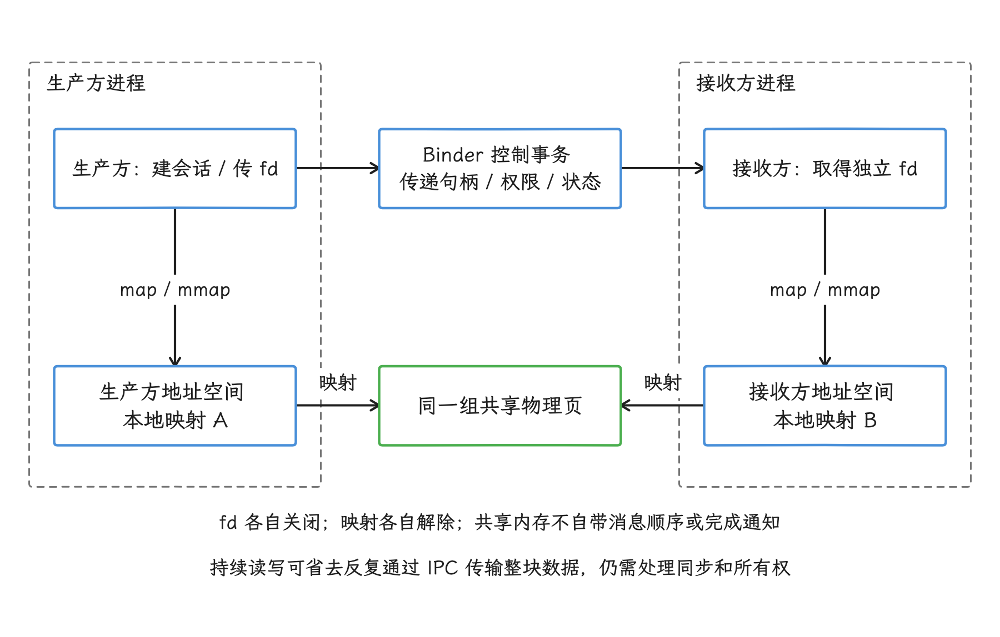
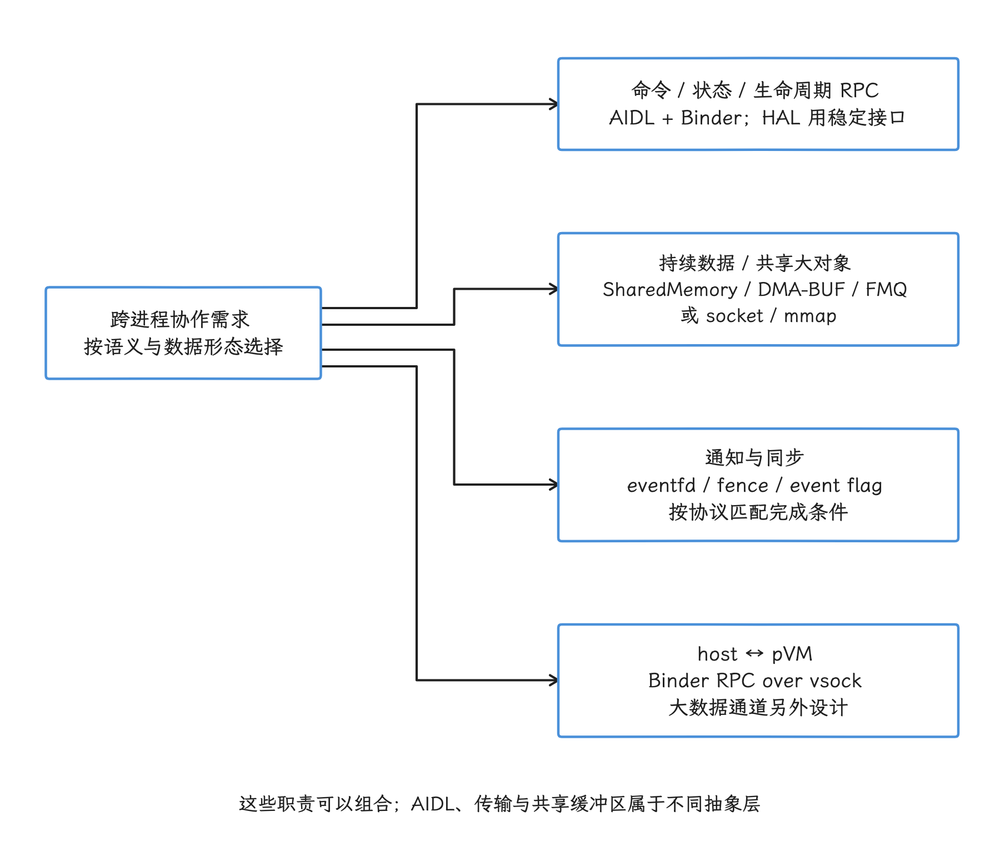
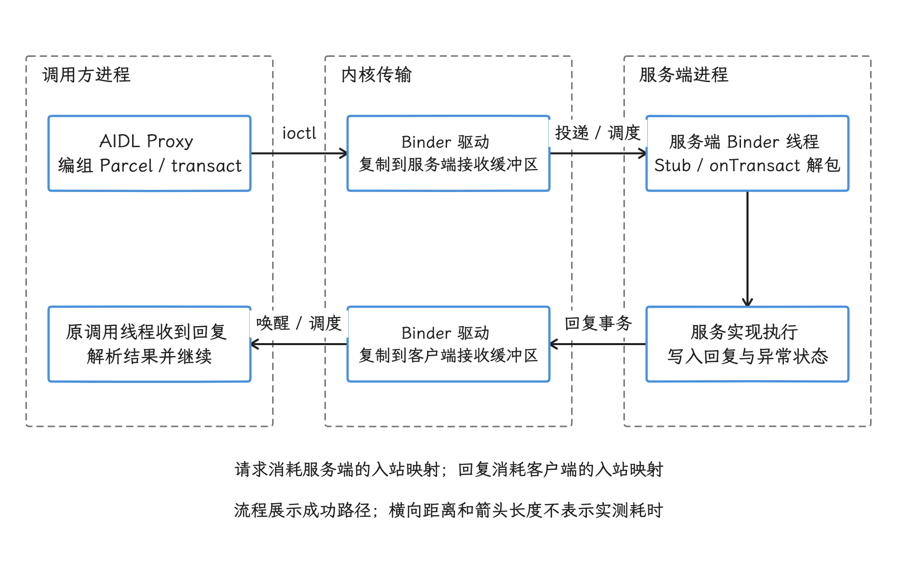

# Android IPC 全景与 Binder 性能

把 Android 的进程间通信（Inter-Process Communication，IPC）想象成「Binder、Intent、共享内存三选一」，是选型出错的常见起点。一条真实链路经常同时用到两到三层机制：Intent 和 AIDL（Android Interface Definition Language）描述上层接口与行为；Binder、Unix 域套接字和 vsock 负责传输；共享内存、DMA-BUF 与 FMQ（Fast Message Queue，快速消息队列）常用于持续传送数据。

> 源码基线：Android 17 / API 37；AOSP `android-17.0.0_r1`；内核 `android17-6.18-2026-06_r6`。

分析时，我们结合源码、文件描述符（file descriptor，fd）、线程和系统轨迹还原真实链路，让每个性能结论都带着自己的成立条件。

IPC 选型先看数据形态、方向、频率、生命周期和权限范围。Binder 适合控制面和结构化调用；共享内存、socket、FMQ 与 DMA-BUF 处理的吞吐、时延和所有权模型各不相同。

## IPC 机制、数据形态与选型

拿到一条跨进程链路，我们先把参与其中的机制按职责分层：哪些负责上层语义，哪些负责传输，哪些搬数据，哪些只做唤醒。分清层之后，后面的选型问题才有讨论的基础。

### 1. 先按职责分类，不按 API 名堆清单

```text
上层语义 / 框架抽象
├─ AIDL、Messenger、ResultReceiver
├─ Intent、BroadcastReceiver
└─ ContentProvider / Cursor

控制面 transport
├─ Binder：/dev/binder
├─ HIDL / HwBinder：/dev/hwbinder（存量 HAL）
├─ Unix domain socket：命名 socket 或 socketpair
├─ Pipe：单向字节流
└─ Binder RPC over socket / AF_VSOCK 的 Binder RPC：host ↔ pVM

数据面 / 共享对象
├─ SharedMemory / mmap
├─ CursorWindow
├─ DMA-BUF / AHardwareBuffer / GraphicBuffer
└─ FMQ：共享内存环形队列

通知与唤醒
├─ eventfd
└─ Signal
```

分层里的控制信息包括建连、权限、状态和命令，持续数据则可能是图像、音频或传感器样本。这四层在真实链路里经常组合使用：

- AIDL（Stable AIDL）定义接口，普通跨进程调用由 Binder 承载。
- Binder 先传递 `SharedMemory` 的文件描述符，之后双方直接读写各自映射出的同一块内存。
- InputManager 通过 Binder 把 `InputChannel` 的文件描述符交给应用，后续输入事件走 Unix `SOCK_SEQPACKET` 套接字。
- HAL 用 AIDL/HIDL 建立 FMQ，持续数据走共享内存队列。
- Microdroid 复用 Binder/AIDL 对象模型，但传输改为 socket/vsock；vsock 是宿主系统与虚拟机之间的套接字通道。

还有一点容易忽略：同一套 API 也可能不跨进程。AIDL 的客户端与服务在同一进程、使用同一代码生成后端（backend）时可以直接调用，省掉 Parcel 数据编组和 Binder 驱动事务；所以动手分析前，我们先确认双方的 PID。

### 2. 选型先回答六个问题

#### 2.1 需要 RPC 还是流

- “调用方法并拿到结果”属于远程过程调用（Remote Procedure Call，RPC），Binder/AIDL 最自然。
- “持续传任意长度字节流”更接近套接字或管道。
- “持续传定长元素”可考虑 FMQ。
- “共享一块大对象”可考虑 SharedMemory 或 DMA-BUF。

#### 2.2 传输内容是控制信息还是大数据

控制信息适合放进 Parcel，例如少量参数、令牌、文件描述符和状态码。方法事务码由 `transact()` 的独立参数传递，不属于 Parcel 数据区。图像、音频帧、模型权重或大型结果集不适合反复直接写入 Parcel，常见做法是只传句柄、文件描述符或描述对象，让接收方据此访问实际数据。

#### 2.3 谁拥有内存，谁负责回收

排查 IPC 故障时，除了传输错误，还要逐项确认资源所有权：

- Binder 对象何时调用 `linkToDeath()` 监听远端死亡，何时释放引用。
- 文件描述符只是临时借用、经 `dup` 复制后由本方拥有，还是随 `ParcelFileDescriptor` 一起关闭。
- `mmap` 创建的映射何时解除，`SharedMemory` 何时关闭。
- DMA-BUF 的同步栅栏（fence）完成前，哪一方要暂缓复用缓冲区。
- FMQ 的写入方或读取方死亡后如何重建队列。

#### 2.4 需要什么顺序和背压

- 背压指接收方处理不过来时，系统如何限制发送方继续写入，避免数据无限堆积。
- 同步 Binder 自带请求/回复和调用线程阻塞。
- `oneway` 没有业务回复，但仍受驱动队列和服务端处理速度约束。
- 套接字或管道由内核缓冲区提供背压，写满后阻塞或返回 `EAGAIN`。
- FMQ 容量固定，写满（overflow）与读空（underflow）的处理方式要在协议里写明。
- 共享内存本身没有消息边界、顺序或唤醒。

#### 2.5 安全边界在哪里

内核 Binder 提供调用方 UID、对象引用与 SELinux Binder 策略，权限检查以 UID 和相应的授权规则为准。`Binder.getCallingPid()` 主要用于调试：PID 会复用，`oneway` 的调用方 PID 为 0，同步调用也可能因调用方退出而得到 0，安全身份要看 UID，PID 只当调试线索。套接字依赖命名空间、文件权限、对端凭据和 SELinux。传递文件描述符，相当于把访问某个内核对象的能力交给对端；共享内存若未降低保护权限，对端可能获得超出预期的写权限。

#### 2.6 如何证明性能结论

IPC 延迟至少包含：

```text
client 编组
+ driver / kernel transport
+ server 排队与调度
+ server 业务
+ reply 编组与返回
```

各项相加才是调用方实际感受到的时长。固定写“Binder 0.5ms、Socket 0.1ms、Pipe 0.05ms”没有工程价值：数据量、CPU、系统构建版本、线程池、SELinux、调度和服务端工作稍有变化，数字就会改变。需要比较时，我们在同一设备上用相同负载、同步语义和统计口径做基准。

### 3. Binder：Android 控制面的主干

#### 3.1 一次同步调用发生了什么

我们以跨进程 AIDL 为例，看一次同步调用的完整路径：

```text
client method
  └─ Proxy 把接口标识与参数写入 Parcel，将方法事务码单独传给 transact()
       └─ ioctl 到 Binder driver
            └─ driver 把 transaction 复制到 server receive mapping
                 └─ server Binder thread
                      └─ Stub 解包并调用实现
                           └─ reply Parcel 原路返回
```

`ioctl` 是用户空间向内核驱动发出操作请求的系统调用。Binder 在端到端上仍有拷贝：Android 8 的分散—聚集（scatter-gather）优化减少了中间复制，但驱动仍要把事务内容复制到目标进程地址空间；复杂的 `Parcelable` 也还有编码、对象表、字符串和容器处理成本。

#### 3.2 同步与 oneway

同步事务要等待服务端返回。调用方看到的总耗时（wall time）可能来自：

- 服务端 Binder 线程尚未空闲。
- 服务端拿锁、做 I/O 或调用下一个 Binder 服务。
- 调用方等待回复时被调度出去。
- 回复本身过大或编组成本较高。

`oneway` 免去的只是「等待业务返回」这一段；驱动、队列和服务端消费速度照样起作用——事务仍经过 Binder 驱动，仍可能排队、可能失败，服务端也不会因此无限快地消费。

顺序保证只覆盖发往同一个 `IBinder` 对象的多个 `oneway` 调用；换成不同 Binder 对象，或 `oneway` 与同步调用混用，顺序就要协议自己约定。同进程直调时，`oneway` 仍是调用线程上的同步执行。

#### 3.3 1MB 共享预算的构成

Java `TransactionTooLargeException` 文档把 Binder 事务缓冲区描述为当前约 1MB，并强调进程内所有尚未完成的事务共享这块空间。C++ `ProcessState.cpp` 中的接收映射大小更具体：

```cpp
#define BINDER_VM_SIZE \
        ((1 * 1024 * 1024) - sysconf(_SC_PAGE_SIZE) * 2)
```

因此：

- 4 KiB 内存页设备：约 1016 KiB。
- 16 KiB 内存页设备：约 992 KiB。

992 KiB 是 16 KiB 页设备上本进程接收映射的总大小，供尚未释放的入站事务数据、对象偏移表等共享。请求占用服务端的接收映射，回复占用客户端的接收映射，两端各自分配，本进程的预算只算自己这一侧。异常发生时，单看异常分不清是请求未能发送还是回复失败，处理上应按操作可能部分完成对待。

工程规则很简单：Binder 事务应保持小；大数据改用文件描述符、分页或流式传递。

#### 3.4 线程池默认上限 15

`ProcessState.cpp`：

```cpp
#define DEFAULT_MAX_BINDER_THREADS 15
```

这个值配置的是驱动可以按需启动的 Binder 线程池默认上限。`startThreadPool()` 启动的线程、主动调用 `joinThreadPool()` 加入线程池的线程，以及进程自行调整的配置都会影响总数；把它简化成「每个进程固定 16 个 Binder 线程」会误导容量分析。

线程池饥饿指所有工作线程都被占用，新事务长时间得不到处理。判断时我们要看的是：

- 服务端 Binder 线程是否全在执行或阻塞。
- 客户端事务是否长时间等不到服务端开始执行的轨迹区段。
- 服务端是否在 Binder 线程上做阻塞 I/O、跨服务调用或持有大锁。
- `binder thread pool ... starved` 类日志是否出现。

#### 3.5 Parcel 对象表里的 Binder 对象与 fd

Parcel 除普通数据外，还维护对象表。它可以传：

- Binder 对象或句柄。
- 文件描述符（`BINDER_TYPE_FD`）。
- 原生句柄中的一组文件描述符与整数。

Binder 驱动会为接收方安装或复制相应引用与文件描述符。传递文件描述符后，后续大数据就无需继续进入 Parcel，但双方仍要定义：

- 文件描述符的访问权限。
- 由谁关闭。
- 是否允许写。
- 对端死亡后的清理。
- 数据完成条件。

### 4. AIDL、Messenger、Intent 和 Provider 在哪一层

#### 4.1 AIDL 是接口与编组语言

AIDL 编译器为接口生成 Proxy/Stub 和类型编解码代码。跨进程时走 Binder；同进程使用同一代码生成后端时可以直接调用。

```text
client interface call
  ├─ local object → direct call
  └─ remote proxy
       └─ Parcel + Binder transaction
            └─ server stub + implementation
```

AIDL 解决类型约定、版本和代码生成后端，底层事务缓冲区的约束原样保留：一个 5MB `byte[]` 写成 AIDL 参数，走的仍是内联编组，共享内存要另外设计。

#### 4.2 Messenger 是 Handler 语义叠在 Binder 上

Messenger 用 Binder 传递 `Message`，接收端最终把消息投递到指定的 Handler / Looper。它适合希望按某个 Looper 的消息队列顺序处理请求、不自行管理并发 RPC 的场景。

把 Messenger 叫作「单线程 Binder」，容易把传输和分发混为一谈：

- 底层传输仍是 Binder。
- Binder 收到消息后再投递给 Handler。
- 一个 Messenger 入口的消息由它绑定的 Handler / Looper 串行分发；Handler 内部是否再把工作拆到线程池并行执行，由应用决定。
- `Message` 携带的数据仍受 Parcel 与事务缓冲区限制。

#### 4.3 Intent 与 Broadcast 是系统调度协议

`Intent` 是描述操作、组件和附加数据（extra）的 `Parcelable`，本身是一种数据描述；跨进程组件启动或广播通常先经过 `system_server` 中的 ActivityManager 等服务，再由 Binder 调用目标进程。

它附带的是更高层语义：

- 组件解析，以及 `exported` 和权限检查。
- 生命周期和进程启动。
- 后台启动、广播队列与缓存进程策略。
- 有序广播的结果传播。

所以 Intent 的耗时不该只用「一次 Binder 耗时」解释：冷启动目标进程、组件调度和生命周期回调的成本，通常远大于底层传输本身。

#### 4.4 ContentProvider 的数据路径

Provider 的查询、插入、更新和删除属于框架层 RPC，跨进程控制调用由 Binder 承载。查询返回的数据窗口常使用 `CursorWindow`，但小窗口和大窗口路径不同。

`CursorWindow.cpp`：

- 初始内联容量取 16 KiB 与请求容量 `inflatedSize` 的较小值。
- 数据能放下时，跨进程按实际占用量压紧数据与槽位布局，再直接复制进 Parcel；这里没有通用压缩算法。
- 需要更大空间且仍可扩容时，才扩展到兼容 ashmem 的共享区域。
- 大窗口通过文件描述符传递，对端使用只读 `mmap` 映射。

所以「所有 ContentProvider 结果都零拷贝」对不上实际路径：列值填充、`CursorWindow` 构建、内联复制或共享区域初始化仍有 CPU 和内存成本。

#### 4.5 ResultReceiver 是回调抽象

跨进程 `ResultReceiver` 内部同样依靠 Binder 回调。它适合一次或少量结果通知，不适合没有长度上限的数据流；结果 `Bundle` 要保持小，并处理接收方生命周期。

### 5. Unix domain socket

Unix 域套接字只在本机进程之间通信，可提供连续字节流，也可保留每条消息的边界。常见类型包括：

- `SOCK_STREAM`：连续字节流，无消息边界。
- `SOCK_SEQPACKET`：保留消息边界与顺序。
- 命名套接字：由 init 在 `/dev/socket/*` 等命名空间中创建。
- 匿名 `socketpair()`：创建一对已经连接的文件描述符。

Binder 那种「所有事务共享约 1MB 接收映射」的限制在这里套不上，套接字这边的约束换成了收发缓冲区、单个数据包、内存和协议分帧——协议分帧就是从字节流里识别一条消息的长度和起止位置。大数据流可以分块持续发送，单次 `send()` 的上限照样存在。

#### 5.1 InputChannel：Binder 交 fd，socket 传事件

`InputChannel::openInputChannelPair()`：

```cpp
socketpair(AF_UNIX, SOCK_SEQPACKET, 0, sockets);
```

InputDispatcher 持有服务端；客户端作为 `Parcelable` 经 Binder 交给窗口所在进程。之后：

- 输入事件走这对匿名 Unix 套接字。
- 应用处理完成后的确认信号也走同一通道。
- Binder 主要负责通道的生命周期和控制，不搬运每个 `MotionEvent` 的数据。

这条链是“Binder 传控制信息 + 套接字传持续数据”的典型例子。

#### 5.2 `SCM_RIGHTS`：socket 也能传 fd

Unix 套接字可用 `sendmsg()` / `recvmsg()` 和 `SCM_RIGHTS` 把文件描述符交给对端。控制消息只携带对同一内核对象的新引用，文件内容并不会被复制进附属数据区域。

接收方必须：

- 校验文件描述符的数量和类型。
- 设置或确认 `CLOEXEC`，让执行新程序时自动关闭无需继承的描述符。
- 定义关闭时机。
- 对端提供的文件大小、偏移量、格式或权限，都要自行校验。

#### 5.3 什么时候比 Binder 更合适

Unix 套接字更适合：

- 已有流式分帧协议。
- 需要长连接和显式背压。
- 非 Android Binder 环境也要复用协议。
- 需要数据包边界或双向字节流。

代价是 Binder 那些现成能力——对象身份、调用方 UID API、远端死亡通知和服务管理——套接字都不自动提供；把系统服务从 Binder 改成套接字，身份、授权、版本、生命周期和错误协议多半要自己实现一遍。

### 6. Pipe、eventfd 与 Signal（信号）

#### 6.1 Pipe：单向字节流

`pipe()` 创建读取端和写入端两个文件描述符：

- 单向。
- 没有消息边界。
- 由容量有限的内核缓冲区提供背压。
- 常通过 `fork` 继承或显式传递文件描述符来建立连接。

Android/Java 常见场景是 `ProcessBuilder` / `Runtime.exec()` 的标准输入、标准输出和标准错误。需要双向通信时用两条管道，或直接 `socketpair()`。

#### 6.2 Looper 当前使用 eventfd

本书覆盖 Android 8–17。`android-17.0.0_r1` 的 `Looper.cpp` 在构造时：

```cpp
mWakeEventFd.reset(
        eventfd(0, EFD_NONBLOCK | EFD_CLOEXEC));
epoll_ctl(mEpollFd.get(), EPOLL_CTL_ADD,
          mWakeEventFd.get(), &wakeEvent);
```

`wake()` 向 eventfd 写入一个 64 位计数，等待在 `epoll_wait()` 上的线程被唤醒后再读取。管道只是更早实现的历史背景；解释当前 MessageQueue 的唤醒路径时，以 eventfd 为准。

eventfd 主要传递计数或通知，不承载业务数据。跨进程使用时，双方仍需继承或传递对应的文件描述符。

#### 6.3 Signal：异步通知的交付路径

信号的交付仍受目标线程调度、信号掩码和处理函数行为影响，「内核直接中断、延迟为零」的印象站不住；标准信号通常只表达编号，带 `siginfo_t` 的机制能附带少量元数据，但业务数据流依然不适合放在信号上。

Android 常见用途：

| Signal | 用途 |
| --- | --- |
| `SIGQUIT` | 请求 ART/进程生成 Java 调用栈信息，ANR 流程会使用 |
| `BIONIC_SIGNAL_DEBUGGER` | debuggerd 生成原生转储或 tombstone（原生崩溃转储文件）的内部通道 |
| `SIGABRT` | 主动终止，进入原生崩溃处理流程 |
| `SIGKILL` | 不可捕获、不可忽略的强制终止 |

bionic 把 `BIONIC_SIGNAL_DEBUGGER` 定义为 `__SIGRTMIN + 3`，这是平台保留信号，应用要避开。

信号处理函数还受异步信号安全（async-signal-safe）规则约束：线程被信号打断时，处理函数只能调用规范明确允许的少量函数。不要在处理函数里分配内存、获取普通互斥锁、记录复杂日志或调用非安全 API。

### 7. SharedMemory 与 mmap

#### 7.1 共享页省掉了哪次复制

共享内存建立后，两个进程可以访问同一组物理页，持续读写时无需让每条消息再次经过内核传输复制。但链路上仍可能出现：

- 生产方把数据复制进共享区域。
- 缺页异常、页表建立和 CPU 缓存未命中。
- CPU 与设备之间的缓存同步维护。
- 消费方再把数据复制到自己的数据结构。

更准确的说法是「持续数据可以避免重复的 IPC 复制」：避免的是逐条消息再次经过内核传输的那次复制，生产方写入、缺页、缓存同步和消费方转换的成本都还在。

<!-- gracker-diagram: ch01-09-control-shared-data -->


图：控制事务先把共享对象的 fd 等描述交给接收方；双方在各自地址空间映射同一组物理页。下方箭头表示映射关系，读写顺序、通知和资源关闭仍由协议明确。

#### 7.2 Java `SharedMemory`

`android.os.SharedMemory` 从 API 27 提供，可通过 `Parcelable` 传递文件描述符。下面是业务代码片段，`size` 应大于 0 且足够容纳 `payload`，`remote.consume()` 代表自行定义的远程接口；外围方法需处理或声明 `ErrnoException`、`RemoteException`。重点看外层资源关闭和内层解除映射：

```java
try (SharedMemory shm = SharedMemory.create("model-input", size)) {
    ByteBuffer writable = shm.mapReadWrite();
    try {
        writable.put(payload);
    } finally {
        SharedMemory.unmap(writable);
    }

    if (!shm.setProtect(OsConstants.PROT_READ)) {
        throw new IllegalStateException("failed to remove write access");
    }

    remote.consume(shm);
}
```

外层 `try-with-resources` 保证映射、写入、降权或远程调用失败时也关闭 `SharedMemory`；映射成功后，内层 `finally` 负责解除映射。

`setProtect()` 只能移除权限，加不回来；它也只约束之后创建的映射，已有的可写映射仍保持原权限。因此，示例采用“写入 → 解除映射 → 降为只读 → 传给对端”的最小权限顺序，让接收方只获得完成任务所需的权限。

接收方创建映射后也要解除映射，并关闭自己收到的文件描述符包装对象。发送方关闭自己的描述符，不会让接收方经 `dup` 获得的独立描述符立即失效。

#### 7.3 `MemoryFile` 是兼容包装

`MemoryFile.java` 已明确实现为 `SharedMemory` 的兼容包装。新代码通常优先使用 SharedMemory；`allowPurging()` 与 `isPurgingAllowed()` 已标记弃用，源码建议应用响应内存回调、按需释放共享区域，不要把历史可回收（purgeable）行为作为新通用共享内存协议的基础。

#### 7.4 ashmem 兼容文件描述符的 memfd 分流

ashmem 是 Android 早期的匿名共享内存机制，memfd 则用匿名内存文件提供类似能力。`ashmem_create_region()` 是兼容 API 名，底层未必还是旧的 `/dev/ashmem` 设备；`ashmem-dev.cpp` 默认按以下条件判断：

1. 内核与 SELinux 策略支持 `memfd_class` 能力。
2. `ro.vendor.api_level >= 202604`。
3. 当前应用的目标 SDK 版本不低于 37。

满足后使用 `memfd_create()`；否则回到 ashmem 设备。`sys.use_memfd=true` 仍可用于强制覆盖默认选择，但源码注明未来会移除。

调试时我们要看 `/proc/<pid>/fd/*`、内存映射和设备属性；单看 Java API 名，是推不出底层对象的。

### 8. `Parcel::writeBlob()`：16KiB 分界的真实含义

`Parcel.cpp` 在未定义 `BINDER_DISABLE_BLOB` 时，按下面的分支选择内联或共享区域；代码仅示意条件，省略分配与错误处理：

```cpp
static const size_t BLOB_INPLACE_LIMIT = 16 * 1024;

if (!mAllowFds || len <= BLOB_INPLACE_LIMIT) {
    // BLOB_INPLACE
} else {
    // ashmem_create_region + mmap + fd in Parcel
}
```

这段代码给出的分界是：

- `len <= 16KiB`：直接写入 Parcel。
- `len > 16KiB` 且 Parcel 允许传递文件描述符：创建兼容 ashmem 的区域，映射后通过 Parcel 传递文件描述符。
- `len > 16KiB` 但不允许传递文件描述符：仍直接写入 Parcel。

若构建定义了 `BINDER_DISABLE_BLOB`，`writeBlob()` 直接返回 `INVALID_OPERATION`，上述分支不适用。

`writeBlob()` 返回可写区域给调用者，数据仍要被写进 Parcel 内联缓冲区或共享映射。文件描述符分支避免把整块二进制数据再次塞进 Binder 事务缓冲区，但生产方仍有写入成本。

这项分流只覆盖实际使用二进制块或以文件描述符为后端的 `Parcelable` 路径；普通字节数组仍会被内联编组，「所有大 AIDL `byte[]` 都会自动走共享内存」的外推到这里就停住了。

### 9. DMA-BUF、GraphicBuffer 与共享内存的分工

DMA-BUF 用于让 CPU、GPU、显示、相机、编解码器等硬件模块共享缓冲区：

- 内存分配器返回 DMA-BUF 文件描述符或原生句柄。
- 图形内存分配器 gralloc 描述格式、行跨度（stride）、用途和图像平面布局。
- Binder 传递句柄与生命周期控制信息。
- 同步栅栏表达生产方写完、消费方可以开始读取的时序。

Android 12 的 GKI（Generic Kernel Image，通用内核镜像）2.0 路线用 DMA-BUF 堆替代 ION 内存分配器。官方旧迁移页限定为「5.4 kernel only」，已标记弃用，并注明原计划于 2026 年 5 月移除，其中的迁移步骤只作历史背景；Android 17 下要看节点（node）创建，可对照 ACK `android17-6.18-2026-06_r6` 的 `drivers/dma-buf/dma-heap.c`，堆设备表现为 `/dev/dma_heap/<name>`。这项迁移也只发生在硬件缓冲区分配器一侧，SharedMemory 仍走在自己的 ashmem/memfd 路线上。

| 对象 | 主要用途 | 同步 |
| --- | --- | --- |
| SharedMemory / memfd / ashmem 兼容区域 | CPU 进程间共享普通字节 | 原子操作、锁、协议、eventfd |
| DMA-BUF / AHardwareBuffer / GraphicBuffer | CPU 与硬件设备共享结构化缓冲区 | 同步栅栏、缓存与一致性规则 |
| mmap file | 文件页映射与持久化共享 | 文件锁、数据库协议、原子/锁 |

图像数据换到 DMA-BUF 上，格式、行跨度、用途和同步栅栏仍要应用自己处理。

### 10. FMQ：共享内存上的有界单向队列

FMQ 先通过 HIDL 或 AIDL RPC 传递 `MQDescriptor` 描述对象，双方再映射环形缓冲区、读写位置和可选的事件标志。建立完成后，非阻塞读写不需要让每条消息都进入 Binder 驱动。

单个 FMQ 的基本约束：

- 只有一个写入方。
- 同步队列（synchronized queue）：只有一个读取方，不允许写入覆盖尚未读取的数据。
- 非同步队列（unsynchronized queue）：可有多个读取方，写入方可以覆盖旧数据；读取方落后超过容量后，下一次读取失败并调整本地读位置，该次读取要当作无效数据处理。
- 两种队列都不允许在没有可读数据时继续读取。
- 双向协议通常需要两条方向相反的队列。

非同步队列的读取方从描述对象建立队列时，必须使用 `resetPointers=false`，避免重置共享写入位置；读位置由各读取方独立维护。检查可读量之后仍可能发生覆盖，因此还要处理实际读取失败。

因此把 FMQ 表格写成“天然双向”是写错了方向。它适合固定布局、频繁、小单元的数据流，不适合：

- 可变长复杂对象。
- 含指针、Binder 接口或任意嵌套缓冲区的数据。
- 需要每条消息独立权限检查的协议。
- 无界队列。

HIDL FMQ 从 Android 8 开始提供；AIDL NDK 代码生成后端从 Android 12 起可使用 FMQ。Java 后端可以转交描述对象，但没有 Java FMQ 库可直接读写队列。

### 11. HAL IPC：HIDL/hwbinder 与 Stable AIDL / binder

Android 8 的 Treble 把系统框架与厂商（vendor）实现分开升级，并用 HIDL 和独立的 `/dev/hwbinder` 驱动域固定双方接口。Android 10 引入稳定 AIDL 机制，Android 11 开始允许 HAL 使用 AIDL。稳定 AIDL HAL 具有以下特点：

- 使用 `/dev/binder`。
- 厂商原生代码使用 NDK 或 Rust 代码生成后端等稳定运行时。只有 `system/system_ext` 可直接使用 C++ `libbinder`，其他分区应使用 `libbinder_ndk`、`libbinder_rs` 或适用的 Java 后端；Java 后端不能用于与 vendor 分区的服务管理器通信，vendor 分区也不能使用 API 34 之后新增的系统 API。
- 系统与厂商之间的 AIDL 类型使用 `@VintfStability`，接口构建声明 `stability: "vintf"`，再通过厂商接口清单（VINTF）、冻结的接口版本和厂商测试套件（VTS）管理兼容性。

HIDL 从 Android 13 起进入弃用状态，但既有 HIDL HAL 仍受支持；分析具体设备时，以它实际暴露的接口为准，单看系统版本下不了「所有 HAL 都已迁移到 AIDL」的结论。

| HAL 接口 | 常见驱动域 | 当前定位 |
| --- | --- | --- |
| HIDL Binder 化 HAL | `/dev/hwbinder` | 存量兼容，不用于新接口 |
| Stable AIDL HAL | `/dev/binder` | 新实现优先 |
| `/dev/vndbinder` + vndservicemanager | 厂商进程间旧 AIDL | Android 11 起弃用 |

控制调用之外，音频、相机、传感器和图形的持续数据仍常放在 FMQ、SharedMemory 或 DMA-BUF 中——AIDL/HIDL 管接口语言和控制信息传输，高吞吐数据有自己的通道。

### 12. AVF：通过 vsock 传输 Binder RPC

Android 虚拟化框架（AVF）中的 Microdroid 运行在受保护虚拟机（pVM）内，接触不到宿主 Android 的 Binder 驱动；Binder RPC 保留 AIDL/Binder 对象模型，把传输改为套接字，pVM 场景通常使用 `AF_VSOCK`。

```text
host RpcSession
  └─ Binder RPC framing
       └─ AF_VSOCK / virtio transport
            └─ pVM RpcServer root Binder object
```

这条路径绕开了内核 Binder 的 `BINDER_VM_SIZE` 接收映射，「Binder 驱动复制一次」的结论也套不上。开销要分成：

- Parcel / Binder RPC 消息分帧。
- socket/vsock 缓冲区与 virtio 虚拟设备 I/O 传输。
- VM 调度和服务端工作。

宿主系统未被攻破时，Android 限制 guest pVM 之间直接建立 vsock 连接，由宿主的 VirtualizationService 建立通道；已建立的通道可以转交其他进程使用。这些宿主侧访问控制不保证在宿主被攻破后继续成立。大文件交换另有带完整性校验的 AuthFS 文件通道；超大 Binder RPC 事务是否安全，要按各自的访问控制前提评估，绕开内核 Binder 映射本身给不出这份保证。

### 13. 定性对比

| 机制 | 消息/数据语义 | 背压与顺序 | 大数据策略 | 主要风险 |
| --- | --- | --- | --- | --- |
| Binder 同步调用 | 方法调用 + 回复 | 调用方等待回复；不同 Binder 对象可并发 | 传文件描述符或分页 | 线程池、嵌套调用、事务缓冲区 |
| Binder `oneway` | 无回复的远程调用 | 同一 Binder 对象串行有序；队列有界 | 传文件描述符，避免大量 `oneway` 堆积 | 积压、冻结进程的缓冲区溢出 |
| Unix 套接字 | 字节流或数据包 | 内核套接字缓冲区；协议自行分帧 | 分块流或通过 `SCM_RIGHTS` 传文件描述符 | 自建认证、版本、生命周期 |
| 管道 | 单向字节流 | 内核管道缓冲区；无消息边界 | 不适合随机访问大对象 | 双向需两条、对端协议能力有限 |
| SharedMemory / mmap | 共享字节区域 | 无内建消息顺序；需另行同步 | 直接访问共享页 | 数据竞争、权限、描述符或映射泄漏 |
| DMA-BUF | 设备共享缓冲区 | 同步栅栏 + 所有权协议 | 句柄或文件描述符指向缓冲区 | 格式、行跨度、栅栏、缓存同步 |
| FMQ | 有界元素队列 | 单写入方；队列类型决定读取方与覆盖行为 | 固定布局环形队列 | 容量、丢数、重建 |
| eventfd | 计数/唤醒 | 计数累积 | 不承载业务数据 | 忘记读空计数、描述符生命周期 |
| Signal | 异步进程/线程通知 | 遵循信号语义 | 不承载业务数据 | 处理函数安全、调度、平台保留信号 |
| Binder RPC / vsock | 跨虚拟机 RPC | socket/vsock 与 RPC 会话 | 专用共享或文件通道 | 虚拟机调度、消息分帧、连接安全 |

这张表回答的是“谁合适”，回答不了“谁最快”。同样传 16 字节，RPC 语义、线程唤醒与权限检查可能是主要成本；同样传 10MB，能否复用映射、是否复制到共享区、CPU 缓存与同步策略更加重要。

### 14. 选型决策树

```text
需要跨进程协作
├─ 是命令、状态、权限或生命周期 RPC？
│  ├─ App / Framework → AIDL + Binder
│  ├─ 新 HAL → Stable AIDL HAL + /dev/binder
│  ├─ 存量 HIDL HAL → /dev/hwbinder
│  └─ 已有流式本地协议 → Unix domain socket
│
├─ 是持续大数据或高频数据面？
│  ├─ 普通 CPU 字节区域 → SharedMemory + fd
│  ├─ CPU/GPU/display/camera buffer → DMA-BUF / AHardwareBuffer
│  ├─ HAL 固定布局元素流 → FMQ
│  ├─ 文件型共享 → mmap
│  └─ 任意长度字节流 → Unix socket
│
├─ 只需要通知？
│  ├─ poll/epoll 唤醒 → eventfd
│  ├─ 父子进程单向字节流 → pipe
│  └─ 平台级异步信号 → Signal
│
└─ host ↔ pVM？
   └─ 通过 vsock 的 Binder RPC / AIDL；大数据另行设计通道
```

决策树先按交互语义选择机制，再根据数据规模补充共享或流式通道。当一条链既有控制又有大数据时，我们通常把它设计成：

```text
Binder/AIDL：鉴权、建会话、传 fd、状态与错误
SharedMemory/DMA-BUF/FMQ/socket：持续数据
eventfd/fence/event flag：完成通知与同步
```

这种分工让控制协议保留 Binder 的身份与生命周期能力，同时避免把大块数据反复写进事务缓冲区。

<!-- gracker-diagram: ch01-09-ipc-selection -->


图：先确定接口语义，再选择传输、数据和同步通道。同一链路可以同时使用 Binder 传句柄、共享内存承载数据，并由事件或 fence 协调完成。

### 15. Perfetto 与现场证据

#### 15.1 抓 Binder 与调度

下面的命令在设备上采集 10 秒 Binder、线程调度和 CPU 频率数据，再把轨迹文件拉到本机：

```bash
adb shell perfetto \
  -o /data/misc/perfetto-traces/ipc.perfetto-trace \
  -t 10s -b 64mb \
  sched freq binder_driver aidl

adb pull \
  /data/misc/perfetto-traces/ipc.perfetto-trace
```

`aidl` 分类为接口与方法解析提供用户态标记；能否采到目标进程的标记和内核事件，还受构建类型、权限、应用可调试性与采集配置限制。轨迹到手后，我们把 Binder 区段的总耗时分成：

1. 客户端编组前后的应用轨迹区段。
2. `binder transaction` 到服务端线程开始执行之间的排队。
3. 服务端线程处于运行、等待 CPU、休眠或阻塞状态的时间。
4. 服务端内部的嵌套 Binder 调用、锁与 I/O。
5. 回复返回，以及客户端重新获得 CPU 的时间。

Perfetto SQL 标准库已经提供 Binder 结构化表。下面的查询按接口和方法聚合调用次数、平均耗时与最大耗时：

```sql
INCLUDE PERFETTO MODULE android.binder;

SELECT
  client_process,
  client_thread,
  interface,
  method_name,
  is_sync,
  COUNT(*) AS calls,
  AVG(client_dur) / 1e6 AS avg_ms,
  MAX(client_dur) / 1e6 AS max_ms
FROM android_binder_txns
GROUP BY
  client_process, client_thread, interface, method_name, is_sync
ORDER BY max_ms DESC
LIMIT 50;
```

结果按最大耗时降序列出前 50 组调用，并以 `is_sync` 区分同步与 `oneway`。同步事务的 `client_dur` 包含等待回复；`oneway` 的该字段只描述客户端提交区间，服务端业务完成时长要另外度量。不同 Perfetto 版本的标准库字段会演进；遇到 `method_name` 等列缺失，先用 `PRAGMA table_info(android_binder_txns);` 检查当前表结构，再对照该 Trace Processor 版本的模块文档。

#### 15.2 套接字和管道的轨迹定位

每次 `sendmsg()` / `recvmsg()` 在系统轨迹里未必留下含义清楚的用户空间区段，更可靠的做法包括：

- 应用和服务在协议请求与完成处主动加入轨迹标记。
- 必要时采集 ftrace 记录的系统调用，或 CPU 调用栈。
- 同时查看线程状态、套接字缓冲区、背压日志和数据量计数。
- 分析 InputChannel 时，结合输入事件分类、InputDispatcher 和目标应用线程。

没有名为 `sendto` 的轨迹区段，也可能存在套接字 I/O。

#### 15.3 如何验证共享内存路径

光看轨迹里有没有 `memcpy`，判断不出共享内存有没有省掉一次 IPC 复制；我们要把下面这些依据合起来看：

- Parcel 里传的是文件描述符或句柄，不是大块内联数据。
- `/proc/<pid>/fd` 与 `/proc/<pid>/maps` 显示两端映射同一对象。
- 源码路径调用了 `writeFileDescriptor()` / `mmap()`。
- CPU 性能剖析中没有持续出现与数据量同规模的编组复制。
- 协议计数、同步栅栏或事件标志与数据生命周期吻合。

即使共享同一物理页，生产方或消费方仍可能在业务层再次复制。

### 版本与实现边界

| 版本 | 变化 | 分析含义 |
| --- | --- | --- |
| Android 8（API 26） | Treble、HIDL/hwbinder、FMQ；Binder 分散—聚集优化 | HAL 控制信息与高吞吐数据开始更明确地分离 |
| Android 8.1（API 27） | Java `SharedMemory` 公共 API | 应用可显式传递共享区域的文件描述符 |
| Android 10 | Stable AIDL 稳定性机制 | 面向系统与厂商边界的 AIDL 接口需要显式考虑稳定性 |
| Android 11 | AIDL HAL；`vndbinder` 路线进入弃用状态 | 新 HAL 可使用 Stable AIDL `/dev/binder` |
| Android 12 | AIDL NDK 后端支持 FMQ；GKI 2.0 推进 ION → DMA-BUF 堆 | SharedMemory 与 DMA-BUF 内存分配器仍是两条路线 |
| Android 13 | HIDL 进入弃用状态；AVF/Microdroid 扩展 Binder RPC over vsock 场景 | 存量 HIDL 仍可能存在；跨虚拟机通信不走内核 Binder |
| Android 17（API 37） | 默认的 ashmem 兼容 memfd 路径增加厂商 API 202604、`targetSdk` 37 等启用条件 | 当前 AOSP 源码以 `android-17.0.0_r1` 为准 |

### 常见反模式

#### 高频 getter 调用

下面是业务接口示意，`remote.getState()`、`remote.getStates()` 和 `State` 均由业务定义，不是 Android API。若逐项同步查询，一帧内会发起 N 次 Binder 调用：

```java
// 差：一帧里 N 次同步 Binder
for (long id : ids) {
    states.add(remote.getState(id));
}
```

每次循环都要单独编组、排队并等待回复。可以改为一次批量快照，或订阅状态增量：

```java
// 好：一次快照，或订阅增量
List<State> states = remote.getStates(ids);
```

批量接口减少了往返次数，但仍要设置合理上限。把 N 次小事务合成一个超大 `Bundle`，只会把高频调用问题换成 `TransactionTooLargeException`。

#### 把 oneway 当成无限队列

生产速度长期高于服务端消费速度时，`oneway` 只会把压力移到异步事务队列。协议应设计：

- 合并或去重。
- 有界序列号，以及只保留最新状态（latest-state）的语义。
- 丢弃策略。
- 服务端健康状态与积压量指标。
- 缓存进程或冻结进程来不及消费时的边界行为。

#### 共享内存没有协议

只有一块 `mmap` 映射，缺少头部、版本、长度、状态和内存顺序时，接收方就可能读到只写了一半的数据。协议至少要明确以下约束：

- 标识与版本：接收方能识别格式，并判断是否支持该版本。
- 容量与数据长度：读取前校验边界，拒绝越界偏移和长度。
- 序列号与所有权：定义谁能写、何时发布、何时读取，以及读完后如何归还、复用空间。
- 发布与读取顺序：状态字段本身不提供同步，需使用跨进程有效的原子操作与内存顺序，或明确的锁协议。
- 校验与恢复：定义对端退出、写入中断和通知丢失后的处理。

涉及 CPU 与硬件设备共同访问时，还要按相应缓冲区协议处理同步栅栏和缓存一致性；同步要落在可执行的协议上，一组状态名字替代不了。

#### 传文件描述符后忘记降低权限

可写文件描述符是一项访问能力。只需要读取时，先完成写入、解除写入方映射、降低后续映射权限，再传给不可信对端。接收方也要校验大小和格式——文件描述符来自 Binder，内容也未必安全。

### 常见误区

#### “Intent、AIDL、Binder 是三种并列 IPC”

这三者不在同一层：Intent/AIDL 是上层协议或接口，跨进程时通常由 Binder 承载。

#### “oneway 不会阻塞，也不会失败”

它不等的是业务回复，提交到驱动、队列容量、冻结进程和服务端消费速度仍构成约束，阻塞和失败都还在。

#### “Binder 单次可以安全传接近 1MB”

约 1MB 是进程内所有尚未完成事务的共享预算，还要扣除内存页和元数据开销；估算单次上限时，并发中的其他事务要一起算进去。

#### “共享内存就是零拷贝”

映射后可以避免的是重复的 IPC 复制；生产方写入、消费方转换、缺页异常和缓存同步的成本还在。

#### “FMQ 是双向队列”

单个 FMQ 只有一个写入方；双向协议通常建立两条方向相反的队列。

#### “Signal 延迟为零”

信号是内核管理的异步通知，交付与处理函数执行仍受信号掩码和线程调度的影响。

#### “Android 17 HAL 都走 AIDL”

新接口优先 AIDL，设备仍可保留受支持的 HIDL HAL。

#### “通过 vsock 的 Binder RPC 仍受 Binder 1MB 缓冲区限制”

它复用 Binder 对象与 RPC 模型，传输走 socket/vsock，内核 Binder 的接收映射在这条路径上并不存在。

## Binder 慢调用的事务与等待链

前文站在选型视角说明了 Binder 的同步语义、共享缓冲区和线程池约束；本节我们换个视角，把同一组事实重新组织成慢调用的调查顺序——先还原事务层次，再区分服务端排队、锁、I/O、嵌套调用和回复。同步与 `oneway` 只改变等待方式，服务端工作和资源约束一样都在。

性能分析要先回答三个问题：

1. 这是本地调用还是远程 Binder 调用？
2. 调用方是否同步等待结果？
3. 时间耗在服务端业务、线程调度、锁与 I/O，还是事务缓冲区和错误路径？

只有先还原调用链，才有理由改客户端、服务端或系统配置。

### 一次 Binder 调用经过哪些层

以 AIDL 的同步远程调用为例，调用链可以写成：

```text
Client
  -> AIDL Proxy
  -> Parcel / transact()
  -> libbinder / Binder driver
  -> target process Binder thread
  -> AIDL Stub / onTransact()
  -> service implementation
  -> reply transaction
  -> Client
```

具体过程是：

1. 客户端 Proxy 把接口标识（token）和参数写入 `Parcel`，方法事务码（transaction code）作为 `transact(code, data, reply, flags)` 的独立参数传入。
2. libbinder 将事务码写入 `binder_transaction_data.code`，由 `data.ptr.buffer` 指向 Parcel 数据，再通过 `BINDER_WRITE_READ` 这个 ioctl 命令把事务交给 Binder 驱动。
3. 驱动解析目标句柄（handle），找到目标 Binder 节点和宿主进程，为目标进程分配事务缓冲区（transaction buffer）。
4. 驱动选择目标线程，或把工作放入目标进程的待处理队列并请求补充工作线程（worker）。
5. 服务端线程收到 `BR_TRANSACTION`，进入服务端 Stub 的 `onTransact()`，反序列化参数并调用实现。
6. 同步调用把结果与异常状态写入回复事务；驱动再把回复投递给原调用线程。

排查方法分发时，可将 `binder_transaction` 跟踪点中的 `code` 字段与生成的 Stub 中的 `TRANSACTION_*` 常量对照。事务码位于事务头，接口标识和业务参数位于 Parcel 数据区，读取源码或轨迹时要分别检查。

<!-- gracker-diagram: ch01-09-sync-binder-roundtrip -->


图：以跨进程同步调用为例，请求进入服务端接收缓冲区，回复进入客户端接收缓冲区。事务码位于事务头，接口标识和参数位于 Parcel；排队、调度和服务端等待都计入端到端延迟。

Binder 还能在传输时转换 Binder 对象、句柄和文件描述符。内核提供调用方 UID，服务端据此结合权限规则鉴权；PID 可能为 0 或被复用，只能作为调试线索。SELinux 安全上下文 SID 也不会默认随每次事务附带，目标节点需显式请求 `FLAT_BINDER_FLAG_TXN_SECURITY_CTX`；原生 `BBinder::setRequestingSid(true)` 必须在对象首次被编组、传给其他进程之前设置。

权限检查应在 IPC 入口完成。将任务交给其他线程前，先获取 `Binder.getCallingUid()` 并完成鉴权；新线程不在原入站事务上下文中，再调用它得到的是本进程 UID。客户端写进 `Parcel` 的「身份字段」要当作普通数据，鉴权身份以驱动提供的为准。

如果客户端代理（Proxy）发现目标对象就在本进程，`queryLocalInterface()` 可以返回本地实现，调用不经内核驱动。此时 AIDL 的 `oneway` 也没有远程异步语义，方法仍在调用线程同步执行；写性能测试时必须确认接口跨进程。

### AIDL 生成了什么

AIDL 定义的是双方共同遵守的接口协议：

```aidl
interface ICounterService {
    int getCount(String key);
    oneway void invalidate(String key);
}
```

以 Java 后端为例，编译器生成的关键角色有两个：

- `Stub` 继承 `Binder`，把事务码分发到服务端实现。
- `Proxy` 持有远端 `IBinder`，负责写入请求 `Parcel`、调用 `transact()` 并读取响应。

`getCount()` 没有标记 `oneway`，即使返回类型写成 `void` 也仍是同步调用。`invalidate()` 是远程异步调用：没有业务返回值，调用方据此也确认不了服务端已经执行。

远程 AIDL 调用通常从目标进程的 Binder 线程池进入，多个调用可以并发；同步嵌套回调还可能复用正在等待回复的原调用线程，包括主线程。AIDL 实现既要线程安全，也要处理重入。

业务只能在单一线程修改状态时，可以转交 `Executor`、`Handler` 或内部队列，但必须保留接口约定的完成语义。若同步接口承诺返回已完成的结果，仅入队就返回会破坏约定；留在 Binder 线程上等待业务线程，也仍会占用该 Binder 线程。长任务可改成明确的异步任务接口，通过回调或另一次查询交付结果。

### 为什么常说 Binder 是“一次拷贝”

内核 Binder 实现在目标进程的事务缓冲区中分配页面，再用 `copy_from_user()` 把发送方数据写入这些页面。目标进程已经把这片缓冲区映射到自己的地址空间，「内核缓冲区到接收方用户空间」的第二次拷贝就此省掉。

ACK（Android Common Kernel，Android 通用内核）`android17-6.18-2026-06_r6` 中的主要操作位于 `binder_alloc_copy_user_to_buffer()`：

```c
// drivers/android/binder_alloc.c
// @ android17-6.18-2026-06_r6
page = binder_alloc_get_page(alloc, buffer, buffer_offset, &pgoff);
size = min_t(size_t, bytes, PAGE_SIZE - pgoff);
kptr = kmap_local_page(page) + pgoff;
ret = copy_from_user(kptr, from, size);
kunmap_local(kptr);
```

“一次拷贝”只描述事务在驱动中的主要数据路径；整条 RPC 链谈不上零拷贝：

- 客户端仍要把对象编组为 `Parcel` 可表达的形式。
- 服务端仍要解析 `Parcel` 并构造业务对象。
- 响应是反方向的一次新事务，也有自己的拷贝和解析。
- Binder 对象、文件描述符和安全上下文（security context）需要驱动校验与修正。

Android 8 引入 `BC_TRANSACTION_SG`/`BC_REPLY_SG`，让 `binder_buffer_object` 描述的附加缓冲区可以由驱动直接复制到目标布局，减少发送端先聚合连续数据的成本。它没有把所有 AIDL 参数都变成零拷贝。

### 事务缓冲区的 1MB 共享预算

libbinder 仍使用以下大小：

```cpp
// frameworks/native/libs/binder/ProcessState.cpp
// @ android-17.0.0_r1
#define BINDER_VM_SIZE ((1 * 1024 * 1024) - sysconf(_SC_PAGE_SIZE) * 2)
#define DEFAULT_MAX_BINDER_THREADS 15
```

所以 libbinder 实际请求的是 `1 MiB - 2 × page_size` 的虚拟地址映射，`page_size` 是内存页大小。Android Developers 文档把它概括为当前约 1 MB。这块缓冲区属于进程，供该进程当前进行中的 Binder 事务共享，每次事务并没有各自的 1 MB：

- 多个中等大小事务并发，也可能共同耗尽缓冲区。
- 请求太大可能在客户端发送阶段失败。
- 响应太大可能在服务端返回阶段失败。
- `TransactionTooLargeException` 只提示事务可能过大；单看异常分不清是请求还是响应失败，处理时按“操作可能部分完成”对待。

内核把一半缓冲区空间作为异步事务的初始可用额度。大量 `oneway` 请求也会耗尽异步事务空间（async space），并可能触发 `-ENOSPC`、`FAILED_TRANSACTION` 或 `oneway` 滥用检测。

大数据直接塞进 `Bundle`、Intent extras 或 AIDL 列表都是坏味道，常见做法是：

- 通过 Binder 传元数据和 `ParcelFileDescriptor`，数据放在文件或管道（pipe）里。
- 用 `SharedMemory` 或 memfd 共享大块二进制数据。
- 分页读取列表，并为每页设置明确上限。
- 界面状态只保存重建 UI 所需的最小信息。

“单次不到 1 MB”当不了安全线：并发量和对端响应同样占用各自进程的缓冲区。

### Binder 线程池的按需增长

`DEFAULT_MAX_BINDER_THREADS = 15` 是原生 libbinder 的默认 `mMaxThreads`，「每个 Android 进程恰好只有 15 个 Binder 线程」是误读。

`ProcessState::startThreadPool()` 会先创建线程池的首个工作线程；驱动在没有足够工作线程时返回 `BR_SPAWN_LOOPER`，libbinder 再按需创建线程，直到配置上限。手工调用 `joinThreadPool()`、Java 运行时的接入方式和服务自身配置都会影响最终可见线程数。诊断时读目标进程的实际线程与配置，数到 15 就断定线程池耗尽是常见误判。

线程池有几条稳定的行为：

- 工作线程按需创建，创建后通常存活到进程结束。
- `setThreadPoolMaxThreadCount()` 可以修改原生线程池上限；线程池启动后，这个上限只升不降。
- 一个 Binder 工作线程可以处理不同节点的事务，服务端实现必须允许并发。
- 同步嵌套调用可能复用正在等待的原调用线程，使远端服务可以沿调用链同步回调原进程。

`IPCThreadState` 在执行顶层驱动命令时递增用户态执行计数，计数达到 `mMaxThreads` 后开始计时；执行结束、计数回落到阈值以下时，若持续超过 100 ms，才输出：

```text
binder thread pool (<N> threads) starved for <M> ms
```

这是用户态阈值统计，日志中的 `<N>` 是配置阈值；要判断所有实际 Binder 线程的忙闲、或某个具体事务排队了多久，还得结合下面几条：

1. 客户端同步 Binder 的等待时间升高。
2. 服务端可用工作线程很少，或已经接近它自己的配置上限。
3. 现有工作线程长时间执行业务、等锁、等下游 Binder 或做 I/O。
4. 新事务在服务端开始执行前有明显排队。

如果工作线程都在等同一把锁，增加线程只会让更多线程加入等待。应先缩短临界区、移出阻塞 I/O，或把长任务转交给受控的业务线程池。

### 同步、`oneway` 与嵌套调用

#### 同步事务

同步调用会阻塞调用线程，直到服务端返回响应或事务失败。总耗时包括：

- `Parcel` 编组与校验。
- 驱动查找、缓冲区分配和数据复制。
- 目标线程唤醒与调度。
- 服务端排队、锁、I/O、下游 IPC 和业务执行。
- 响应的编组、复制和调用线程再次调度。

这里没有跨设备固定的“上下文切换次数”或“基础微秒数”——嵌套事务、同进程调用、CPU 负载与调度位置都会改变实际路径。主线程只要发起同步 Binder，服务端慢请求就可能直接拖长当前帧或启动阶段。

#### `oneway` 事务

远程 `oneway` 在事务交给驱动后即可返回，不等服务端处理结果。它适合不需要结果和确认、重复执行也不会改变最终结果的幂等通知；以下几点要清楚：

- 同一个 Binder 节点上的异步事务不会并行执行；它们可以由不同工作线程处理，但同一时刻只处理一个。
- 不同节点的异步事务可以并发。
- 调用方返回只说明驱动接受了事务，服务端是否执行成功还要另查。
- `oneway` 仍然消耗 `Parcel`、驱动、缓冲区、调度和服务端 CPU。
- 缺少业务反压时，高频通知会堆积并挤占目标进程的异步事务空间。

libbinder 默认请求启用 `BINDER_ENABLE_ONEWAY_SPAM_DETECTION`。当某个发送进程占用过多目标异步缓冲区时，内核可以返回 `BR_ONEWAY_SPAM_SUSPECT`，libbinder 输出调用栈。这是一条异常信号，称不上可靠的限流协议；接口设计仍需合并状态、去重、批量发送或明确丢弃策略。

#### 冻结进程

对已被冻结的进程调用 Binder，还有额外语义；缓存状态本身还到不了「已经冻结」：

- 同步事务会被内核以 `BR_FROZEN_REPLY` 拒绝；平台的缓存进程冻结策略可能终止目标进程，调用方收到 `RemoteException` 或对应的冻结错误。
- 异步事务可留在目标进程的待处理队列；同一节点已有异步事务时，后续事务进入该节点的 `async_todo`。它们要等目标解冻后才能继续处理，缓冲区溢出时目标进程可能被终止。
- 延迟到解冻后才处理的回调可能已经过期。

对客户端来说，「远端进程还活着」和「它现在能处理 IPC」是两回事：解绑后应丢弃旧 Binder 引用；状态型高频回调要支持合并或丢弃，解冻后补发全部历史值没有意义。

### 优先级继承能解决什么

同步 Binder 的调用方可能是高优先级线程，服务端工作线程原本优先级较低。Binder 驱动会临时调整处理该事务的工作线程优先级，事务完成后再恢复，缓解“高优先级线程等低优先级线程”的优先级反转。

Android 支持三层规则：

- 事务优先级继承（transaction priority inheritance）：同步事务继承调用方优先级；`oneway` 默认不继承。
- 节点最低优先级（node priority inheritance）：服务端通过 `BBinder::setMinSchedulerPolicy()` 为节点设置最低调度优先级。
- 实时优先级继承（real-time priority inheritance）：原生 libbinder 的默认值为关闭，可由节点的 `setInheritRt(true)` 显式启用。Android 17 另有 `BBinder::setGlobalInheritRt()` 改变进程级默认值，分析具体节点时还要核对 `isInheritRt()` 的最终取值，不能据此认定该节点单独调用过 `setInheritRt(true)`。

`setMinSchedulerPolicy()` 与 `setInheritRt()` 都必须在对象首次被编组、传给其他进程之前设置；Android 17 源码对传出后再修改使用 `LOG_ALWAYS_FATAL_IF` 检查。

优先级继承能做到的，是让工作线程更早拿到 CPU；互斥锁、磁盘 I/O、内存回收和下游慢服务都还在原地。Perfetto 中若工作线程已被调度却仍长时间处于睡眠（Sleeping）状态，接下来要查的是锁与 I/O，线程优先级先放一边。

### Binder 与锁：跨进程死锁

Binder 支持同步嵌套调用。假设进程 A 持有锁 `LA` 调 B，B 又同步回调 A；驱动可能让 A 中原本等待响应的线程直接处理回调。如果回调再次获取 `LA`，即使 A 只有一个 Binder 工作线程，也可能形成重入问题或死锁。

另一种典型环路是：

```text
A 持有 LA -> 同步调用 B -> 等待 LB
B 持有 LB -> 同步调用 A -> 等待 LA
```

工程上应遵守：

- 不要持有业务锁发起未知耗时的同步 Binder 调用。
- `Stub` 入口不要持锁调用不受自己控制的远端回调。
- 状态修改与外部通知分成两个阶段：锁内复制快照，锁外发 IPC。
- 设计明确的超时、死亡通知和幂等重试边界；Binder 同步调用本身不提供业务超时。

### 在 Perfetto 中还原调用链

用 Perfetto 分析 Binder，至少要采集内核 Binder 跟踪点（tracepoint）与线程调度信息。ACK 提供 `binder_transaction`、`binder_transaction_received`、`binder_transaction_alloc_buf` 等跟踪点；要解析 AIDL 接口与方法名，还需同时启用 AIDL atrace 事件——`BBinder::transact()` 用 `ATRACE_TAG_AIDL` 标记服务端调用区间。

Trace Processor 的标准库可直接加载：

```sql
INCLUDE PERFETTO MODULE android.binder;
```

`android_binder_txns` 同时包含同步和异步事务，常用字段包括：

- `client_process`、`client_thread`、`client_ts`、`client_dur`。
- `server_process`、`server_thread`、`server_ts`、`server_dur`。
- `is_main_thread`、`is_sync`。
- `aidl_name`、`interface`、`method_name`。
- 客户端和服务端的内存回收优先级 `oom_score`。

接口名依赖跟踪数据中可解析的 `AIDL::*Server` 或 HIDL 的 slice；只采集 ftrace 的 Binder 事件时，`interface` 与 `method_name` 可以为空。

下面的查询列出主线程发起、总等待时间最长的同步事务：

```sql
INCLUDE PERFETTO MODULE android.binder;

SELECT
  client_process,
  client_thread,
  server_process,
  coalesce(interface || '.' || method_name, aidl_name, '<unknown>') AS endpoint,
  client_dur / 1e6 AS client_ms,
  server_dur / 1e6 AS server_ms,
  (server_ts - client_ts) / 1e6 AS dispatch_start_ms
FROM android_binder_txns
WHERE is_sync = 1
  AND is_main_thread = 1
ORDER BY client_dur DESC
LIMIT 50;
```

`client_dur` 是客户端事务时间片段（slice）实际经过的总时间（墙钟时间，包括等待），`server_dur` 是服务端响应时间片段实际经过的时间。两者之差里除了驱动，还可能有客户端调度、服务端开始前排队、嵌套调用、系统挂起（suspend）边界和跟踪数据建模差异，直接叫「Binder 驱动耗时」会误导。

Perfetto 标准库还提供：

```sql
INCLUDE PERFETTO MODULE android.binder_breakdown;
```

`android_binder_client_server_breakdown` 会按 `monitor_contention`、`art_lock_contention`、`mutex_contention`、`io`、`binder`、内存回收和线程状态等原因划分事务区间。它比手工用 `client_dur - server_dur` 猜原因可靠，具体代码仍要回到时间线和调用栈确认。

#### 一次慢调用的排查顺序

1. 在客户端线程找到 `binder transaction` 时间片段，确认是否同步、是否位于主线程关键路径。
2. 沿事务流向找到服务端 `binder reply` 或 AIDL 服务端时间片段，记录 `server_ts` 与 `server_dur`。
3. 服务端开始得晚：检查工作线程、调度唤醒、线程池和前序事务。
4. 服务端执行得久：展开子时间片段，检查锁、I/O、GC、直接内存回收（direct reclaim）和下游 Binder。
5. 接口名缺失：不要猜方法，补采 AIDL atrace 事件，或用事务码与服务端调用栈交叉确认。
6. 事务失败：检查 `FAILED_TRANSACTION`、缓冲区、进程死亡与冻结记录。

空闲的 Binder 工作线程本来就睡在 `binder_thread_read` 或 ioctl 等待路径上，看到这个阻塞函数先别判卡死；只有承载关键事务的调用线程长时间等待，或目标端迟迟没有开始执行时，它才是我们要追的线索。

### 版本与实现边界

- Android 8：Treble 架构把系统框架与厂商实现分开，引入 framework 与 vendor 的 Binder 上下文隔离；Binder 驱动增加 scatter-gather 传输与细粒度锁等改进。历史设备上还可能看到 `/dev/hwbinder` 与 HIDL。
- Android 11：HAL 可以使用稳定版 AIDL；HIDL 现已废弃，新 HAL 优先 AIDL，已有 HIDL HAL 仍按设备实际接口分析。
- Android 11 及以后：缓存应用冻结器改变冻结进程的同步与异步 Binder 行为。
- Android 12：AOSP `frameworks/native` 已通过 `BINDER_ENABLE_ONEWAY_SPAM_DETECTION` 请求驱动启用 `oneway` 滥用检测；它用于诊断缓冲区异常，不是业务流量控制机制。
- Android 14 及以后：平台会暂存发往缓存应用的运行时注册广播（context-registered broadcast），并在应用解冻后再投递；清单注册的接收器（manifest receiver）仍会触发立即解冻。
- Android 17：原生 libbinder 仍以 `BINDER_VM_SIZE = 1 MiB - 2 × page_size`、`DEFAULT_MAX_BINDER_THREADS = 15` 为默认源码参考；实际服务可以改变线程池配置。Perfetto `android.binder` 与 `android.binder_breakdown` 应以当前 Trace Processor 模块和实际录制事件为准。

厂商内核的扩展钩子、服务线程池大小、SELinux 的可见性和 user build 的调试权限，仍要在目标设备上确认。

### 常见误区

#### 在主线程循环查询系统服务

单次调用很短，远端慢请求也会拖长每一帧。能由回调维护的状态不要每帧查询；多项读取优先使用批量接口或本地快照。

#### 用 `oneway` 掩盖服务端过载

调用方不等待以后，延迟转移到了队列。没有合并、丢弃和流量控制，最终会表现为旧事件集中回放、异步缓冲区耗尽或目标进程被终止。

#### 看到 15 个线程就直接加大线程池

先确认工作线程在做什么。锁竞争和 I/O 不会因为等待线程增多而变快；更大的线程池还会增加并发内存开销、锁竞争和下游压力。

#### 用大 `Bundle` 省接口设计

Binder 缓冲区是进程级共享资源。大列表、`Bitmap` 和完整对象图改为分页、文件描述符或共享内存，并给协议设置明确的大小上限。

#### 持锁调用远端回调

远端可能同步回调、阻塞、死亡或重入当前进程。锁内只准备不可变快照，锁外再调用。

## 诊断与验证清单

把全文的方法收进一张现场可执行的清单，按顺序核对：

1. 先确认客户端和服务端的 PID，排除同进程直接调用。
2. 区分上层抽象、控制信息传输、持续数据和通知机制。
3. 为 Binder 调用记录接口、方法、数据量，以及同步或 `oneway` 类型。
4. 大数据要确认是直接写入 Parcel，还是通过文件描述符、句柄或描述对象传递。
5. 记录文件描述符的所有权、保护权限、映射与关闭时序。
6. 检查背压、队列容量、写满时的行为与丢弃策略。
7. 把 Binder 慢调用分成客户端、排队、服务端、嵌套调用和回复几个阶段。
8. 为套接字或管道记录分帧方式、缓冲区、阻塞模式和对端凭据。
9. 为 SharedMemory、FMQ 和 DMA-BUF 检查同步、栅栏、内存顺序与协议版本。
10. HAL 先分 HIDL/hwbinder 与 Stable AIDL/binder。
11. pVM 路径单独按 Binder RPC + vsock 分析。
12. 所有延迟数字都附设备、系统构建版本、数据量、统计口径和分位数。

## 参考资料

- [AOSP：Binder overview](https://source.android.com/docs/core/architecture/ipc/binder-overview)
- [AOSP：AIDL overview](https://source.android.com/docs/core/architecture/aidl)
- [Android API：IBinder](https://developer.android.com/reference/android/os/IBinder)
- [Android API：TransactionTooLargeException](https://developer.android.com/reference/android/os/TransactionTooLargeException)
- [Android API：SharedMemory](https://developer.android.com/reference/android/os/SharedMemory)
- [Android API：CursorWindow](https://developer.android.com/reference/android/database/CursorWindow)
- [AOSP：Fast Message Queue](https://source.android.com/docs/core/architecture/hidl/fmq)
- [AOSP：FMQ with AIDL](https://source.android.com/docs/core/architecture/aidl/fmq)
- [AOSP：HAL overview](https://source.android.com/docs/core/architecture/hal)
- [AOSP：AIDL for HALs](https://source.android.com/docs/core/architecture/aidl/aidl-hals)
- [AOSP：Microdroid / Binder RPC](https://source.android.com/docs/core/virtualization/microdroid)
- [PerfettoSQL standard library](https://perfetto.dev/docs/analysis/stdlib-docs)
- [AOSP：ProcessState.cpp（android-17.0.0_r1）](https://android.googlesource.com/platform/frameworks/native/+/refs/tags/android-17.0.0_r1/libs/binder/ProcessState.cpp)
- [AOSP：Parcel.cpp（android-17.0.0_r1）](https://android.googlesource.com/platform/frameworks/native/+/refs/tags/android-17.0.0_r1/libs/binder/Parcel.cpp)
- [AOSP：InputTransport.cpp（android-17.0.0_r1）](https://android.googlesource.com/platform/frameworks/native/+/refs/tags/android-17.0.0_r1/libs/input/InputTransport.cpp)
- [AOSP：Looper.cpp（android-17.0.0_r1）](https://android.googlesource.com/platform/system/core/+/refs/tags/android-17.0.0_r1/libutils/Looper.cpp)
- [AOSP：ashmem-dev.cpp（android-17.0.0_r1）](https://android.googlesource.com/platform/system/core/+/refs/tags/android-17.0.0_r1/libcutils/ashmem-dev.cpp)
- [AOSP：CursorWindow.cpp（android-17.0.0_r1）](https://android.googlesource.com/platform/frameworks/base/+/refs/tags/android-17.0.0_r1/libs/androidfw/CursorWindow.cpp)
- [AOSP：reserved_signals.h（android-17.0.0_r1）](https://android.googlesource.com/platform/bionic/+/refs/tags/android-17.0.0_r1/libc/platform/bionic/reserved_signals.h)
- [AOSP：Binder.java（android-17.0.0_r1，调用方身份警告）](https://android.googlesource.com/platform/frameworks/base/+/refs/tags/android-17.0.0_r1/core/java/android/os/Binder.java)
- [AOSP：Binder.cpp（android-17.0.0_r1，SID 请求与调度设置）](https://android.googlesource.com/platform/frameworks/native/+/refs/tags/android-17.0.0_r1/libs/binder/Binder.cpp)
- [AOSP：IPCThreadState.cpp（android-17.0.0_r1）](https://android.googlesource.com/platform/frameworks/native/+/refs/tags/android-17.0.0_r1/libs/binder/IPCThreadState.cpp)
- [AOSP：AIDL 生成的 ITestService.java（android-17.0.0_r1，事务码与 Parcel 分开传递）](https://android.googlesource.com/platform/system/tools/aidl/+/refs/tags/android-17.0.0_r1/tests/golden_output/aidl-test-interface-java-source/gen/android/aidl/tests/ITestService.java)
- [ACK：binder.h（android17-6.18-2026-06_r6，事务头字段）](https://android.googlesource.com/kernel/common/+/refs/tags/android17-6.18-2026-06_r6/include/uapi/linux/android/binder.h)
- [ACK：binder_trace.h（android17-6.18-2026-06_r6，事务码跟踪字段）](https://android.googlesource.com/kernel/common/+/refs/tags/android17-6.18-2026-06_r6/drivers/android/binder_trace.h)
- [AOSP：SharedMemory.java（android-17.0.0_r1）](https://android.googlesource.com/platform/frameworks/base/+/refs/tags/android-17.0.0_r1/core/java/android/os/SharedMemory.java)
- [AOSP：MemoryFile.java（android-17.0.0_r1）](https://android.googlesource.com/platform/frameworks/base/+/refs/tags/android-17.0.0_r1/core/java/android/os/MemoryFile.java)
- [ACK：binder.c（android17-6.18-2026-06_r6）](https://android.googlesource.com/kernel/common/+/refs/tags/android17-6.18-2026-06_r6/drivers/android/binder.c)
- [ACK：binder_alloc.c（android17-6.18-2026-06_r6）](https://android.googlesource.com/kernel/common/+/refs/tags/android17-6.18-2026-06_r6/drivers/android/binder_alloc.c)
- [ACK：dma-heap.c（android17-6.18-2026-06_r6）](https://android.googlesource.com/kernel/common/+/refs/tags/android17-6.18-2026-06_r6/drivers/dma-buf/dma-heap.c)
- [AOSP：ION → DMA-BUF 堆旧迁移页（仅 5.4 内核，已弃用）](https://source.android.com/docs/core/architecture/kernel/dma-buf-heaps)
- [AOSP：AVF security（含宿主安全前提）](https://source.android.com/docs/core/virtualization/security)
- [AOSP：Handle threads](https://source.android.com/docs/core/architecture/ipc/binder-threading)
- [AOSP：Priority inheritance](https://source.android.com/docs/core/architecture/ipc/priority-inheritance)
- [AOSP：binder.sql（android-17.0.0_r1）](https://android.googlesource.com/platform/external/perfetto/+/refs/tags/android-17.0.0_r1/src/trace_processor/perfetto_sql/stdlib/android/binder.sql)
- [AOSP：binder_breakdown.sql（android-17.0.0_r1）](https://android.googlesource.com/platform/external/perfetto/+/refs/tags/android-17.0.0_r1/src/trace_processor/perfetto_sql/stdlib/android/binder_breakdown.sql)
