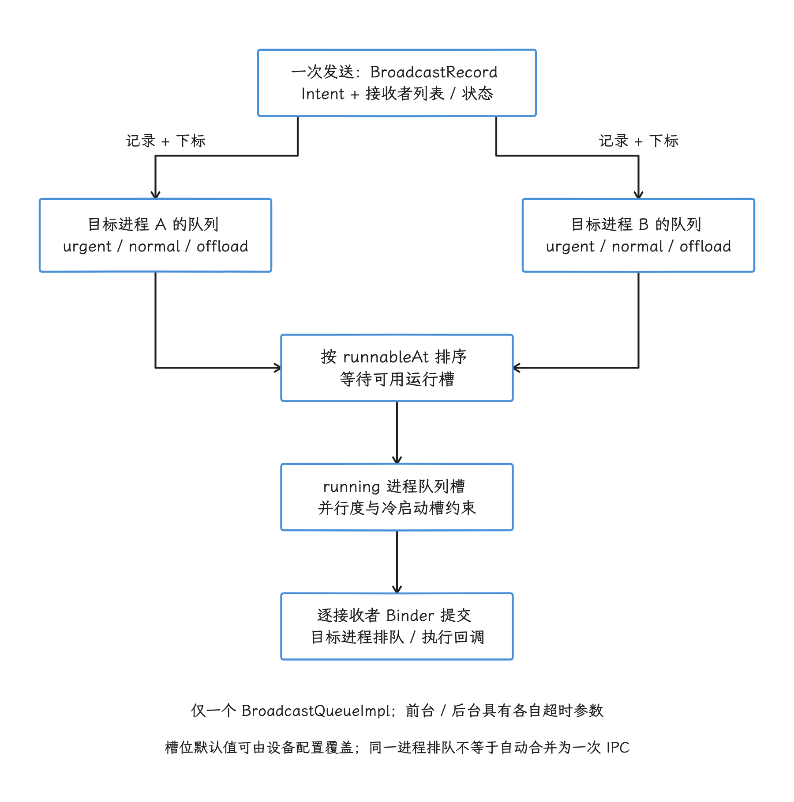
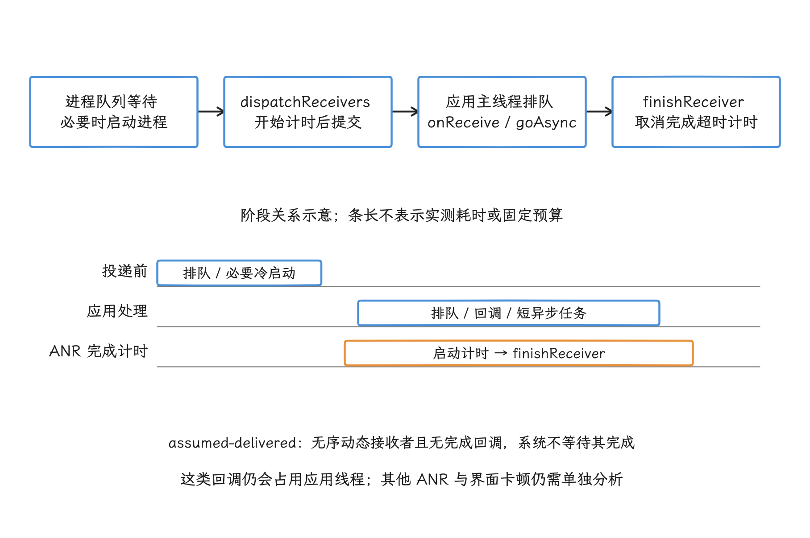

# Android 17 BroadcastQueue 进程级调度与广播性能边界

Android 广播是一种受系统策略调度的事件分发机制。调用 `sendBroadcast()` 只说明系统接受了发送请求，接收方未必立刻执行。目标进程是否存活、是否处于缓存进程状态（cached）、接收者类型、广播是否有序，以及可并行投递的进程槽是否空闲，都会改变投递时间。

> 源码基线：AOSP `android-17.0.0_r1`。

早期 Android 示意图里“前台一条队列、后台一条队列”的结构，在 Android 17 上已经找不到了，第一节会专门说明。理解广播性能，可以从三个层次入手：`BroadcastRecord` 记录一次发送和它的接收者，`BroadcastProcessQueue` 记录每个目标进程的待投递项，进程调度槽决定同一时刻有多少个进程队列在投递。

本章按这个顺序展开：第二节讲这三层结构，第三节跟一遍从 `sendBroadcast()` 到 `onReceive()` 的调用路径，第四到第六节分别讲优先级与顺序、cached 进程的延迟和广播 ANR 计时，第七到第十节给应用侧取舍、排查手段、版本差异和源码锚点。

## 一、Android 17 只有一个 BroadcastQueue 实例

### 1.1 前台与后台：两套超时参数，一条队列

我们从一个容易搞错的地方说起。API 37 的 `ActivityManagerService` 只持有一个 `mBroadcastQueue`；`ActivityManagerService.Injector.getBroadcastQueue()` 创建的是两个 `BroadcastConstants`：

- `foreConstants.TIMEOUT = BROADCAST_FG_TIMEOUT`；
- `backConstants.TIMEOUT = BROADCAST_BG_TIMEOUT`；
- 两者共同传给一个 `BroadcastQueueImpl`。

也就是说，前台和后台分开的只是超时参数。旧示意图里 `mFgBroadcastQueue`、`mBgBroadcastQueue` 两条独立队列的画法，放到 Android 17 上已经对不上现状。`Intent.FLAG_RECEIVER_FOREGROUND` 仍然有效，但它改变的是紧急程度、接收进程的调度组和超时参数，记录本身仍在同一套队列里排队。

源码中的基准超时为：

| 类型 | API 37 基准值 | 选择条件 |
|---|---:|---|
| 前台广播 | `10 s × Build.HW_TIMEOUT_MULTIPLIER` | 带 `FLAG_RECEIVER_FOREGROUND` |
| 后台广播 | `60 s × Build.HW_TIMEOUT_MULTIPLIER` | 未带上述标志 |

这两个值是源码基准值，还能通过 `Settings.Global.BROADCAST_FG_CONSTANTS` 和 `BROADCAST_BG_CONSTANTS` 中的 `bcast_timeout` 覆盖，10 秒/60 秒只是起点，实际取值以设置为准。

### 1.2 API 37 的实现类 `BroadcastQueueImpl`

Android 17 的源码标签里已经找不到 `BroadcastQueueModernImpl.java`，队列实现只剩 `BroadcastQueueImpl` 一个类。类注释直接说明：广播按目标进程分发，每个进程由一个 `BroadcastProcessQueue` 表示。

框架内部的类名在开发分支和历史版本中发生过变化。应用可以依赖的始终是公开广播语义；设备究竟运行 Legacy 还是 Modern 模式，判断依据是当前源码里的类名，旧类名说明不了问题。

## 二、三层数据结构分别解决什么问题

### 2.1 `BroadcastRecord`：一次发送及其全部接收者

这一节我们自上而下把三层结构过一遍。发送侧，`BroadcastController.broadcastIntentLockedTraced()` 查询在清单中声明的接收者（manifest receiver）和运行时注册接收者，把结果合成一份接收者列表，构造出 `BroadcastRecord`。

一个 `BroadcastRecord` 保存发送者、Intent、广播选项、接收者列表，以及每个接收者自己的状态数组。API 37 的投递状态为：

| 状态 | 含义 | 是否终态 |
|---|---|---|
| `DELIVERY_PENDING` | 尚未调度 | 否 |
| `DELIVERY_SCHEDULED` | 已提交给目标进程，等待完成 | 否 |
| `DELIVERY_DEFERRED` | 因 cached 状态或延后投递（deferral）策略而推迟 | 否 |
| `DELIVERY_DELIVERED` | 已完成或系统按规则视为完成 | 是 |
| `DELIVERY_SKIPPED` | 被权限、进程状态或其他策略跳过 | 是 |
| `DELIVERY_TIMEOUT` | 接收者执行超时 | 是 |
| `DELIVERY_FAILURE` | 调度到进程失败 | 是 |

`APP_RECEIVE`、`CALL_IN_RECEIVE`、`CALL_DONE_RECEIVE` 描述的是 `BroadcastRecord.state` 这一层，即整条记录的执行状态；要看某个接收者走到哪一步，得读逐接收者的 `delivery[]` 数组。

### 2.2 `BroadcastProcessQueue`：同一目标进程的待投递项

`BroadcastQueueImpl.enqueueBroadcastLocked()` 不会把整个 `BroadcastRecord` 只放进一条全局 FIFO 队列：它遍历接收者，以 `processName + uid` 找到目标 `BroadcastProcessQueue`，将“记录 + 接收者下标”入队。

每个进程队列内部有三条待处理队列：

| 队列 | 进入条件 | 调度关系 |
|---|---|---|
| `mPendingUrgent` | `BroadcastRecord.isUrgent()` | 优先于 normal / offload，但有防饥饿限制 |
| `mPending` | 普通广播 | 位于 urgent 之后、offload 之前 |
| `mPendingOffload` | 隐藏标志 `FLAG_RECEIVER_OFFLOAD` | 系统内部使用，优先级最低 |

`Intent.java` 将 `FLAG_RECEIVER_OFFLOAD` 标记为 `@hide`，它的职责很窄：让这条记录进入 offload 调度类别。想找“允许系统延迟合并”的公开性能开关时，这个标志帮不上忙。

### 2.3 `runnable`（等待获得执行槽） 与 `running`（已占用执行槽）：控制跨进程并行度

有待处理项的进程队列会计算最早可运行时刻 `runnableAt`，按时间排序进入 `runnable` 链表等待执行槽；`updateRunningListLocked()` 再从链表中选取队列，放进固定大小的 `running` 数组并开始投递。跨进程并行度就由这个数组控制。

这套调度的默认值是：

- 普通设备最多同时运行 4 个普通进程队列；
- 低内存（low-RAM）设备最多同时运行 2 个；
- urgent 广播可额外使用 1 个槽；
- 同一时刻只允许发起 1 个广播冷启动。

这些值来自 `BroadcastConstants`，可由 `activity_manager_native_boot` DeviceConfig 配置项调整。额外的 urgent 槽解决的是紧急广播被普通槽堵住的情况：普通槽已占满时，紧急广播靠这个槽继续推进，所有广播的并行度并不会因此永久提高到 5。

<!-- gracker-diagram: ch01-14-process-queues -->


图：一个 BroadcastRecord 关联多个接收者；每个接收者以记录和下标进入 processName+uid 对应的进程队列。runnableAt 决定候选顺序，running 槽决定同时推进多少个进程队列；实际投递仍逐接收者发 Binder。

## 三、从发送到 `onReceive()` 的调用路径

下面的调用链把一次投递拆成“解析接收者”“排队”“拉起进程”和“执行回调”四段，后面讨论延迟时，我们说的都是这四段中的某一段：

```text
ContextImpl.sendBroadcast()
  → IActivityManager.broadcastIntentWithFeature()
  → BroadcastController.broadcastIntentLockedTraced()
      ├─ PackageManagerInternal.queryIntentReceivers()  // manifest receiver
      ├─ ReceiverResolver.queryIntent()                 // context-registered receiver
      └─ new BroadcastRecord(...)
  → BroadcastQueueImpl.enqueueBroadcastLocked()
      └─ 每个 receiver 入对应 BroadcastProcessQueue
  → updateRunnableList() → updateRunningListLocked()
      ├─ cold: scheduleReceiverColdLocked()
      │       → startProcessLocked()
      │       → onApplicationAttachedLocked()
      └─ warm: scheduleReceiverWarmLocked()
              ├─ IApplicationThread.scheduleRegisteredReceiver()
              └─ IApplicationThread.scheduleReceiver()
  → 应用进程 ActivityThread / ReceiverDispatcher
  → BroadcastReceiver.onReceive()
  → finishReceiver()（系统需要等待完成的投递）
```

这条链说明，广播总延迟至少包含接收者解析、进程队列等待、必要时的进程冷启动、Binder 调度、应用主线程排队和 `onReceive()` 执行。我们评估端到端延迟时，要把这几段加在一起；只测 `onReceive()` 方法体，看到的只是最后一段。

### 3.1 冷启动与逐接收者的 Binder 调用

目标进程不存在时，`scheduleReceiverColdLocked()` 请求启动进程；进程完成 attach（与 `system_server` 建立应用线程连接）后，再转入 `scheduleReceiverWarmLocked()`。同一进程的多条广播共用一个进程队列，可以在一次占用 `running` 槽期间连续处理若干项，减少调度槽的反复切换。

共用队列归共用队列，到了投递这一步，源码仍对每个接收者分别调用 `scheduleRegisteredReceiver()` 或 `scheduleReceiver()`，一条一条走 Binder。“同进程多个广播自动合并为一次 IPC”，在源码里找不到依据。

冷启动耗时同样要落到测量上：300～800 ms 没有平台层面的保证，Zygote 分支、存储冷热、`bindApplication`、应用初始化和设备负载都会改变结果，真实数字要用进程启动轨迹与广播轨迹在目标设备上测量。

### 3.2 运行时接收者与清单接收者的完成语义

对于无序、没有完成回调（completion callback）的运行时注册接收者，`BroadcastRecord.isAssumedDelivered()` 返回 `true`：`system_server` 成功发出 `scheduleRegisteredReceiver()` 后，就把该项标记为已投递（delivered），既不等待应用回报，也不为它启动广播 ANR 定时器。

反过来，以下投递要等 `finishReceiver()`，并受广播超时跟踪：

- 清单接收者；
- 有序广播接收者；
- 带完成回调、超出“假定已投递”（assumed-delivered）适用范围的投递。

还有一层容易被看漏：BroadcastQueue 虽然不等这类投递的完成回执，无序动态接收者照样占用自己应用的主线程——这次投递仍会阻塞该应用的 UI 和后续消息，可能触发输入、前台服务等其他类型的 ANR。

## 四、优先级、顺序与避免低优先级长期等待

这一节回答三个问题：哪些广播算 urgent、接收者 `priority` 在哪一层生效、有序广播怎样串行。

### 4.1 `urgent` 的判定条件

Android 的 `Intent` 里并没有 `PRIORITY_URGENT_APP`、`PRIORITY_NORMAL_APP` 这组广播字符串。urgent 与否由系统判定，我们直接看条件：API 37 的 `BroadcastRecord.calculateUrgent()` 在以下情况返回 `true`：

- Intent 带 `FLAG_RECEIVER_FOREGROUND`；
- `BroadcastOptions` 将其标记为交互型（interactive）广播；
- `BroadcastOptions` 将其标记为闹钟广播（alarm broadcast）。

后两项主要供系统组件使用。普通应用拿前台接收者标志抢占调度，代价要一起算上：接收者会以更高调度优先级运行，广播超时基准也同时缩短到 10 秒。

### 4.2 接收者 `priority` 的生效范围

`IntentFilter` 的 `priority` 仍是整数，但 Android 16 起公开行为多了两项限制：优先级只保证在同一应用进程内生效；应用可设置的值也被限制在系统保留上下界之间。

所以两个应用即便为同一个广播设置了不同 `priority`，这个数字也定不了跨应用的接收顺序。需要请求 / 响应、确认或全序处理时，应改用 Binder 服务、明确的任务队列或持久化协调机制。

### 4.3 有序广播的接收者依赖

有序广播的第 N 个接收者，要等第 N-1 个接收者到达终态或延后（deferred）状态后才能继续；无序广播的接收者没有这条依赖，可以分散到多个进程队列并行推进——不过“并行”到此为止：同时执行的进程数仍受 `running` 槽、单冷启动槽、目标进程主线程和 cached 策略限制。

进程队列内部按 `urgent` → `normal` → `offload` 选择下一项，同时用两个上限防止低优先级长期等待：默认连续 3 个 `urgent` 后会考虑更早入队的低优先级项，连续 10 个 `normal` 后也会考虑 `offload` 项。若低优先级项被有序广播依赖挡住，就只能等依赖解除。

## 五、cached 进程的投递延迟

### 5.1 Android 14 起的公开行为

先看 Android 14 起定下的公开行为：应用处于 cached 状态时，系统可以延后运行时注册接收者的广播；应用重新拥有活跃组件、回到 active（有活跃组件） 状态后，系统再投递积压项，某些广播的多个实例还可能被合并。

清单接收者不走这条无限延迟路径：重要的清单广播可以让应用离开 cached 状态并启动接收进程。把“cached 进程的所有广播都要等待其他原因启动进程”当成统一规则，会直接漏掉这批投递。

### 5.2 API 37 如何计算 `runnableAt`

`BroadcastProcessQueue.updateRunnableAt()` 按队列内容和进程状态选择原因，默认调度偏移包括：

| 条件 | 默认偏移 | 含义 |
|---|---:|---|
| urgent / foreground / instrumented（测试插桩进程） | `-120 s` | 排序时强烈前移，不代表提前执行 |
| ordered / alarm / prioritized / manifest | `0` | 不加普通广播的短暂等待余量 |
| 普通广播 | `+500 ms` | 给快速变化事件留出调度余量 |
| cached 且不能无限延后 | `+120 s` | 延后处理 |
| cached 且全部记录 `deferUntilActive` | `Long.MAX_VALUE` | 等进程变为 active 或条件变化 |

我们记住这张表的性质就够了：它们是 DeviceConfig 默认值，不是 API 时延承诺。积压有兜底，队列积压上限 `MAX_PENDING_BROADCASTS` 普通设备默认 256、低内存设备默认 128；达到上限后，代码会绕过已施加的延迟，帮助队列排空。

### 5.3 延后投递与 delivery group 的分工

API 34 加入的 `BroadcastOptions` 提供两组不同能力：

- `setDeferralPolicy(DEFERRAL_POLICY_UNTIL_ACTIVE)`：允许把符合条件的运行时接收者延后到进程 active；它不适用于有序、闹钟、交互型广播和清单接收者；
- `setDeliveryGroupPolicy(DELIVERY_GROUP_POLICY_MOST_RECENT)`：投递组（delivery group）内的待投递项只保留最近一条，旧的被跳过。

对带完成回调（completion callback）的无序广播，`DEFERRAL_POLICY_UNTIL_ACTIVE` 还有一个容易误读的地方：处于 inactive / cached 进程状态的接收者不计入“回调完成前必须接收”的 eligible 集合。完成回调到达时，它覆盖的只是这个集合，这部分 cached 接收者可能还没执行。

两组能力解决的是两个维度的问题：延后策略决定何时投递，投递组决定积压项是否都要投递。没有显式投递组策略时，系统不会因为接收者在同一进程就自动合并任意广播。

`FLAG_RECEIVER_REPLACE_PENDING` 也只替换同时满足发送 UID（用户标识）、用户、Intent 匹配、接收者和其他条件的待处理项，对整个 `action` 或整个进程都没有无条件去重。

### 5.4 freezer 与广播队列的互动

freezer 是 Android 的应用进程冻结机制。广播队列会观察进程是否可冻结，并在状态变化时重新计算 runnable / deferred 状态；若接收进程已进入 `running` 投递，系统还会更新该进程的 OOM adj 和冻结状态，保证回调能够执行。

API 37 另有受 feature flag 控制的发送方广播延迟：可冻结的发送进程产生的广播，可以先暂存在它自己的进程队列，等进程恢复后再进入正式队列。这条发送方延迟，与接收方处于 cached 状态时的延迟投递走的是两条路径。

## 六、广播 ANR 的计时方式

### 6.1 定时器在提交给接收进程之前启动

排查广播超时，我们先要确认定时器的起点。`dispatchReceivers()` 在调用 `scheduleRegisteredReceiver()` 或 `scheduleReceiver()` 之前启动 `AnrTimer`，投递完成后由 `finishReceiverLocked()` 取消；超时会把该接收者标为 `DELIVERY_TIMEOUT`，随后调用 `appNotResponding()`。

队列等待和广播触发的冷启动都发生在定时器启动之前。所以一条广播端到端等了很久，接收者可能还没进入计时——排障时要把调度延迟和完成延迟分开看。

### 6.2 `goAsync()` 与完成窗口

需要异步完成的接收者可以调用 `goAsync()` 取得 `PendingResult`，在短任务结束后调用 `finish()`。对于需要 `system_server` 等待完成的投递，ANR 定时器并不因 `goAsync()` 自动取消。

<!-- gracker-diagram: ch01-14-completion-timeout-window -->


图：这里限定系统已就绪、需要完成回执且没有超时豁免的投递。队列等待与必要冷启动先发生；dispatchReceivers 在 Binder 提交前启动完成计时，直到 finishReceiver。goAsync 延长完成回执到 finish，不会暂停这段计时。

长时间网络、磁盘扫描、数据库迁移等工作，留在广播完成窗口里并不合适；接收者更适合做参数校验、去重和任务入队。提交点怎么划、执行交给哪类机制，见 7.4。

### 6.3 从 ANR 文件看哪一段卡住

广播 ANR 的 `TimeoutRecord` 描述包含 Intent、接收包名和类名。拿到记录后，我们至少核对这几项：

1. 当前接收者是清单接收者、有序接收者，还是带完成回调的动态接收者；
2. 主线程在执行 Java/Kotlin 代码、等待锁、Binder 调用还是文件 I/O；
3. 是否调用 `goAsync()` 后遗漏 `finish()`；
4. 广播是否带 `FLAG_RECEIVER_FOREGROUND`，从而使用 10 秒基准；
5. 系统轨迹中的长时间出现在调度前排队，还是提交给应用后执行。

## 七、应用侧常见误区

### 7.1 清单接收者与动态接收者的选择

清单接收者的 IntentFilter 在安装阶段就解析完，看起来便宜；真到投递时仍要查询并做权限 / 可见性检查，而且这条路径能启动尚未运行的进程。Android 8 起，多数隐式广播已限制面向 API 26+ 的应用随意静态注册。

两类接收者各管一段：动态接收者适合只在页面、服务或进程存活期间关注的事件；清单接收者适合需要在进程不存在时接收、且平台允许静态注册的事件。按生命周期与后台启动语义选择即可，至于哪个更快，交给测量回答。

### 7.2 `RECEIVER_NOT_EXPORTED` 的安全语义

面向 Android 14 的应用注册非纯系统广播接收者时，需要显式选择 `RECEIVER_EXPORTED` 或 `RECEIVER_NOT_EXPORTED`。`RECEIVER_NOT_EXPORTED` 限制的是可向该接收者发送广播的外部身份；它仍然注册在 `system_server` 中，仍然走广播分发路径执行。

如果接收者要接收的系统广播来自 Bluetooth、telephony 这类高权限、不以 system UID 运行的框架组件，官方文档建议使用 `RECEIVER_EXPORTED`；选择导出时又要配套私有 action、权限或发送方校验，因为其他应用也可能向导出接收者发送未保护广播。

`RECEIVER_NOT_EXPORTED` 收紧的是发送方身份，性能上没有附带的好处：它没有把广播自动变成进程内函数调用；省去 PackageManager 查询或 Binder IPC 这笔账，也记不到它头上。若事件只在一个进程内使用，直接回调、`Flow` 或应用自己的事件模型更简单。

### 7.3 广播与低延迟 IPC 的分工

官方文档明确不保证广播投递时延。需要同步响应、调用结果、稳定低延迟，或接收方处理不过来时让发送方减速的背压机制，应使用绑定服务（bound service）或 AIDL；广播适合一次发送、多个可能接收者的事件通知。

发送侧我们能做的，是把接收范围缩到最小：

- 私有 `action` 使用应用包名前缀；
- 已知目标时使用显式组件（explicit component）或 `Intent.setPackage()`；
- 对跨应用广播设置发送/接收权限；
- 高频状态变化只发送必要字段，或通知接收方读取权威状态源；
- 需要去重时明确使用 delivery group，让系统按声明的规则执行，业务语义它猜不到。

### 7.4 `goAsync()` 的提交点与失败语义

`goAsync()` 只把完成回执从 `onReceive()` 返回点延后到 `PendingResult.finish()`，既不暂停广播 ANR 计时，也不给进程持久任务保证。实现时先把提交点定义清楚：幂等任务已持久化入队、有序广播结果已写完，或短任务确实完成；随后在 `finally` 中调用 `finish()`。只启动一条不受生命周期管理的裸线程、再立刻结束接收者，进程可能在工作完成前就被回收。

短异步任务也应放进应用级协程作用域（scope）、独立调度器（dispatcher），并设置一个短于系统窗口的内部截止时间（deadline）。下载、上传、数据库迁移、大目录扫描以及要求进程死亡后重试的任务，由接收者做快速校验和去重，再交给 WorkManager、JobScheduler 或有明确生命周期的服务。

### 7.5 sticky、系统事件与业务状态的分工

sticky broadcast（粘性广播）保存的是最近一次 Intent，后注册的接收者可立即取得它；它没有版本、一致性和事务语义，承载不了状态仓库的职责。平台仍保留少量系统粘性事件；业务状态方面，普通应用要避免新增 sticky 协议。需要当前值时优先读取权威存储，把广播当作“状态可能变化”的通知。

`BOOT_COMPLETED` 和 `PACKAGE_*` 事件尤其容易形成启动风暴——大量应用在短时间内被事件集中唤起。接收者内我们只做 `action`、用户、包名校验、幂等去重和任务入队；包扫描、索引重建与网络同步交给受约束任务，并把同一启动周期内的重复事件合并。发送端调用很快返回，只说明 AMS 接受了请求，说明不了下游是否完成；端到端指标必须包含系统排队、必要的进程启动和应用执行。

## 八、可观测性

### 8.1 查看队列快照与当前常量

排查广播问题，我们先用这几条命令确认设备当前的队列、历史记录和可调参数，避免只按 AOSP 默认值推断：

```bash
adb shell dumpsys activity broadcasts
adb shell dumpsys activity broadcast-stats

adb shell cmd activity get-broadcast-constant bcast_max_running_process_queues
adb shell cmd activity get-broadcast-constant bcast_delay_normal_millis
adb shell cmd activity get-broadcast-constant bcast_delay_cached_millis
adb shell cmd activity get-broadcast-constant bcast_timeout
```

`dumpsys activity broadcasts` 会打印每个 `BroadcastProcessQueue` 的待处理 / 活跃状态、`runnableAt` 原因、历史记录，以及前台 / 后台常量。`get-broadcast-constant` 返回 BroadcastQueue 当前读取到的配置；注意 `bcast_timeout` 的结果取自前台常量实例，后台超时仍要在完整输出中核对。

### 8.2 Perfetto 轨迹中的广播事件

API 37 定义了 `broadcasts` Perfetto SDK 分类。启用相关 v3 跟踪功能后，每个接收者完成时可产生名为 `broadcast_delivered` 的瞬时事件（instant event），并附带结构化字段：

- 发送方 / 接收方 UID、PID（进程 ID） 和进程状态；
- `action`、接收者类型；
- cold（需要启动）/ warm（进程已存在）启动类型；
- `dispatch_delay_ms`、`receive_delay_ms`、`finish_delay_ms`；
- Intent 标志、接收者优先级、delivery group 策略。

当前进程级实现把 `receive_delay_ms` 记为 0，因为“被进程队列选中”和“提交给应用”之间没有旧实现中的独立阶段。分析时我们重点看两个值：

- `dispatch_delay_ms = scheduledTime - enqueueTime`：包含队列等待及冷启动影响；
- `finish_delay_ms = terminalTime - scheduledTime`：包含应用侧执行与完成回执。

写 SQL 前先在目标轨迹中确认存在 `broadcast_delivered`，再通过 `slice` / `args` 表查看该版本导出的参数名，别照搬依赖不存在字段或别名的语句。没启用 SDK 分类时，仍可结合传统 ActivityManager trace 中 `BroadcastQueue` 的 `enqueueBroadcast`、`updateRunningList`、`scheduleReceiverWarmLocked`、`finishReceiver` 等方法片段，加上 `BroadcastQueue.mRunning[N]` 进程队列片段、应用主线程时间片、`sched` 调度事件和 Binder 轨道还原延迟。

### 8.3 一次可靠的广播性能实验

我们按下面的清单搭实验，重点是控制变量、记录现场配置：

1. 记录 `action`、发送 UID、接收者类型、有序 / 前台 / 延后 / delivery group 配置；
2. 分别测量 warm、cached 和 cold 进程；
3. 同时记录发送时刻、`onReceive()` 开始、异步 `finish()` 和业务完成时刻；
4. 用系统轨迹对齐进程启动、`system_server` 队列、Binder 和应用主线程；
5. 报告 P50 / P90 / P99 分位数，并记录设备温度、CPU 负载和构建类型；
6. 用 `dumpsys` 保存实验时的 BroadcastConstants，避免配置在实验期间变化。

## 九、版本差异

- Android 8 / API 26：面向 API 26+ 的应用受到清单隐式广播限制；
- Android 14 / API 34：cached 进程的运行时注册广播可以延后，并公开 `BroadcastOptions` 延后 API；
- Android 16 / API 36：跨进程接收者优先级顺序不再保证，`priority` 只在同一应用进程内有效；
- Android 17 / API 37：源码结构以 `BroadcastQueueImpl`、`BroadcastProcessQueue` 和逐接收者 `delivery[]` 为准。

## 十、源码锚点

- 发送与接收者解析：
  - `frameworks/base/core/java/android/app/ContextImpl.java`
  - `frameworks/base/services/core/java/com/android/server/am/BroadcastController.java`
- 队列与调度：
  - `frameworks/base/services/core/java/com/android/server/am/BroadcastQueueImpl.java`
  - `frameworks/base/services/core/java/com/android/server/am/BroadcastProcessQueue.java`
  - `frameworks/base/services/core/java/com/android/server/am/BroadcastRecord.java`
  - `frameworks/base/services/core/java/com/android/server/am/BroadcastConstants.java`
- 标志与公开选项：
  - `frameworks/base/core/java/android/content/Intent.java`
  - `frameworks/base/core/java/android/app/BroadcastOptions.java`
- 跟踪：
  - `frameworks/base/core/java/android/os/PerfettoCategories.java`
  - `BroadcastQueueImpl.logBroadcastDeliveryEventReported()`
- 官方行为说明：
  - [Broadcasts overview](https://developer.android.com/develop/background-work/background-tasks/broadcasts)
  - [Android 14 behavior changes](https://developer.android.com/about/versions/14/behavior-changes-all#cached-broadcasts)
  - [BroadcastOptions API](https://developer.android.com/reference/android/app/BroadcastOptions)

广播调度在及时性、进程启动成本、cached 状态和系统健康之间权衡，不保证每一条事件都立即唤醒每一个进程。分析时我们先判断接收者为什么此刻可运行，再区分排队、冷启动、Binder 提交和应用执行，进而决定是优化接收者、调整发送策略，还是改用更合适的 IPC 或任务机制。
