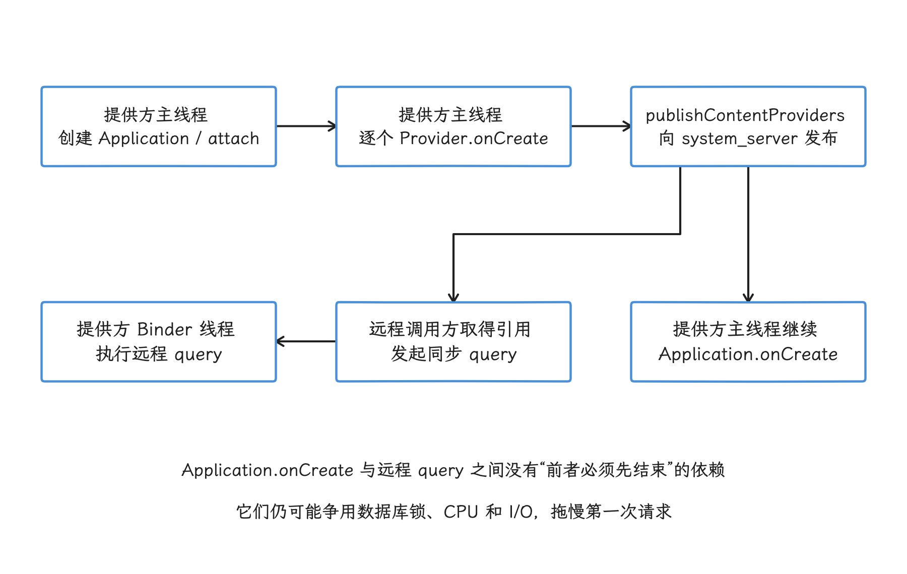
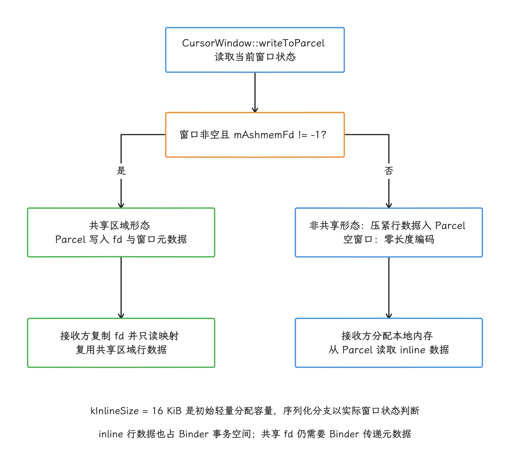
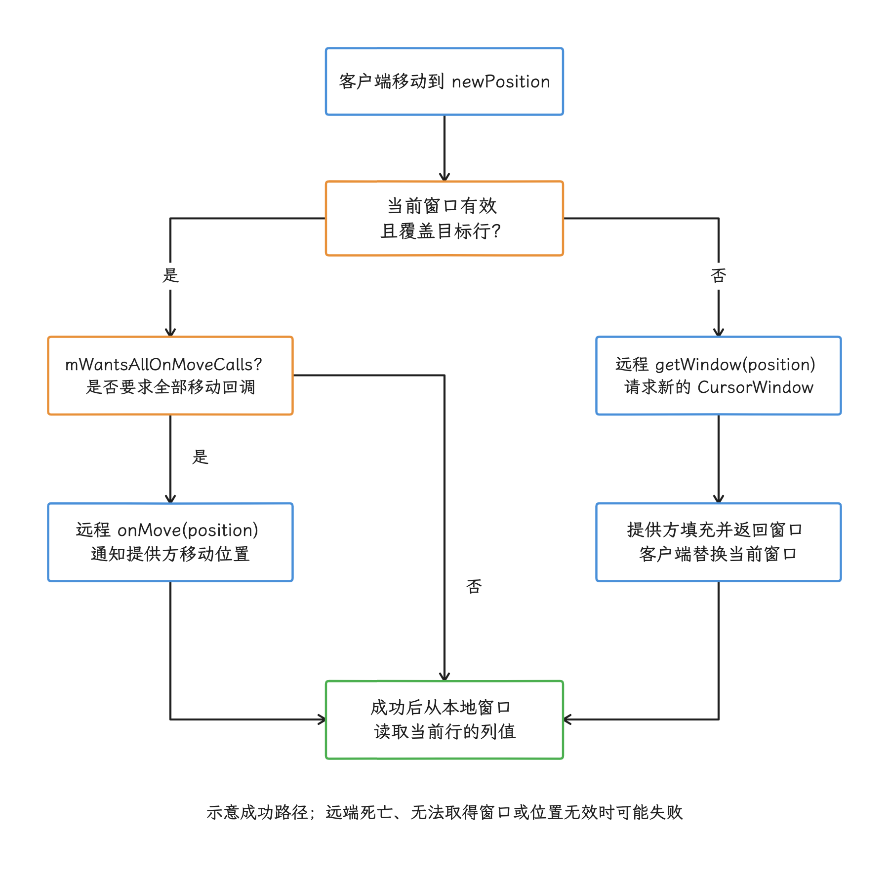

# ContentProvider 性能与优化

ContentProvider（内容提供组件，下文简称 Provider）同时出现在两条关键路径上：

- 应用进程首次创建并绑定 Application 时，当前进程声明的 Provider 会早于 `Application.onCreate()` 初始化；
- 跨进程访问数据时，调用方通过 Binder 同步进入提供方，查询结果再借助游标窗口 `CursorWindow` 分批传递。

前一条路径影响冷启动；后一条路径容易造成主线程阻塞、Binder 线程池排队和数据库 I/O。我们分析 ContentProvider 问题时，先确认调用发生在同一进程还是跨进程、提供方已经运行还是正在冷启动，再检查具体 URI 和查询参数。

> 源码基线：AOSP `android-17.0.0_r1`；Android 8～16 的差异只在“版本演进”一节说明。

---

## ContentProvider 在系统中的位置

要看懂 Provider 的性能行为，先看它把哪些角色拉进了同一次调用。ContentProvider 为结构化数据提供统一的 URI、权限和调用协议：在 `content://authority/path` 中，`authority` 是定位 Provider 的唯一标识，`path` 和查询参数由 Provider 自己解释。

一次访问涉及三方：

| 参与者 | 主要对象 | 职责 |
|---|---|---|
| 调用方 | `ContentResolver`、`ContentProviderClient` | 解析 URI、取得 Provider、发起同步调用、管理引用 |
| `system_server` | `ContentProviderHelper`、`ContentProviderRecord` | 按 `authority` 查找 Provider，必要时启动进程，跟踪发布和引用关系 |
| 提供方 | `ContentProvider`、内部 `Transport` | 校验传入身份与权限，执行 `query()`、`insert()`、`update()`、`delete()` 等实际逻辑 |

`ContentProvider.Transport` 是 Binder 服务端桩（Stub），负责接收并分派请求。跨进程调用会进入提供方的 Binder 线程；同进程调用则可以取得本地 Provider 引用，直接在调用方线程执行。于是同一个 `query()` 可能运行在完全不同的线程模型里：

```text
同进程：
调用线程 → ContentProvider.query()

跨进程：
调用线程 → IContentProvider Proxy → Binder
        → 提供方 Binder 线程 → ContentProvider.Transport.query()
        → ContentProvider.query()
```

Provider 调用未必经过 Binder；要确认某次调用是否跨进程，应结合调用双方 PID、当前生命周期以及 Binder 事务或 flow。只有在采集覆盖完整时，缺少某类事件才有排除意义，不能从“没采到 Binder”反推一定是同进程。

### 权限检查发生在哪里

Provider 可以通过 `readPermission`、`writePermission`、路径级权限（path permission）和临时 URI 授权（URI grant）控制访问。`Transport` 会校验 `authority`、用于标识实际调用方的归因信息，以及读写权限，再把请求交给 Provider 实现。

性能优化要在这层安全语义之内进行，落到实现上就是：

- 只导出需要跨应用访问的 Provider；
- 只对需要共享的最小 URI 范围发放临时授权；
- `selection` 使用占位符和 `selectionArgs`，不要直接拼接调用方传入的字符串；
- `call()`、`openFile()` 等自定义入口同样要设计好权限约束。

---

## 进程启动时，为什么 Provider 早于 `Application.onCreate()`

要看清这个顺序，我们直接跟一遍 `ActivityThread.handleBindApplication()`：它先创建 Application 对象，执行完 `Application.attach()` 后，`attachBaseContext()` 也已经完成，随后主线程按以下顺序继续：

```text
makeApplicationInner()
  → Application.attach() / attachBaseContext()
  → installContentProviders()
      → installProvider()
          → ContentProvider.attachInfo()
              → ContentProvider.onCreate()
      → publishContentProviders()
  → Instrumentation.callApplicationOnCreate()
      → Application.onCreate()
```

从这段顺序可以读出三件事：Provider 的 `onCreate()` 在主线程执行；同一进程的 Provider 逐个安装，全部装完才一起发布给 `system_server`；`Application.attachBaseContext()` 在 Provider 初始化之前，`Application.onCreate()` 在发布之后。

只要有一个 Provider 在 `onCreate()` 里做磁盘扫描、数据库迁移、同步网络等待或复杂依赖初始化，后面的 Provider 和 `Application.onCreate()` 就都被推迟了；这时远程调用方也可能正等着这个进程发布 Provider。

### `initOrder` 的排序语义

`ComputerEngine.queryContentProviders()` 按 `ProviderInfo.initOrder` 降序排列，值大的先安装。比较器（comparator）对相同值返回 0，所以源码明确保证的只有不同数值之间的先后，两个同值 Provider 谁先安装，源码层面没有承诺。

组件之间存在依赖时，要么明确声明依赖关系，要么由应用在可控入口统一组织初始化顺序；两个库碰巧选了不同 `initOrder` 凑出的先后，靠不住。

### 远程 Provider 冷启动

调用方请求的 Provider 进程尚未运行时，`system_server` 会先把进程拉起来，调用方在原地等待：

```text
fork 进程
  → 运行时和 APK 加载
  → Application.attachBaseContext()
  → 安装当前进程 Provider
  → publishContentProviders()
  → 调用方取得 IContentProvider
  → 执行本次请求
```

这条等待链里通常没有 `Application.onCreate()`——它在 Provider 发布之后才执行。不过 Provider 一经发布，远程 Binder 请求就可能与提供方主线程的 `Application.onCreate()` 并发执行；一旦二者争用同一数据库锁、CPU 或 I/O，第一次 `query()` 仍会被间接拖慢。

<!-- gracker-diagram: ch01-15-provider-publication -->


图：当前进程的 Application.attachBaseContext 完成后，主线程逐个安装 Provider 并调用 onCreate，然后一起发布。远程调用方取得引用后即可发请求，不需要等 Application.onCreate 结束。

---

## 跨进程查询怎样返回 Cursor

拿到 Provider 引用之后，我们最常打交道的还是查询。`query()` 是同步 API，调用方线程会一直等 Provider 返回可用的游标（Cursor，用于逐行读取查询结果）；这个等待一旦发生在主线程，远程进程冷启动、数据库锁和磁盘 I/O 都会直接变成界面卡顿。

### `CursorWindow` 的窗口传输

跨进程 Cursor 的结果按 `CursorWindow` 分批传递，并不会无条件把整个结果集一次性序列化。原生窗口有两种传输形态：初始使用轻量 inline 分配，空间不足时才膨胀为共享区域。`CursorWindow::writeToParcel()` 对已使用共享区域的非空窗口写入文件描述符和元数据；对非共享窗口，则把压紧后的行数据直接写入 Parcel。调用方一侧由 `BulkCursorToCursorAdaptor` 管理当前窗口，所以小窗口的行数据仍可能占 Binder 事务空间，这也是一条实际路径。参见 [CursorWindow.cpp @ android-17.0.0_r1](https://android.googlesource.com/platform/frameworks/base/+/android-17.0.0_r1/libs/androidfw/CursorWindow.cpp)。

窗口的大小由配置决定：`config_cursorWindowSize` 在 AOSP 中默认为 2048 KiB，产品配置可以覆盖该值，公开构造函数 `CursorWindow(String, long)` 也允许调用方为单个窗口指定容量，所以这是一层可调的默认配置。原生窗口初始只分配配置容量与 `kInlineSize = 16384` 字节中的较小值，需要更多空间时才扩展到配置的共享区域；映射大小和实际物理驻留量还要分开观察。这里的 16 KiB 是源码中的 inline 初始容量，与 Binder 单笔事务上限是两回事。

<!-- gracker-diagram: ch01-15-cursor-window-encoding -->


图：writeToParcel 根据窗口当前是否拥有共享区域 fd 选择编码；已膨胀的窗口不会仅因本次行数据变少就自动按大小改回 inline。两条路径都有元数据和 Binder 控制开销。

窗口减少了大结果集的复制，但容量仍然有限：一个窗口装不下全部结果时，调用方一旦移动到窗口之外的行，`BulkCursorToCursorAdaptor` 就会调用远端 `getWindow(newPosition)` 取得新窗口；若 Provider 要求接收所有游标移动事件，即使目标仍在当前窗口，也可能调用远端 `onMove()`。

顺带澄清一个常见印象：“`moveToNext()` 永远不走 Binder”。在当前窗口内读取列值，通常不需要远程取数；但窗口失效、越界或 Provider 请求所有移动回调时，仍会发生 Binder 往返。

<!-- gracker-diagram: ch01-15-cursor-window-movement -->


图：BulkCursorToCursorAdaptor 先检查目标位置是否被当前窗口覆盖；未覆盖时远程 getWindow。窗口内还要检查 mWantsAllOnMoveCalls，要求时仍远程通知 onMove；成功后再从本地窗口读列值。

### 深位置访问为什么会变慢

再看深位置访问为什么变慢。SQLite 查询返回 `SQLiteCursor` 时，窗口填充路径是：

```text
SQLiteCursor.onMove()
  → SQLiteCursor.fillWindow(requiredPos)
  → SQLiteQuery.fillWindow(window, startPos, requiredPos, countAllRows)
  → SQLiteSession.executeForCursorWindow(...)
```

这条路径上，框架并不会替我们把原 SQL 自动改写成高效的基于键值分页（keyset pagination）。调用方访问结果集中很靠后的位置时，底层查询仍可能遍历大量前序结果才能填充目标窗口。对于数据量大且需要翻页的接口，应该让 Provider 直接提供分页条件，例如：

```sql
SELECT _id, title
FROM article
WHERE _id > ?
ORDER BY _id
LIMIT ?
```

这类分页以上一页最后一条记录的排序键为起点，需要匹配的索引和稳定的排序键；它优化的是数据库查询计划，单纯调大 `CursorWindow` 替代不了这一层。

### Binder 缓冲区的容量与占用

窗口之外，Parcel 层还有一块共享资源要盯住：在 `frameworks/native/libs/binder/ProcessState.cpp` 中，Binder 缓冲区的默认映射大小为 `1 MiB - 2 × 系统页大小`，一个进程内所有进行中的 Binder 事务共享这块空间，并非每次调用都独享 1 MiB。

共享区域形态的 `CursorWindow` 通过 fd 传递其行数据访问能力；inline 形态会把压紧后的行数据直接写入 Parcel。除这类小窗口数据外，下列内容也会占用 Binder 事务空间：

- URI、查询列清单（`projection`）、筛选条件（`selection`）、参数和附加数据（extras）；
- `ContentValues`、`Bundle`、`ContentProviderOperation` 数组；
- 返回的元数据、异常和文件描述符；
- 同一进程并发进行的其他 Binder 请求。

`applyBatch()` 的批次大小是个权衡：增大批次能减少往返次数，却可能让单笔 Parcel 序列化数据过大，并触发 `TransactionTooLargeException`。具体取值应根据真实数据分布测试确定。

图片、视频和大文件应通过 `openFile()`、`openAssetFile()` 或 `openTypedAssetFile()` 返回 `ParcelFileDescriptor`，避免塞进 `Bundle` 或 `ContentValues`。

---

## 稳定与非稳定的 Provider 客户端

使用 Provider 时还有一组选择：客户端引用的形态。`ContentResolver.acquireContentProviderClient()` 返回稳定客户端（stable client）：系统会把 Provider 视为调用方的稳定依赖，并据此处理 Provider 意外死亡对调用方进程的影响；调用方用完客户端后必须调用 `close()` 释放引用。

`acquireUnstableContentProviderClient()` 返回非稳定客户端，适合调用方不能假定 Provider 会持续存活的场景。Provider 进程死亡时，系统不按稳定引用的规则处理依赖进程，剩下的恢复工作由调用方自己完成：

- 捕获 `DeadObjectException`，它表示远端 Binder 对象已经死亡；
- 检查当前客户端是否已经失效，失效后关闭旧客户端；
- 需要时重新调用获取接口，让系统重启 Provider。

选择非稳定客户端主要改变进程依赖与死亡恢复责任；它不会自动优化慢查询，也不会额外提供通用的 CRUD 超时。实际延迟还受 Provider 存活、重启、重试与系统调度影响，不能保证两种引用方式的耗时完全相同。

---

## ContentProvider 的四类超时

Provider 相关的超时按路径分成四类，各有各的触发场景和后果；AOSP 标准值还会乘以 `Build.HW_TIMEOUT_MULTIPLIER`，所以表中的秒数是常规构建下的名义值：

| 场景 | 名义时间 | Android 17 实现 | 超时后的含义 |
|---|---:|---|---|
| 已完成绑定（attach）的进程发布 Provider | 10 秒 | `CONTENT_PROVIDER_PUBLISH_TIMEOUT_MILLIS` | `system_server` 清理正在启动的 Provider 记录，并以初始化失败为由移除提供方进程 |
| 调用方等待新进程发布 Provider | 20 秒 | `CONTENT_PROVIDER_READY_TIMEOUT_MILLIS` | 获取 Provider 的等待结束，返回失败或进入相应清理 |
| 已取得 Provider 后的 `getTypeAsync()` 等回调 | 3 秒 | 私有 `CONTENT_PROVIDER_TIMEOUT_MILLIS` | `ContentResolver` 停止等待并返回失败结果 |
| 普通 `query()` / `insert()` / `update()` / `delete()` | 无统一 Provider 超时 | 同步 Binder 调用 | 后果由调用线程所处场景、应用 ANR 条件或系统 API 监测决定 |

以 `ContentResolver.getType()` 为例：它拿不到现成的 Provider 连接时，会经过 `system_server` 的异步备用路径（fallback），等待上限由 20 秒的发布就绪等待与 3 秒的回调等待组合而来。这个上限只属于这条异步路径，CRUD 的等待语义见表中最后一行。

### Android 17 对取消请求的无响应监测

Android 17 在受权限保护的系统 API 中补充了两种监测入口，普通应用的统一 CRUD（增删改查）超时并没有因此出现：

- `setDetectNotRespondingOnCancel()` 从调用方发出取消后开始计时；
- `setCallNotCancelledTimeout()` 是测试入口，用来设置“调用开始后迟迟没有取消”的监测窗口；
- 原有 `setDetectNotResponding(fixed)` 在对应功能开关（feature flag）开启时仍保持固定时长语义。

计时到期后，`NotRespondingRunnable` 会通过 `ContentResolver.appNotRespondingViaProvider()` 通知系统处理已经连接但无响应的 Provider。这套机制供系统识别和处理故障，普通应用不会从中收到自动抛出的 `TimeoutException`。

### `setDetectNotResponding()` 的适用范围

`ContentProviderClient.setDetectNotResponding()` 是标有 `@SystemApi` / `@hide` 的系统接口，并要求 `REMOVE_TASKS` 权限；调用方为它设置时长后才会启用上面这套无响应监测。

这是有权限的客户端配置探测、再由系统处理目标 Provider 的入口；普通应用的业务等待与取消要自行设计：

- 在后台线程执行同步的 ContentResolver API；
- 为自己的业务请求设置超时；
- 向支持取消的 `query()` 传入 `CancellationSignal`；
- 超时后调用 `cancel()` 取消请求，并丢弃迟到结果。

取消采用协作方式：Provider 和数据库执行路径只有主动检查取消信号，操作才会及时停止。

下面的 Kotlin 代码让调度器在 5 秒后主动取消远程查询；这 5 秒是业务选择，Android 平台并没有对应的常量：

```kotlin
suspend fun queryWithTimeout(
    resolver: ContentResolver,
    uri: Uri,
    projection: Array<String>,
    scheduler: ScheduledExecutorService,
): Cursor? {
    return withContext(Dispatchers.IO) {
        val signal = CancellationSignal()
        val timeout = scheduler.schedule(
            { signal.cancel() },
            5,
            TimeUnit.SECONDS,
        )
        try {
            resolver.query(uri, projection, null, null, null, signal)
        } catch (_: OperationCanceledException) {
            null
        } finally {
            timeout.cancel(false)
        }
    }
}
```

调用方还要用 Kotlin 的 `use` 或其他资源管理方式及时关闭 Cursor，避免长期占用窗口和 Provider 引用。

---

## Binder 线程池如何耗尽

跨进程 Provider 的 CRUD 默认在提供方的 Binder 线程中执行。`ProcessState.cpp` 中的 `DEFAULT_MAX_BINDER_THREADS` 为 15，这只是默认配置；性能轨迹里实际出现多少条 Binder 线程，还取决于线程池的启动方式、主动加入线程池的线程和产品代码。

典型的耗尽过程是：

1. 多个调用方并发进入同一个 Provider；
2. 提供方 Binder 线程都在等待数据库写锁、文件 I/O 或下游 Binder；
3. 可执行 Binder 线程逐渐用尽；
4. 新请求在驱动或线程池中排队；
5. 调用方同步等待，随后可能触发所处场景的 ANR，或进入 Android 框架的 Provider 无响应处理。

Android 没有“`system_server` 心跳拿不到 Binder 线程，所以自动判定 ANR”这一通用机制；定位时我们按线程停住的位置区分三种情况：

- 调用方主线程停在 `IContentProvider` 客户端代理（Proxy）：正在等待远端返回；
- 提供方多条 Binder 线程停在同一锁或 I/O：并发请求受到同一串行瓶颈限制；
- 提供方主线程停在 `handleBindApplication()` 或 Provider `onCreate()`：Provider 还在冷启动或发布。

锁竞争是根因时，把 Provider 移到独立进程只是换了内存和线程池的隔离范围，竞争本身还在原地。

---

## 独立 Provider 进程的收益和代价

Manifest 中的 `android:process=":provider"` 会把 Provider 放入应用私有的独立进程：

```xml
<provider
    android:name=".ArticleProvider"
    android:authorities="${applicationId}.articles"
    android:exported="false"
    android:process=":provider" />
```

可能的收益包括：

- 独立的 Java 堆和垃圾回收（GC）；
- 独立 Binder 线程池；
- Provider 崩溃不一定直接终止主进程。

代价同样明确：

- 首次访问需要完整冷启动；
- 独立 Application 实例会重复初始化未区分进程的 SDK；
- 进程基础内存、类加载和页表成本增加；
- 调用全部变成 Binder 跨进程通信（IPC）；
- Provider 进程被回收后，下次访问要重新启动。

Provider 进程中的 GC 不会直接暂停主进程的 ART 线程，但可能延迟尚未完成的远程请求，因此调用方仍可能感知到停顿；是否影响本次返回要核对 GC 暂停与服务端工作、回复时序。

多个进程访问同一个 SQLite 文件时，预写日志（Write-Ahead Logging，WAL）通常能提高读写并发，但它是多进程访问的可选项，消除不了所有写入串行和 `SQLITE_BUSY`：数据库表与索引结构、事务长度、连接配置和跨进程数据失效通知，都要在目标设备上验证。

独立进程适合明确需要故障或内存隔离、且能接受冷启动成本的服务端数据组件；常规的数据库优化，一般走不到这一步。

---

## 启动阶段怎样减负

### `onCreate()` 里放什么、推迟什么

发布前必须完成的工作越少越好。可以保留：

- 保存应用级 Context；
- 创建轻量级依赖容器；
- 注册发布前必须可用的回调和系统资源引用。

应该推迟：

- 全库扫描和迁移后的预热；
- 同步网络请求；
- 大量磁盘读取；
- 与第一次 CRUD 无关的 SDK 初始化；
- 等待其他线程完成的阻塞任务。

推迟这些工作时也要有并发上的安排：Provider 的第一次 `query()` 可能马上到来，必要状态要用锁或一次性初始化状态等明确的并发协议保护，并允许取消或返回失败；把工作无条件丢到线程池，覆盖不了这些要求。

### 正确理解 Jetpack App Startup

Jetpack App Startup 使用一个 `InitializationProvider` 发现多个 `Initializer`，并根据 `dependencies()` 声明的依赖确定初始化顺序。它可以避免每个库各自声明一个初始化 Provider，但初始化代码本身仍然运行在启动路径上。

要让某个组件不自动初始化，需要从合并后的 Manifest 中移除对应的 `<meta-data>` 节点，再在真正需要时调用 `AppInitializer.initializeComponent()`——App Startup 的延迟初始化指的就是这套手动流程；框架里没有一个能自动把耗时任务移出启动路径的 `lazy` 标记。

收益必须用目标应用实测；“每减少一个 Provider 固定节省 2 ms”“必然提升 35%”这类没有设备、构建和样本条件的数字，不能拿来当优化依据。

---

## 减少跨进程成本

### 先减数据，再减调用次数

查询时具体控制这几件事：

- 明确 `projection`，只返回需要的列；
- 用 `selection` 与 `selectionArgs` 在数据库层过滤；
- 为筛选条件和排序字段建立合适的索引；
- 避免在单列中返回大型二进制对象（BLOB）或大段 JSON；
- 为列表接口设计稳定的分页规则。

批量写入可以使用 `bulkInsert()` 或 `applyBatch()`，但要控制每批 Parcel 数据的大小。下面的代码把多次插入组织为一次 `applyBatch()` 调用：

```java
ArrayList<ContentProviderOperation> operations = new ArrayList<>();
for (ContentValues values : pendingRows) {
    operations.add(
            ContentProviderOperation.newInsert(uri)
                    .withValues(values)
                    .build());
}
ContentProviderResult[] results =
        contentResolver.applyBatch(uri.getAuthority(), operations);
```

这段代码减少的只是调用次数。`ContentProvider.applyBatch()` 的默认实现只是逐个调用 `ContentProviderOperation.apply()`：它既不会自动开启 SQLite 事务，也不保证失败时回滚前面已经完成的操作。

若 Provider 要提供“全部成功或全部回滚”的原子批处理，必须在自己的存储层实现事务。下面的实现用 SQLite 事务包住整批操作：

```java
@Override
public ContentProviderResult[] applyBatch(
        ArrayList<ContentProviderOperation> operations)
        throws OperationApplicationException {
    SQLiteDatabase db = helper.getWritableDatabase();
    db.beginTransaction();
    try {
        ContentProviderResult[] result = super.applyBatch(operations);
        db.setTransactionSuccessful();
        return result;
    } finally {
        db.endTransaction();
    }
}
```

只有在 `setTransactionSuccessful()` 执行后，`endTransaction()` 才会提交这批修改，否则会回滚。调用方使用第三方 Provider 前，应查阅它的 `applyBatch()` 接口约定，确认原子性是否成立。

---

## 用 Perfetto 与线程栈互相印证

### 远程 CRUD

在 Perfetto 里定位 Provider 调用，靠的是 `ContentProvider.Transport` 用 `TRACE_TAG_ACTIVITY_MANAGER` 记录的这些名称：

- `query: <authority>`
- `insert: <authority>`
- `bulkInsert: <authority>`
- `applyBatch: <authority>`
- `delete: <authority>`
- `update: <authority>`
- `openFile: <authority>`
- `call: <authority>`

采集时启用 Activity Manager 的 atrace 事件分类，并同时记录 Binder、`sched` 调度事件、进程和文件系统 I/O。诊断时我们按以下顺序走：

1. 在调用方找到同步 Binder 等待；
2. 沿 Binder 事务定位提供方线程；
3. 查看 `query: authority` 等轨迹区段（slice）内发生的是 CPU 运行、锁等待还是 I/O；
4. 再看数据库线程、GC 和下游 Binder。

### Provider 初始化

`ActivityThread.installContentProviders()` 在固定源码中没有可依赖的同名 Trace 区段，冷启动分析时不要预设 Perfetto 里一定有名为 `installContentProviders` 的轨迹区段。

冷启动分析可以使用：

- `bindApplication` 所在主线程时间段；
- `Application.onCreate()` 的边界；
- Provider 用 `Trace.beginSection()` 添加的短时自定义区段；
- simpleperf 或 Perfetto 的调用栈采样（callstack sampling）；
- 提供方主线程的 ANR traces 栈；
- `system_server` 中记录进程启动和 Provider 发布的日志。

对于 SDK 或应用自定义的 Provider，在 `onCreate()` 内给每个可疑步骤分别加区段，比只给整个方法加一个区段有用得多。

### ANR 现场

至少同时保留：

- 调用方主线程；
- 提供方主线程；
- 提供方全部 Binder 线程；
- `system_server` 中相关 Provider 记录；
- 同时段的 EventLog 和系统日志；
- Perfetto 中的 Binder、调度、监视器锁竞争（monitor contention）和 I/O。

发布超时的源码原因字符串是 `timeout publishing content providers`；外部等待路径可见 `Timeout waiting for provider ...`。通过系统 API 设置无响应检测后，对应路径会记录 `ContentProvider not responding`。这些日志来自不同机制，判断 Provider 超时问题时，我们要按机制选择对应的关键字。

---

## 版本演进

| 版本 | 已确认变化 | 使用边界 |
|---|---|---|
| Android 9（API 28） | 公开 `CursorWindow(String, long)`，旧的本地/远程（local/remote）构造语义废弃 | 可指定窗口容量，但不能替代分页和索引 |
| Android 11（API 30） | 固定 tag 中可见 `ContentProviderClient.setDetectNotResponding()` 的系统/测试能力 | 需要系统权限，不属于普通应用 CRUD 超时 API |
| Android 12（API 31） | `ContentResolver.getType()` 内部使用 `getTypeAsync()` 回调 | 公开 API 仍是同步 `getType()`；应用仍应自行选择线程 |
| Android 17（API 37） | 当前实现基线，保留 10 秒发布、20 秒就绪等待、3 秒已连接异步回调的分层语义 | 数值受 `Build.HW_TIMEOUT_MULTIPLIER` 影响，CRUD 仍无统一 Provider 超时 |

这张表只收录能够由固定源码标签（tag）或官方 API 确认的变化。系统照片选择器（Photo Picker）、分区存储（Scoped Storage）等功能会改变数据访问方式，但这些功能描述本身不能证明 ContentProvider 的 Binder 调用或超时机制在该版本改变；要断言具体关联，仍需对应源码标签或 API 契约证据。

---

## 常见误区

### “Provider 一定运行在 Binder 线程”

同进程调用可以直接在调用方线程执行。只有跨进程调用才进入提供方 Binder 线程。

### “所有 Provider 都有 10 秒 CRUD 超时”

10 秒是进程完成绑定（attach）后的发布窗口。普通 CRUD 没有这个统一计时器。

### “CursorWindow 绕过了 Binder”

窗口可以通过共享区域 fd 或 inline 行数据传递；窗口描述、控制调用、翻页和其他参数仍通过 Binder。只有共享区域形态的行数据不需要作为普通 Parcel 数据再次传送。

### “多进程能消除数据库卡顿”

多进程把 Provider 与主进程隔离开，却增加了冷启动、内存和 IPC 成本。共享数据库的锁与 I/O 仍然存在。

### “App Startup 会自动延迟所有初始化”

它默认仍在 `InitializationProvider` 中运行 `Initializer`。要真正延迟初始化，需要从合并后的 Manifest 中移除对应的 `<meta-data>` 注册项，并在业务入口手动初始化。

### “批处理天然具有事务性”

Android 框架默认只让 `applyBatch()` 按顺序应用操作，事务语义由具体 Provider 实现。

---

## 源码阅读顺序

一次远程冷启动查询涉及以下源码路径：

1. `ContentResolver.acquireProvider()`：调用方怎样向 AMS 取得 Provider；
2. `ContentProviderHelper.getContentProviderImpl()`：按 `authority` 查找、启动进程并等待 Provider 就绪；
3. `ActivityThread.handleBindApplication()` / `installContentProviders()`：提供方怎样创建和发布 Provider；
4. `ContentProvider.Transport.query()`：权限校验和远程调用入口；
5. `BulkCursorToCursorAdaptor`：远程窗口怎样交给调用方；
6. `SQLiteCursor.fillWindow()` / `SQLiteSession.executeForCursorWindow()`：查询结果怎样填入窗口；
7. `ContentProviderClient`：稳定/非稳定引用和系统 API 的无响应监测。

一次缓慢的 `query()`，可以按“等待进程”“等待发布”“等待 Binder 线程”“等待数据库”和“等待新 `CursorWindow`”五类问题来分解。我们先把所处阶段分清，再在不破坏安全性、正确性和进程稳定性的前提下做优化。
