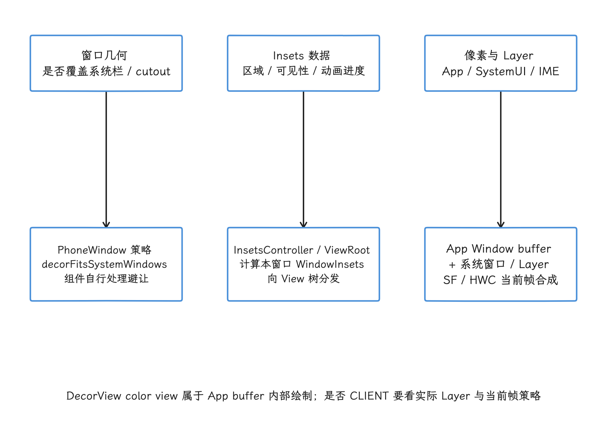
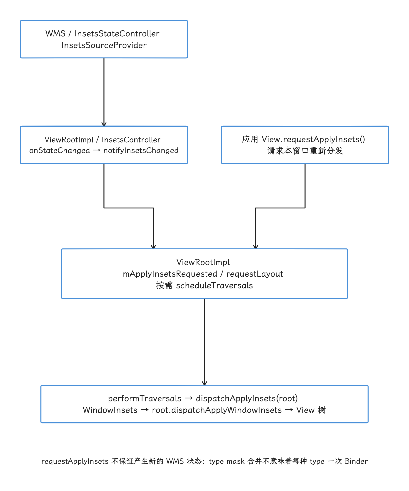
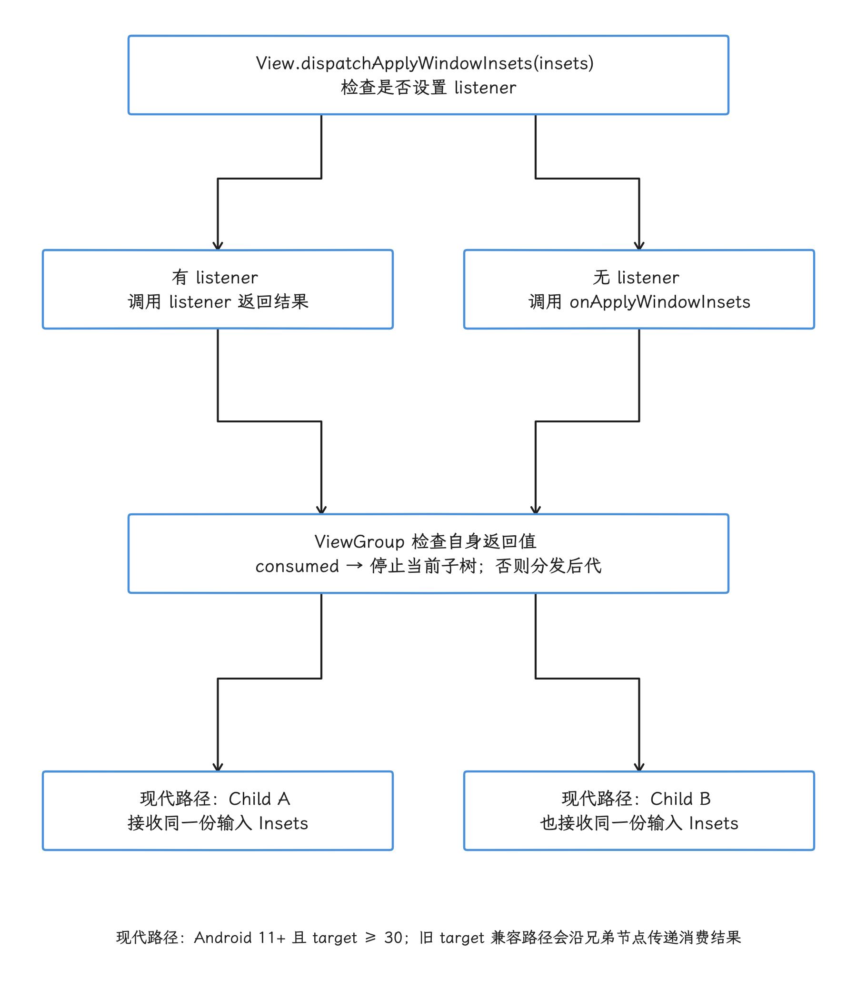
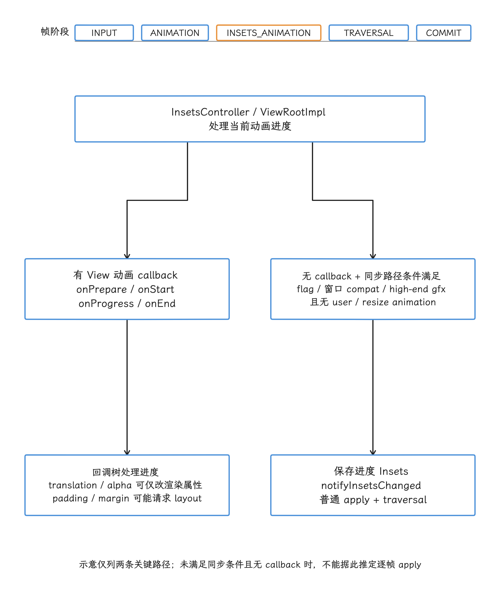
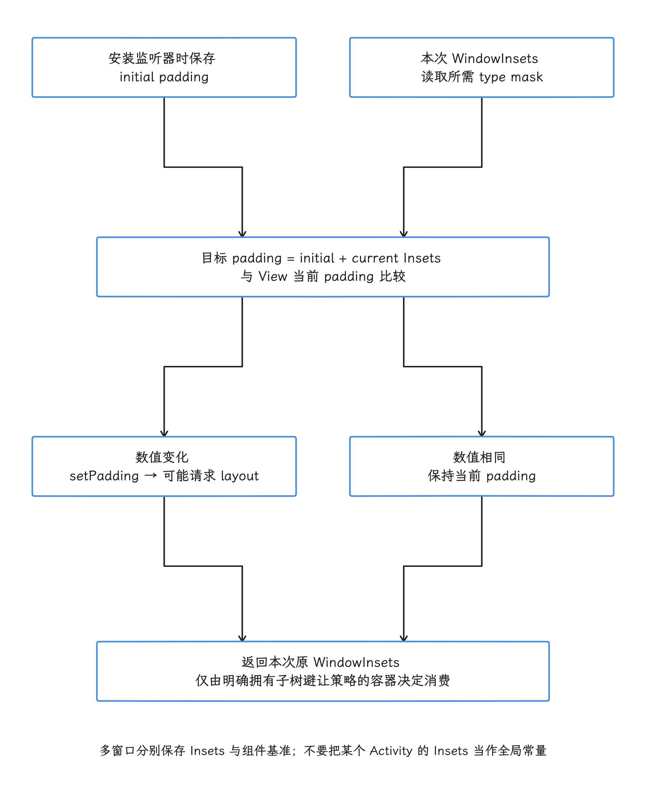

# Android 17 Edge-to-Edge 渲染与 WindowInsets 处理性能

Android 15（API 35）开始对满足版本条件的 Activity 强制 Edge-to-Edge（内容延伸到系统栏和屏幕缺口后方）。它改变的是窗口布局、系统栏背景和 Insets（系统界面占用或建议避让的边缘区域）的责任边界，不会为应用更换渲染管线。

普通 View 或 Compose 页面仍沿 `ViewRootImpl → HWUI RenderThread（硬件加速渲染线程）→ App Window BLAST（应用窗口缓冲队列）→ SurfaceFlinger → HWC（Hardware Composer，硬件合成器）` 生成并显示；状态栏、导航栏、桌面 caption（标题栏）和 IME（输入法窗口）则作为系统 UI 或受控 Surface 参与同一 Display 的合成。

我们做性能分析时，先把问题分到三类里：

1. **窗口几何**：应用窗口是否覆盖系统栏和 cutout（屏幕缺口）区域；
2. **Insets 数据**：哪些系统区域与当前窗口相交，何时分发给 View 树；
3. **像素与 layer（合成图层）**：当前帧哪些内容重绘，SurfaceFlinger 与 HWC 最终如何合成。

这三层要分开查，混在一起容易看错对象：透明系统栏会被当成新增 GPU 合成层，Insets 动画会被当成每帧完整重新布局。

<!-- gracker-diagram: ch02-15-three-responsibility-boundaries -->


图：窗口是否延伸到系统栏后方属于几何策略；WindowInsets 告知各组件需要避让的区域；应用和系统窗口最终各自产生像素并参与合成。DecorView color view 画入当前 App Window buffer，透明配置本身不能证明新增 Layer 或 HWC CLIENT 回退。

## 1. Android 15 到 Android 17 的行为边界

### 1.1 Edge-to-Edge 由运行平台和 target SDK 共同决定

我们先把版本边界划清楚：在 Android 15 及更高版本设备上，target SDK 35 及以上的应用默认使用 Edge-to-Edge。Android 15 为 target 35 留过 `windowOptOutEdgeToEdgeEnforcement` 临时退出项；Android 16 上，target SDK 36 及以上时该退出项被禁用。Android 17 延续这条边界，Edge-to-Edge 模型仍是这一套。

落到源码上，`PhoneWindow` 里对应两项兼容性变更：

- `ENFORCE_EDGE_TO_EDGE` 从 `VANILLA_ICE_CREAM`（Android 15）target 开始启用；
- `DISABLE_OPT_OUT_EDGE_TO_EDGE` 从 `BAKLAVA`（Android 16）target 开始启用。

强制条件成立后，`PhoneWindow` 会设置 `PRIVATE_FLAG_EDGE_TO_EDGE_ENFORCED`，把 `mDecorFitsSystemWindows` 置为 `false`，并把状态栏颜色和导航栏分隔线颜色置为透明。`mDecorFitsSystemWindows = false` 之后，Decor 不再把内容自动限制在系统栏以内；此时再调用 `Window.setDecorFitsSystemWindows()`，也换不回旧布局策略。

> 版本判断应同时记录 Android 设备版本和 target SDK，不能只看 `compileSdk`（编译时使用的 API 级别）或设备系统版本。

### 1.2 四类可见变化

| 区域 | Android 15+ 强制行为 | 应用需要处理的事 |
|---|---|---|
| 状态栏 | 背景透明，内容可以画到其下方 | 给需要避让的交互内容应用 `statusBars()` 或 `safeDrawing()` |
| 手势导航栏 | 背景透明，内容可以画到手势区域 | 区分视觉内容与可滑动、可点击内容，必要时使用 `systemGestures()` |
| 三键导航栏 | 内容仍画到其后；默认可有 80% 不透明的对比度保护 | 手势导航和三键导航的颜色行为应分别处理 |
| Display cutout（屏幕缺口） | 非浮动窗口的 `DEFAULT`、`SHORT_EDGES`、`NEVER` 按 `ALWAYS` 处理 | 用 `displayCutout()` 保护关键内容，不能依靠黑边 |

同一批变化里还有 `Configuration` 尺寸：Android 15 起，target 35 及以上应用的 `screenWidthDp`、`screenHeightDp` 不再排除系统栏，尺寸与系统栏 Insets 解耦。资源限定符仍可使用这些值；运行时要拿布局几何，就改用实际容器、`WindowMetrics`（窗口边界指标）和 `WindowInsets`。

### 1.3 `enableEdgeToEdge()` 实际做了什么

`WindowCompat.enableEdgeToEdge(window)` 从 AndroidX Core 1.17.0 开始提供。按 [Core 1.17.0 源码包](https://dl.google.com/dl/android/maven2/androidx/core/core/1.17.0/core-1.17.0-sources.jar) 中的 `androidx/core/view/WindowCompat.java`，它会让内容延伸到窗口边缘、请求透明系统栏颜色，并按运行平台设置 cutout 模式；API 29 及以上还会关闭状态栏与导航栏对比度保护。系统栏图标明暗和三键导航保护背景不在它的工作范围内：应用要根据栏后内容通过 `WindowInsetsControllerCompat` 自己配置图标明暗，并按需处理三键导航背景。

它在不同系统版本上走不同的兼容路径，把它当成一组固定的 legacy flag（旧版窗口标志）来理解，跨版本就会出错：Android 15 及以上的强制场景中，平台自身的 `PhoneWindow` 已经决定 `decorFitsSystemWindows = false`，状态栏颜色和手势导航栏颜色的设置 API 已弃用且不再生效；三键导航的颜色设置仍要与手势导航分开判断。

## 2. Edge-to-Edge 没有改变标准 App Window 出图拓扑

普通硬件加速 Activity 的出图主线维持原样，我们先把它摆出来对照：

```text
Insets / input / animation / invalidate / requestLayout
    ↓
Choreographer#doFrame
    INPUT → ANIMATION → INSETS_ANIMATION → TRAVERSAL → COMMIT
    ↓
ViewRootImpl.performTraversals()
    ↓
HWUI RenderThread → App Window BLASTBufferQueue
    ↓
SurfaceFlinger → HWC / RenderEngine → Display present
```

我们用这段骨架定位问题落在哪一层。Edge-to-Edge 带来的变化集中在两端：App Window 的内容可能覆盖更大的窗口区域，Insets 变化可能触发 traversal（View 树遍历）；生成与提交这一段照旧——Edge-to-Edge 没有自动另建一个应用 Producer（BufferQueue 生产端），出帧仍走 App Window 的 BLAST 队列。

### 2.1 系统栏背景画在哪里

系统栏透明之后，我们先要弄清这些栏的内容各自画在哪里。系统栏图标、手势 handle（导航手势提示条）、caption 控件等 SystemUI 内容可以有自己的窗口或 layer；应用侧的系统栏背景处理还可能发生在 `DecorView` 内部：

- `DecorView.updateColorViews()` 维护状态栏和导航栏的 color view（绘制栏背景的辅助 View）；
- `calculateNavigationBarColor()` 在 Edge-to-Edge 强制场景中可把三键导航栏颜色转成对比度 scrim（半透明保护层）；
- 这些 color view 最终画进当前 App Window buffer，统计应用 Surface 时按这个 buffer 算即可。

所以系统栏透明后有没有新增透明 layer、覆盖区域有没有新增绘制，都要落到实际对象上确认：layer 数量以 SurfaceFlinger layer tree（图层树）为准；App Window 内部的普通 View 或 DecorView color view，哪怕视觉上像一层遮罩，也仍然是 App Window 的一部分，不会因此变成 HWC layer。

### 2.2 HWC 回退 CLIENT 的判断依据

排查合成问题时，我们关心的是 HWC 在当前这一帧的选择：它按整个 Display 的可见 layer 集合评估 composition strategy（合成策略）。影响因素包括：

- layer 的 format（像素格式）、dataspace（颜色数据空间）、blend（混合方式）、transform（变换）、crop（裁剪）和 protected usage（受保护内容标志）；
- 可用 overlay plane（硬件叠加平面）、scaler（缩放器）、带宽与厂商限制；
- SystemUI、IME、transition leash（转场期间使用的临时父 Surface）、dim layer（调暗层）、多窗口和视频 layer；
- 当前 Display mode、分辨率、色彩模式与全局 transform。

透明或半透明 layer 可能影响 HWC 的选择，但从 Edge-to-Edge 配置推不出 `CLIENT` composition（由 RenderEngine 使用 GPU 合成），“某类低端 GPU 固定增加 4～8 ms”这样的跨设备常量也不存在。要下判断，就看 per-layer composition type（逐图层合成类型）、FrameTimeline 的 `GPU Composition`、HWC 与 layer trace，或与稳定复现场景对应的 dumpsys（系统诊断输出）快照。

### 2.3 新增绘制成本由哪些因素决定

窗口内容延伸到边缘之后，每帧是否真的多出一次 measure 或 layout，取决于当前帧状态：

- 边缘区域本来就在 App Window buffer 内；内容静止时，可以复用已有的 RenderNode 与 DisplayList（可重复回放的绘制命令）；
- Insets 数值变化或监听器修改 padding、margin、LayoutParams 时，可能请求 layout；
- 边缘渐变、模糊、大图、视频采样或持续动画会增加实际像素工作；
- dirty region（需要重绘的区域）、buffer age（缓冲区内容保留轮次）、GPU tile（分块渲染）架构和 OEM 驱动都会影响最终成本。

评估 Edge-to-Edge 的 GPU 成本，对比的是同一设备、页面和导航模式下的 App GPU 与 RenderThread、SurfaceFlinger composition 和功耗；系统栏高度乘屏幕宽度代替测量并不合适。

## 3. Android 17 的 WindowInsets 分发链

### 3.1 系统状态到 View 树

排查 Insets 相关开销时，我们先弄清这份状态从哪里来、经谁计算、什么时候到达 View 树。主路径可以概括为：

```text
WMS InsetsStateController / InsetsSourceProvider
    ↓  InsetsState 与 InsetsSourceControl
ViewRootImpl
    ↓  InsetsController.onStateChanged()
ViewRootImpl.notifyInsetsChanged()
    ↓  mApplyInsetsRequested + requestLayout() + scheduleTraversals()
ViewRootImpl.performTraversals()
    ↓  dispatchApplyInsets(root)
root.dispatchApplyWindowInsets(WindowInsets)
    ↓
View / ViewGroup hierarchy
```

WMS（WindowManagerService，窗口管理服务）维护带类型的 `InsetsState`、Insets source（区域数据源）和 `InsetsSourceControl`（控制权信息）；到了应用进程，`InsetsController` 结合当前窗口 frame、bounds（边界）、可见性和窗口属性计算出 `WindowInsets`。读这条链要沿着 `InsetsController` 走，`WindowState.computeFrameLw()` 对不上分发时机，当不了切入点。

系统发来新的 Insets 状态时，`ViewRootImpl.notifyInsetsChanged()` 会设置 `mApplyInsetsRequested`、调用 `requestLayout()`，并在需要时安排 traversal。应用主动调用 `View.requestApplyInsets()` 则是本地动作：View 请求根节点把已有状态重新分发一遍，相当于一次本地重放；Binder（跨进程通信）请求也不会按 Insets type 各来一轮。

<!-- gracker-diagram: ch02-15-state-to-view-dispatch -->


图：系统状态变化经 ViewRootImpl / InsetsController 更新当前窗口 Insets，notifyInsetsChanged 请求布局和 traversal；应用 requestApplyInsets 也可要求本地重新分发。下一次实际 traversal 中再向根 View 分发计算出的 WindowInsets，多种 type 可以由同一个对象承载。

### 3.2 一次 `WindowInsets` 可以同时携带多种 type

状态栏、导航栏、caption、IME、cutout、system gestures（系统手势区域）等信息都可以出现在同一个 `WindowInsets` 中。下面的代码只从已有对象读取并合并两种 type：

```kotlin
val safe = insets.getInsets(
    WindowInsetsCompat.Type.systemBars() or
        WindowInsetsCompat.Type.displayCutout()
)
```

这里按 type mask（类型位掩码）计算合并结果，读取两种 type 对应的还是同一轮分发。旋转、窗口 resize（调整大小）、系统栏可见性变化可能连续产生多个状态，实际几轮从 trace 或日志里数出来，事先不预设“2～3 轮”这样的数字。

### 3.3 Listener 和 override 处在同一条 dispatch 路径

`View.dispatchApplyWindowInsets()` 的实现规则很直接：

- 设置了 `OnApplyWindowInsetsListener` 时调用 listener（监听器）；
- 没有 listener 时调用 View 的 `onApplyWindowInsets()`；
- listener 可以主动调用 View 的默认实现，但平台不会替它再调用一次。

`ViewCompat.setOnApplyWindowInsetsListener()` 提供 AndroidX 兼容层和统一 API；“它能带来纳秒级调度优化”的说法缺乏依据。选 listener 还是 override（重写）方法，看组件封装方式和生命周期即可。

### 3.4 消费语义要区分后代和兄弟节点

消费语义最要紧的区别在后代和兄弟节点。一个 `ViewGroup` 自身返回 consumed（已消费）时，分发会在进入其子树前停止；Android 11（API 30）及以上，`ViewGroup` 把相同输入 Insets 分别交给兄弟节点，前一个子节点消费与否，后一个拿到的输入都一样。target SDK 低于 30 的兼容路径仍保留旧的顺序消费行为。

如果在 `decorView` 根节点无条件返回 `CONSUMED`，再把 Insets 放入 `ViewModel` 供所有子 View 自行读取，会带来一组连锁问题：

- 切断依赖标准分发的 Material、Fragment、ComposeView 或 WebView 子树；
- 把窗口几何状态混入业务状态，增加生命周期与多窗口同步问题；
- 让同一组件在 Dialog、分屏或外接 Display 中拿到错误缓存。

我们把消费放在明确负责这块避让区域的容器里，并测试它的后代和兄弟节点仍然正常。

<!-- gracker-diagram: ch02-15-listener-consumption -->


图：当前 View 有 listener 时调用 listener，否则调用 onApplyWindowInsets。ViewGroup 自身返回 consumed 会停止其子树分发；现代路径把相同输入分别交给兄弟节点，前一个子节点的返回值不会覆盖后一个节点的输入。target < 30 的兼容路径仍会顺序消费。

## 4. Insets Animation：两条路径不能混写

`Choreographer` 按下面的顺序执行回调，Insets 动画的调度位置由此决定：

```text
INPUT → ANIMATION → INSETS_ANIMATION → TRAVERSAL → COMMIT
```

`InsetsController` 把动画帧安排到 `CALLBACK_INSETS_ANIMATION`，所以同一帧里的 Insets 动画工作排在普通 animation 之后、traversal 之前。这个顺序描述的只是回调阶段，布局是否发生要看该帧的实际请求。

### 4.1 有动画回调：分发 `onProgress()`

设置 `WindowInsetsAnimation.Callback` 后，动画生命周期包含四个阶段：

- `onPrepare()`：布局切换前记录起始状态；
- `onStart()`：布局已切到结束状态后记录结束位置和 bounds（动画边界）；
- `onProgress()`：动画进行时收到插值后的 Insets 与 running animations（当前仍在运行的动画列表）；
- `onEnd()`：动画完成或收尾时清理临时属性。

`ViewGroup` 根据 callback 的 dispatch mode（分发模式）决定是否把动画继续传给后代。这里分发的是 WindowInsets Animation 的回调树，与每帧调用普通 `onApplyWindowInsets()` 是两条路。

回调在主线程帧阶段执行。我们修改 `translationY`、alpha 这类渲染属性，通常不会引起 measure；修改 padding、margin、约束或列表结构则可能请求 layout。成本跟着回调里做的事走，固定毫秒值从可见 item（列表项）数是推不出来的。

### 4.2 同步 Insets 动画的启用条件

`android-17.0.0_r1` 已包含同步 Insets 动画机制，窗口要走这条路，得先满足下面这些开关和条件：

1. `ActivityInfo.ENABLE_SYNCHRONIZED_INSETS_ANIMATION` 是从 Android 16 target 开始启用、允许设备覆盖的 compat change（兼容性变更开关）；
2. `WindowState` 计算窗口是否允许同步动画，并把结果随 add 与 relayout result（窗口创建或重布局结果）交给 `ViewRootImpl`；
3. `InsetsController` 的 `synced_insets_animation` aconfig flag（平台配置开关）必须开启；
4. `ViewRootImpl` 还要求设备满足 high-end graphics（高性能图形设备）条件；
5. 当前动画不能是 user-controlled（用户直接控制）或 resize animation，也不能已经注册 View 动画 callback。

这些条件全部成立时，`dispatchWindowInsetsAnimationProgress()` 会走 `notifyInsetsChanged()`，把动画进度 Insets 放入普通 apply 与 traversal 路径。源码注释说明这条路径资源开销更高，因此低端设备被排除在外。

逐帧 apply 在 Android 17 上是已实现的能力，但某个窗口此刻是否在走这条路径，仅凭 API 37 看不出来；我们还要结合设备 flag、窗口 compat 状态、是否注册 callback，以及 trace 中 `dispatchApplyInsets` 与 traversal 是否随动画逐帧出现来判断。

<!-- gracker-diagram: ch02-15-animation-dispatch-branches -->


图：INSETS_ANIMATION 位于普通 ANIMATION 之后、TRAVERSAL 之前。有 View 动画 callback 时向回调树分发进度；没有 callback 且满足同步动画的其他条件时，进度 Insets 可经 notifyInsetsChanged 进入普通 apply / traversal。修改渲染属性和修改布局属性的成本仍取决于具体代码。

### 4.3 IME 动画的时长与回调次数

IME 动画的 duration（时长）、interpolator（插值器）、刷新率和实际回调数量，由系统实现、控制方式、掉帧和设备状态共同决定；“默认 300 ms、60 Hz 一定回调 18 次”在 Android 17 上当不了固定结论。

View 布局如果在动画开始时就已切到结束状态，就可以按官方建议用起点与终点的差值设置位移，避免在 `onProgress()` 中反复修改布局。下面的代码只展示关键状态；实际组件还要保存和恢复已有 translation。

```kotlin
private var startBottom = 0f
private var endBottom = 0f
private var baseTranslationY = 0f

private val imeCallback =
    object : WindowInsetsAnimationCompat.Callback(
        WindowInsetsAnimationCompat.Callback.DISPATCH_MODE_STOP
    ) {
        override fun onPrepare(animation: WindowInsetsAnimationCompat) {
            baseTranslationY = target.translationY
            startBottom = target.bottom.toFloat()
        }

        override fun onStart(
            animation: WindowInsetsAnimationCompat,
            bounds: WindowInsetsAnimationCompat.BoundsCompat
        ): WindowInsetsAnimationCompat.BoundsCompat {
            endBottom = target.bottom.toFloat()
            return bounds
        }

        override fun onProgress(
            insets: WindowInsetsCompat,
            runningAnimations: MutableList<WindowInsetsAnimationCompat>
        ): WindowInsetsCompat {
            val ime = runningAnimations.firstOrNull {
                it.typeMask and WindowInsetsCompat.Type.ime() != 0
            } ?: return insets

            target.translationY = baseTranslationY +
                (startBottom - endBottom) * (1f - ime.interpolatedFraction)
            return insets
        }

        override fun onEnd(animation: WindowInsetsAnimationCompat) {
            if (animation.typeMask and WindowInsetsCompat.Type.ime() != 0) {
                target.translationY = baseTranslationY
            }
        }
    }
```

这里用的是几何差值，避开了直接写 `translationY = -imeBottom` 的做法：直接用 IME 底部距离，容易重复计算原有 padding 与位置，并在浮动 IME、分屏或横屏下把内容移到错误位置。

### 4.4 Android 17 的 IME 可见性变化

Android 17 还改动了应用未自行处理的配置变更行为：例如旋转导致 Activity 重建时，系统不再恢复之前的 IME 可见性；页面要在重建后继续显示键盘，就得设置合适的 `windowSoftInputMode`，或在新 Activity 生命周期中明确请求。

这会直接影响测试序列：旋转后的“IME 没有再次出现”不一定是 Insets 动画丢帧，我们先确认新 Activity 是否请求了 IME，再分析动画和布局性能。

## 5. 正确处理静态 Insets

### 5.1 保留组件原始 padding，并只在值变化时更新

监听器可能因 attach（挂接到 View 树）、可见性、窗口移动、系统栏变化或应用主动请求而多次执行，所以下面的写法把每次读到的系统栏 Insets 都叠加到组件原始 padding 上，回调重复执行也不会累加。

```kotlin
val initialLeft = list.paddingLeft
val initialTop = list.paddingTop
val initialRight = list.paddingRight
val initialBottom = list.paddingBottom

ViewCompat.setOnApplyWindowInsetsListener(list) { view, windowInsets ->
    val safe = windowInsets.getInsets(
        WindowInsetsCompat.Type.systemBars() or
            WindowInsetsCompat.Type.displayCutout()
    )

    val left = initialLeft + safe.left
    val top = initialTop + safe.top
    val right = initialRight + safe.right
    val bottom = initialBottom + safe.bottom

    if (view.paddingLeft != left ||
        view.paddingTop != top ||
        view.paddingRight != right ||
        view.paddingBottom != bottom
    ) {
        view.setPadding(left, top, right, bottom)
    }
    windowInsets
}
```

返回原对象，后代就能继续按各自的责任处理。只有当前容器明确拥有整个子树的避让策略时，我们才考虑返回 `CONSUMED`。

<!-- gracker-diagram: ch02-15-idempotent-padding -->


图：初始 padding 在安装监听器时保存一次；每次回调用当前窗口的 Insets 计算目标值，而不是继续加在上一次的结果上。目标值变化时才 setPadding，默认返回原 Insets，让后代继续处理自己的避让责任。

### 5.2 滚动内容与固定控件采用不同策略

- 列表背景和滚动内容可以延伸到系统栏后方，常见做法是设置内边距并关闭 `clipToPadding`（不按 padding 裁剪滚动内容）；
- FAB（悬浮操作按钮）、输入框、底部操作按钮等交互控件应避开 `systemBars()`；
- 依赖边缘滑动的 carousel（轮播控件）、bottom sheet（底部抽屉）或游戏控制区还要考虑 `systemGestures()`；
- 三键导航栏背景保护可参考 `tappableElement()`，不要把手势 handle 高度硬编码成导航栏高度；
- cutout、瀑布屏和圆角屏应按页面内容选择 `displayCutout()`、`waterfall()` 或 `safeDrawing()`，不能用统一的 24 dp 或 48 dp 常量。

### 5.3 Compose 的边界

标准 `ComposeView` 宿主仍画入当前 App Window，使用 `WindowInsets` modifier（布局修饰符）并不会让它变成独立 Surface。Compose 官方 Insets API 把消费关系纳入 modifier 布局，并可随 IME Insets 动画更新。

性能判断仍要回到 Compose 的三阶段：

- 状态读取是否引起不必要的 recomposition（重组）；
- Insets modifier 是否让大范围 layout 重算；
- drawing（绘制）是否只更新需要变化的节点。

“某个 modifier 因内部 `remember` 就不会每帧计算”这类说法，我们不下断言：Compose 是独立发布组件，具体行为要注明 Compose 与 AndroidX 版本，并以 composition trace、layout trace 和目标版本源码或官方文档为准。

## 6. 多窗口、桌面窗口化与浮动 IME

到了多窗口和桌面窗口化，单窗口下的结论要重新对一遍。每个顶层 Window 都有自己的 `ViewRootImpl`、Insets 状态、Surface 和 BLAST 队列；同一进程的 Activity、Dialog 或其他窗口如果共享 UI Looper（主线程消息循环），traversal 会在同一主线程串行执行。“两个窗口的 Insets 相互独立”只覆盖数据层面，主线程和 RenderThread 仍是共享资源，争用随时可能发生。

桌面窗口化还要处理 caption：

- caption bar（窗口标题栏）即使在 immersive（沉浸式）模式下也可能保持可见；
- 使用 `systemBars()` 时已包含 caption，也可以单独读取 `captionBar()`；
- 自定义 header（标题区域）要结合 `WindowInsets.getBoundingRects()` 返回的系统控件边界，避开关闭、最大化等按钮；
- resize 期间同时核对 Window bounds、Insets source 与 control、App traversal、Shell transition leash 和 App Window buffer geometry（缓冲区几何）。

浮动 IME 场景里，`ime()` 的值按“相对于当前窗口”计算：IME 未遮挡窗口时可以为 0，与窗口相交、或系统选择 resize（调整窗口大小）或 pan（平移内容）时可以非 0。我们记录当前 windowing mode（窗口模式）、IME window 与 leash 的几何以及实际 Insets 再下判断，“桌面模式”这个标签本身给不出 `ime()` 的值。

## 7. Predictive Back 与 Insets 的关系

Predictive Back（预测性返回）让用户在完成返回手势前预览目的地。Android 15 起，back-to-home（返回桌面）、cross-task（跨任务）、cross-activity（跨 Activity）系统动画不再依赖开发者选项；Android 16 上，target SDK 36 及以上的应用默认启用这些系统动画，并提供迁移或临时退出边界。

它不要求每个应用在同一 Window 内固定绘制返回前后的两份页面内容：

- back-to-home、cross-task、cross-activity 可以由系统基于窗口、Task 和 transition leash 组织动画；
- Fragment、Navigation 或 Compose 的自定义进度动画可以在应用内部更新 UI；
- 应用回调是否触发 composition、layout、draw，取决于具体导航库和页面实现；
- 没有 Android 17 证据表明 Predictive Back 会自动逐帧调用 `requestApplyInsets()`。

返回手势卡顿时，我们先把系统 transition（转场）与应用自定义动画分开。系统路径检查 WM Shell、SurfaceFlinger 的 layer 与 transaction，以及 DisplayFrame；应用路径检查返回进度回调、Compose 或 Fragment 状态变化、`doFrame` 和 App SurfaceFrame。详见 22.11。

## 8. Perfetto：按证据定位 Insets 成本

### 8.1 应用回调的 trace 标注

`ViewRootImpl.dispatchApplyInsets()` 自带名为 `dispatchApplyInsets` 的 trace section（跟踪区段）；业务 listener 和动画 callback 默认没有能区分页面逻辑的名字。调试构建里我们用 `Trace.beginSection()` 包住自己的处理，再与系统 slice（时间片）对齐。

建议同时采集：

- 目标进程的 `Choreographer#doFrame` 与五类帧阶段 callback；
- `dispatchApplyInsets`、Choreographer 的 `traversal` 回调范围，以及实际存在的 `measure`、`layout`、`draw-VRI[...]` 等区间；
- 自定义 `InsetsApply/<screen>`、`ImeProgress/<screen>` section；
- RenderThread `DrawFrame`、dequeue 与 queue buffer（取出和提交缓冲区）；
- App 和 SurfaceFlinger FrameTimeline；
- WMS 与 WM Shell 的 Insets、IME、transition 和 SurfaceControl transaction；
- HWC composition type、client composition（客户端合成）和 present。

### 8.2 `traversal` 回调区间与实际执行的 layout

同一 pending frame（待处理帧）的多个 `requestLayout()` 或 `invalidate()` 可能被 `Choreographer` 合并成一次，一次 `performTraversals` 也未必同时执行 measure、layout 和 draw，所以先数次数、再看子段。

下面的查询统计指定时间段内系统应用 Insets 与 traversal 的次数，用于寻找相关性；根因判定要靠后面的子段核对：

```sql
SELECT
  s.name,
  COUNT(*) AS count,
  ROUND(SUM(s.dur) / 1e6, 3) AS total_ms,
  ROUND(MAX(s.dur) / 1e6, 3) AS max_ms
FROM slice AS s
WHERE s.ts BETWEEN :start_ts AND :end_ts
  AND s.name IN ('dispatchApplyInsets', 'traversal')
GROUP BY s.name;
```

AOSP `android-17.0.0_r1` 的 `performTraversals()` 没有同名显式系统 trace，这里统计的是 Choreographer 的 `traversal` 回调区间，结果只显示这两类区间的次数和耗时。若 `dispatchApplyInsets` 随 IME 动画逐帧出现，下一步核对窗口是否满足同步 Insets 动画条件；如果只有 `onProgress` 自定义 section 在增长，就把注意力移到动画 callback 的业务代码。随后进入每次 traversal，确认实际执行的 measure、layout、draw 子段。

### 8.3 用 FrameTimeline 判断帧有没有错过显示时机

固定 16.67 ms 阈值只适用于 60 Hz 的简化估算，放到 90 Hz、120 Hz、可变刷新率或不同调度策略下就会误判。FrameTimeline 已提供 expected 与 actual timeline（预期与实际时间线）、present type（显示时机分类）、jank type（卡顿分类）和 token（帧关联标识），我们以目标帧 deadline 为准。

下面的查询列出目标进程最慢的 App SurfaceFrame。替换包名后，再用 `layer_name` 过滤目标 Window：

```sql
SELECT
  a.ts,
  a.dur / 1e6 AS actual_ms,
  a.surface_frame_token,
  a.display_frame_token,
  a.present_type,
  a.on_time_finish,
  a.jank_type,
  a.layer_name
FROM actual_frame_timeline_slice AS a
JOIN process AS p USING (upid)
WHERE p.name = :package_name
  AND a.surface_frame_token != 0
ORDER BY a.dur DESC
LIMIT 40;
```

查询结果给出慢帧的实际持续时间及关联 token。`jank_type` 只用于缩小范围；要证明 Insets 是根因，还要让慢帧与 `dispatchApplyInsets` callback、traversal 子段、RenderThread 和 SurfaceFlinger DisplayFrame 在时间上对应。

### 8.4 合成结论必须看整个 Display

要验证“Edge-to-Edge 导致 CLIENT composition”，至少完成以下对照：

1. 固定设备、Display mode、导航方式和页面内容；
2. 对比变更前后的可见 layer tree；
3. 对齐同一 DisplayFrame 的 per-layer composition type（逐图层合成类型）或 `GPU Composition`；
4. 检查是否同时出现 IME、transition、视频、dim、HDR 或多窗口变化；
5. 查看 RenderEngine client composition 和 present 路径，而非只看一个 `composeSurfaces` slice 的时长。

仅凭透明栏出现、SF duration 变长或功耗上升中的任何一项，都不足以单独证明 HWC 回退。

## 9. 常见误判

| 现象 | 不能直接得出的结论 | 继续检查 |
|---|---|---|
| 内容画到状态栏后方 | 多了一个应用 Surface | App Window layer、SystemUI layer、DecorView color view |
| Insets 数值变化 | 每种 type 分别完成一次 Binder 分发 | `InsetsState` 序列、`dispatchApplyInsets` 次数 |
| `onProgress()` 每帧出现 | 每帧都执行普通 `onApplyWindowInsets()` | callback 路径与同步 apply 条件 |
| `traversal` 回调区间出现 | measure、layout、draw 全部发生 | traversal 内部子段和 View 请求来源 |
| 三键导航有半透明背景 | SurfaceFlinger 必须 CLIENT composition | DecorView scrim、layer composition type |
| 桌面窗口出现浮动 IME | `ime()` 必为 0 | 窗口与 IME 相交、InsetsState、adjust mode |
| Predictive Back 卡顿 | 应用固定双份渲染页面 | 系统 transition 与应用自定义 progress 分开 |
| `doFrame` 超过 16.67 ms | 所有刷新率下都已超时 | FrameTimeline expected 与 actual deadline |

## 10. Android 17 源码入口

以下平台入口按 Android 17（API 37）的 `android-17.0.0_r1` 核对：

- [`PhoneWindow.java`](https://android.googlesource.com/platform/frameworks/base/+/android-17.0.0_r1/core/java/com/android/internal/policy/PhoneWindow.java)：Edge-to-Edge compat change、opt-out 边界、`decorFitsSystemWindows` 和系统栏颜色；
- [`DecorView.java`](https://android.googlesource.com/platform/frameworks/base/+/android-17.0.0_r1/core/java/com/android/internal/policy/DecorView.java)：color view、三键导航 scrim、系统栏消费；
- [`ViewRootImpl.java`](https://android.googlesource.com/platform/frameworks/base/+/android-17.0.0_r1/core/java/android/view/ViewRootImpl.java)：Insets 状态变化、`dispatchApplyInsets`、同步动画条件与 traversal；
- [`InsetsController.java`](https://android.googlesource.com/platform/frameworks/base/+/android-17.0.0_r1/core/java/android/view/InsetsController.java) 和 [`ViewRootInsetsControllerHost.java`](https://android.googlesource.com/platform/frameworks/base/+/android-17.0.0_r1/core/java/android/view/ViewRootInsetsControllerHost.java)：动画 runner（执行器）、`CALLBACK_INSETS_ANIMATION`、progress 分发；
- [`View.java`](https://android.googlesource.com/platform/frameworks/base/+/android-17.0.0_r1/core/java/android/view/View.java) 和 [`ViewGroup.java`](https://android.googlesource.com/platform/frameworks/base/+/android-17.0.0_r1/core/java/android/view/ViewGroup.java)：listener 与 override、消费和新旧兄弟分发语义；
- [`Choreographer.java`](https://android.googlesource.com/platform/frameworks/base/+/android-17.0.0_r1/core/java/android/view/Choreographer.java)：Input、Animation、Insets Animation、Traversal、Commit 的帧内顺序；
- [`ActivityInfo.java`](https://android.googlesource.com/platform/frameworks/base/+/android-17.0.0_r1/core/java/android/content/pm/ActivityInfo.java)、[`WindowState.java`](https://android.googlesource.com/platform/frameworks/base/+/android-17.0.0_r1/services/core/java/com/android/server/wm/WindowState.java)、[`WindowRelayoutResult.java`](https://android.googlesource.com/platform/frameworks/base/+/android-17.0.0_r1/core/java/android/view/WindowRelayoutResult.java) 和 [`WindowManagerService.java`](https://android.googlesource.com/platform/frameworks/base/+/android-17.0.0_r1/services/core/java/com/android/server/wm/WindowManagerService.java)：同步 Insets 动画 compat change、窗口资格计算，以及 add/relayout result 如何把 `usesSyncedInsetsAnimation` 传给 `ViewRootImpl`。

这章不涉及新的 kernel（内核）算法。CPU 调度、频率或 fence 分析如需深入内核，kernel 版本仍固定为 `android17-6.18-2026-06_r6`，不能用旧 kernel tag（版本标签）推断 Android 17 设备行为。

## 11. 检查清单

- [ ] 是否按“运行平台 + target SDK”判断 Edge-to-Edge 和退出项？
- [ ] 是否分别处理手势导航、三键导航、status bar、caption 和 cutout？
- [ ] 是否避免用 `Configuration.screenHeightDp` 推导系统栏后的可用高度？
- [ ] Insets listener 是否保留原始 padding 与 margin，避免重复累加？
- [ ] 是否在明确责任边界后才消费 Insets？
- [ ] IME 动画是否区分 callback progress 与 Android 17 同步 apply 路径？
- [ ] 是否记录实际动画 duration、刷新率和回调次数，而非套用 300 ms/18 帧？
- [ ] 多窗口是否按 Window、ViewRoot、layer、Display 分组？
- [ ] Predictive Back 是否区分系统 transition 与应用自定义动画？
- [ ] HWC `CLIENT` 与 `DEVICE` 结论是否有同帧 composition 证据？
- [ ] 是否使用 FrameTimeline expected 与 actual deadline 判断卡顿？

## 总结

Edge-to-Edge 把“避开系统栏”的责任从窗口默认留白转给了应用布局，标准 App Window 的生产与显示主线保持原样。性能风险主要来自 Insets 变化后的主线程工作、错误的布局更新范围、动画期间逐帧 apply 或 progress，以及实际 Display layer 集合对 HWC 策略的影响。

排查时我们先识别路径：普通状态变化、动画 callback、同步 Insets 动画、桌面窗口 resize 和 Predictive Back 各有不同的调度与 layer 证据。把路径分清，再用 `dispatchApplyInsets`、traversal 子段、FrameTimeline 和 composition type（合成类型）对齐同一帧，才能判断该修 View 层、动画逻辑、窗口策略还是显示合成。
