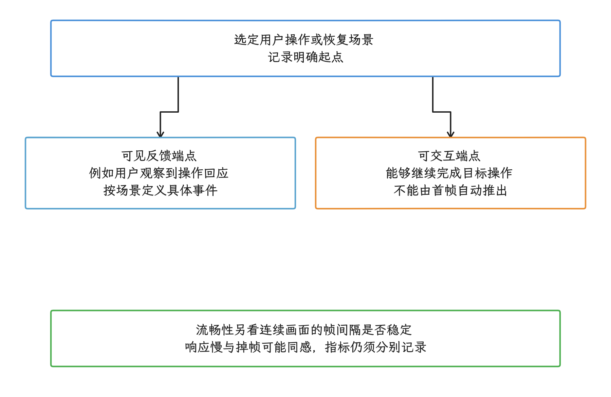
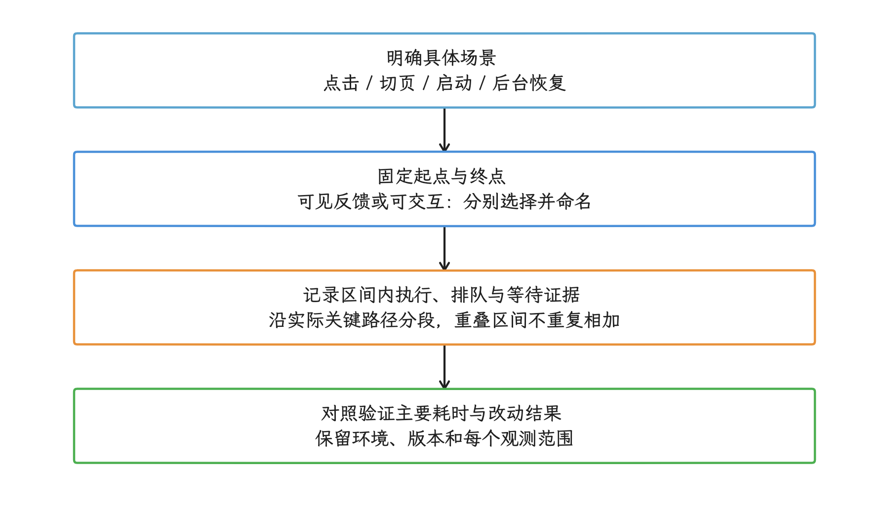
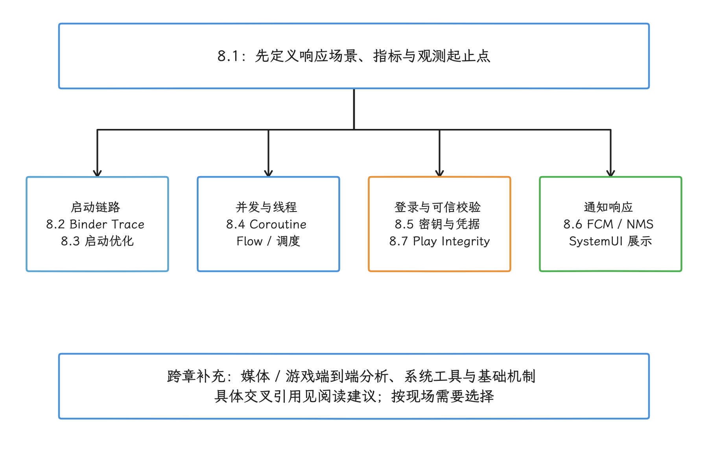

# 第 8 章：响应速度

响应速度关注从用户操作到界面给出可见反馈或恢复可交互状态所需的时间；流畅性关注连续画面的帧间隔是否稳定。

<!-- gracker-diagram: ch08-overview-response-and-smoothness -->

图：响应度选择可见反馈或可交互端点；流畅性关注连续帧间隔，不能仅凭帧率正常判断响应及时。

响应慢和掉帧给人的感受可能相似，但分析指标和归因路径不同。帧率正常时，点击反馈仍可能延迟；首帧按时显示后，内容也可能暂时无法交互。应用从后台恢复、准备数据，或把输入事件传递到画面的过程，都可能产生响应延迟。

分析时，应把“感觉慢”转换成有明确起点和终点的时间区间，再分别测量和归因。

<!-- gracker-diagram: ch08-overview-measurement-route -->

图：先确定场景和观测端点，再沿同一操作分段归因；首帧、可交互和连续帧稳定性分别报告。

## 内容索引

- [8.1 响应速度原理、场景与案例](01-responsiveness-principles-scenarios-cases.md)
- [8.2 App 冷启动链路与 Binder Trace 分析](02-app-cold-start-binder-trace.md)
- [8.3 启动优化策略](03-launch-optimization.md)
- [8.4 Kotlin Coroutine、Flow 与线程调度实践](04-coroutine-performance.md)
- [8.5 Keystore、Biometric 与 Credential 登录性能](05-keystore-biometric-credential-login.md)
- [8.6 推送通知管线性能：FCM 投递、NMS 入队与 SystemUI 渲染](06-push-notification-pipeline-performance.md)
- [8.7 Play Integrity API 性能与集成延迟](07-play-integrity-api-performance.md)

## 阅读建议

- 启动体验：优先阅读 `8.1 → 8.2 → 8.3`；需要逐次检查 IPC（跨进程调用）时重点读 `8.2`。
- “点了没反应”“切页慢”“首屏空白久”：从 `8.1` 开始，再按现场进入启动、并发或登录专项。
- 并发、Flow 和线程调度从 `8.4` 开始；登录与可信校验相关内容见 `8.5` 和 `8.7`。
- 多媒体和游戏的端到端分析分别见 `13.11` 与 `13.12`；ProfilingManager、JNI、动态链接和 Broadcast 分别见 `15.7`、`1.6`、`1.7`、`1.14`。

<!-- gracker-diagram: ch08-overview-reading-map -->

图：从8.1统一口径后，按启动、并发、登录或通知现场进入专项；跨章资料按具体问题补充。