# Notification 性能与 ANR

通知发布会跨越应用构建、Binder 调用、系统服务处理、`RemoteViews` 加载和监听器分发，多处阻塞都可能最终表现为主线程超时。分析时应按调用方向和线程归属还原链路，而不是把所有通知 ANR 都归因于 NotificationManagerService。

## 为什么 Notification 会引发 ANR

“通知导致 ANR”至少包含四条不同的执行链。它们处理同一份 Notification 数据，但运行在线程和超时检测器各不相同的进程中。NMS 是 `NotificationManagerService`，负责系统侧的通知管理；NLS 是 `NotificationListenerService`，供获得授权的监听器接收通知事件。

| 执行链 | 同步边界 | 可能出现的故障 |
|---|---|---|
| 发布应用调用 `notify()` | 构造对象、写入 Parcel（Binder 序列化容器）、同步 Binder、NMS 同步处理段 | 发布应用主线程 Input ANR、Binder 长等待 |
| NMS 异步入队与分发 | `system_server` 的 notification handler（消息处理线程）、锁和 CPU | 通知积压、`system_server` 延迟，极端情况下还需检查 Watchdog（系统服务存活监视器）证据 |
| SystemUI 消费并渲染 | SystemUI 创建/复用视图、加载图片和主线程提交界面 | 通知延迟显示、面板卡顿；有输入事件时可能形成 SystemUI Input ANR |
| NLS 接收回调 | 监听器的 Binder stub（接收跨进程调用的入口）把消息转给主线程 `MyHandler` | 监听器回调积压；进程持有窗口且输入超时时可能形成自己的 Input ANR |

<!-- gracker-diagram: ch09-05-01-four-chains -->
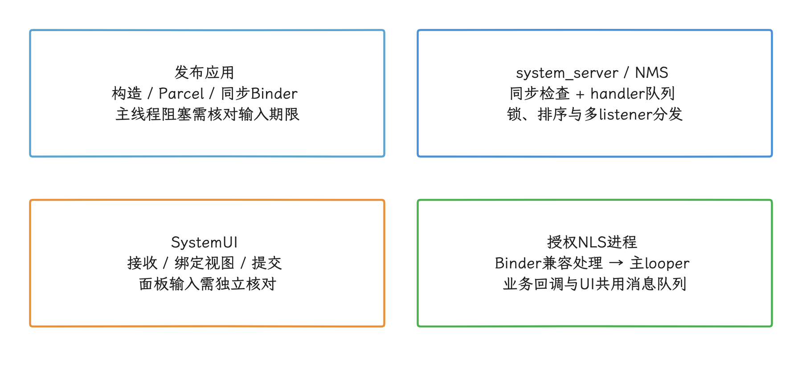

图：同一通知跨越不同进程；延迟显示、输入ANR、FGS转换超时必须按执行链分别取证。

前台服务还有一条相邻的超时：调用 `startForegroundService()` 后若没有及时完成 `Service.startForeground()`，AMS（ActivityManagerService）的 `serviceForegroundTimeout()` 会为该服务构造 timeout record（超时记录）、停止仍在等待的服务，并延迟派发 `SERVICE_FOREGROUND_TIMEOUT_ANR_MSG`；`serviceForegroundCrash()` 则使用 `ForegroundServiceDidNotStartInTimeException` 报告崩溃路径。

复杂通知经常消耗这段时间预算，所以诊断报告仍会把它与通知性能放在一起，但要按前台服务转换超时单独归类。

## 通知发布流程与 ANR 触发点

### `notify()` 返回前做了哪些工作

`NotificationManager.notify()` 最终调用 `INotificationManager.enqueueNotificationWithTag()`。该 AIDL（Android 接口定义语言）方法没有声明 `oneway`，因此它是同步 Binder 调用，调用线程会等待 `system_server` 返回。

Android 17 / `android-17.0.0_r1` 的调用顺序可以拆成六段：

<!-- gracker-diagram: ch09-05-02-sync-prefix -->
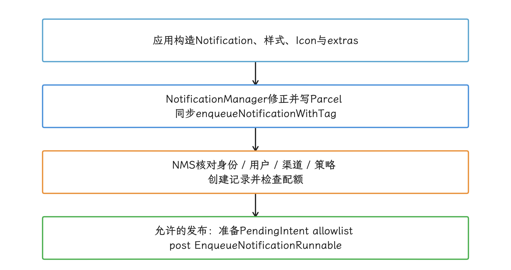

图：这是普通同步发布的允许路径；拒绝和异常可能提前结束，post后的任务与Binder返回可交叠。

1. 应用构造 `Notification`、样式、`RemoteViews`、`Icon` 和 extras（附加字段）。
2. `NotificationManager` 执行兼容性修正，并把对象写入 Binder Parcel。
3. NMS 校验调用 UID、包名、用户、受限类别、通知渠道和前台服务策略。
4. NMS 修正通知、创建 `StatusBarNotification` / `NotificationRecord`，再检查通知数量和更新速率。
5. NMS 为 PendingIntent 设置临时 allowlist（允许后台启动等受限操作的名单）等状态，然后把 `EnqueueNotificationRunnable` post（投递）到 handler。
6. 发布调用不等待 handler 后续入队、正式发布、listener 回调或 SystemUI 呈现完成；这些工作与 Binder 返回可以交叠，不能把本列表画成所有步骤严格串行。

下面的源码片段标出同步 Binder 入口和异步分界：

```java
// frameworks/base/core/java/android/app/NotificationManager.java
service.enqueueNotificationWithTag(
        targetPackage, sender, tag, id,
        fixNotification(notification),
        mContext.getUser().getIdentifier());

// frameworks/base/services/core/java/com/android/server/notification/NotificationManagerService.java
mHandler.post(new EnqueueNotificationRunnable(
        userId, r, isAppForeground, isAppProvided, tracker));
return true;
```

普通同步发布路径中，NMS 投递 handler 前的处理位于该次 Binder 服务端调用内，工作量远多于“权限校验后立刻入队”；投递后的任务可能在客户端收到返回之前已经开始。`INotificationListener.aidl` 则声明为 `oneway interface`，因此 listener 回调和 SystemUI 显示通知都不在发布者这次 Binder 调用的返回路径上。

<!-- gracker-diagram: ch09-05-03-partial-order -->
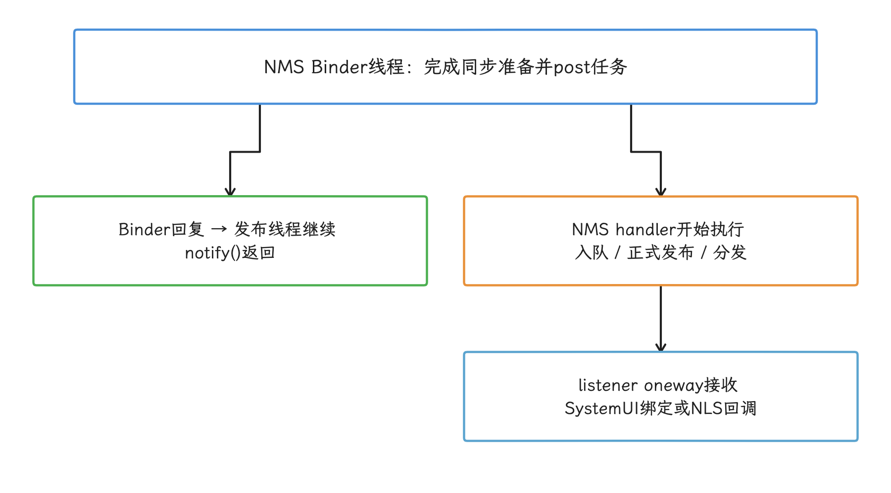

图：handler在任务投递后即可运行；客户端收到Binder回复与handler开始之间没有固定先后，不等待listener或显示完成。

发布应用主线程停在 `notify()` 时，应继续判断耗时位于哪一侧：

<!-- gracker-diagram: ch09-05-04-publisher-cost -->
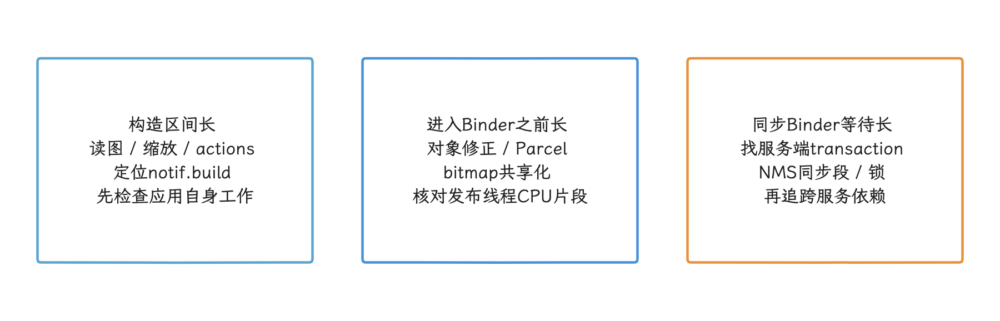

图：若notify很快返回而上屏慢，继续调查handler与SystemUI；主线程长等待还需输入期限证据才能归为Input ANR。

- `notif.build` trace 区间很长：应用在读取文件、缩放图片、创建大量 action 或组装 extras；
- Binder transaction 前的 Running（正在 CPU 上执行）时间很长：Parcel 写入、bitmap 转共享内存或应用侧修正较重；
- 同步 Binder wait 很长：NMS 同步段、`system_server` Binder 线程、内部锁或被调用服务较慢；
- `notify()` 很快返回但用户晚看到：转查 NMS handler 与 SystemUI 消费链。

### 前台服务转换超时

AMS 给要求转为前台的 Service 安排独立 timer（计时器）；服务完成 `startForeground()` 后，这段等待才取消。图片下载、磁盘读图、数据库查询和复杂布局都不应放在此前的主线程路径上。

下面是 Service 上下文中的两阶段教学片段：预先创建有效 channel，并满足清单中的服务类型、权限与当前启动资格后，先用最小通知调用前台转换，再在后台生成增强内容。`DATA_SYNC` 仅代表示例业务类型：

<!-- gracker-diagram: ch09-05-05-fgs-budget -->
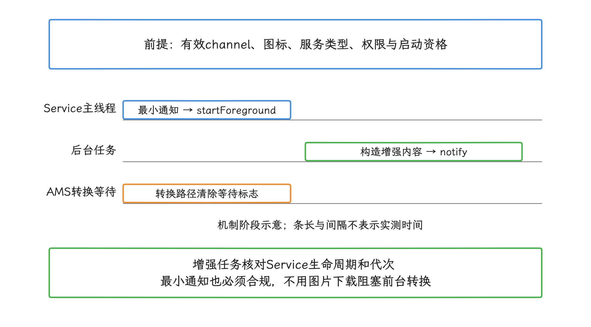

图：阶段条表达示例设计；timer取消、异步通知校验与屏幕呈现是不同事件。

```java
Notification stub = new Notification.Builder(this, CHANNEL_ID)
        .setSmallIcon(R.drawable.ic_stat)
        .setContentTitle("服务启动中")
        .build();
ServiceCompat.startForeground(this, ID, stub, FOREGROUND_SERVICE_TYPE_DATA_SYNC);

backgroundExecutor.execute(() -> {
    Notification full = buildFullNotification();
    notificationManager.notify(ID, full);
});
```

前台转换、通知校验和屏幕呈现是不同阶段。AMS 在转换路径清除 `fgRequired/fgWaiting` 并取消前台转换 timer；`ServiceRecord.postNotification()` 则向 AMS handler 投递通知处理，之后仍可能因渠道或图标等错误走 `CannotPostForegroundServiceNotificationException` 崩溃路径。所以正常返回不能证明通知已完成所有校验或已经上屏。增强通知仍要检查任务代次和 Service 生命周期，避免停止后补发过期内容。

<!-- gracker-diagram: ch09-05-06-fgs-async-outcome -->
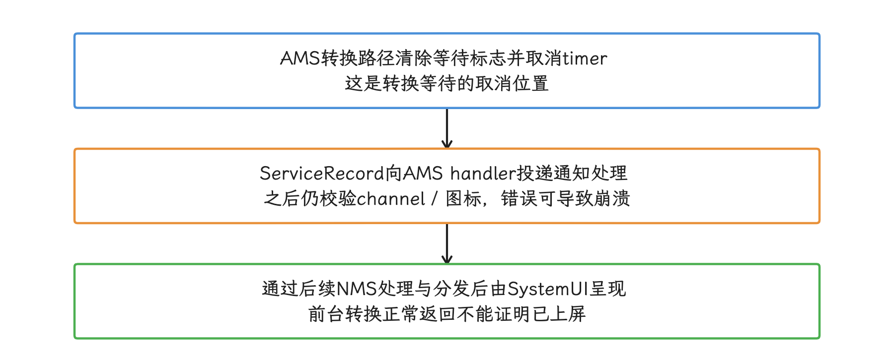

图：前台转换timer取消并不证明后续所有通知校验通过；前台转换ANR、DidNotStart崩溃与坏通知崩溃须分开。

故障日志含 `Context.startForegroundService() did not then call Service.startForeground()`、`ForegroundServiceDidNotStartInTimeException` 或 service foreground timeout ANR 时，按前台转换超时处理。若同一窗口内还有输入 ANR 或普通 Service 执行 ANR，需要分别保留时间线，不能用其中一条自动解释另一条。

## NotificationManagerService 内部机制

### Binder 线程与 handler 各自负责什么

NMS Binder 线程负责检查调用身份、渠道和策略，修正对象，并完成配额检查和入队准备。`EnqueueNotificationRunnable` 进入 handler 后，NMS 才在通知锁保护下处理旧记录、分组、排序、提醒效果、URI 权限和 listener 通知。

<!-- gracker-diagram: ch09-05-07-nms-handler -->
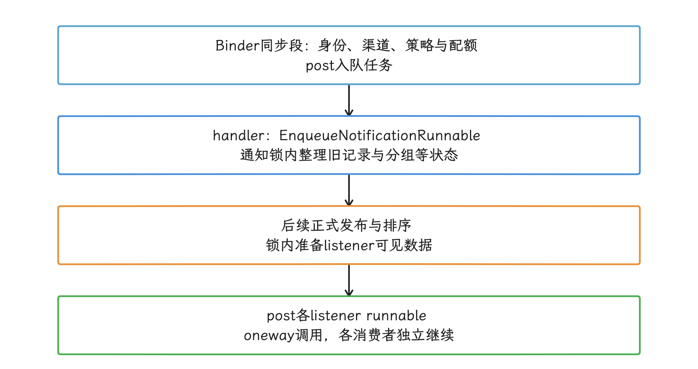

图：为便于读图合并handler内部阶段；源码还有正式发布任务，不把入队完成等同于上屏完成。

源码里的线程名和 Trace section 会被平台分支调整。诊断时从执行上下文逐项确认：

- 发布线程处于 Running、Runnable（具备运行条件但尚未获得 CPU）还是 Binder sleep（等待 Binder 回复）；
- 同一 Binder transaction 的服务端线程何时开始、何时返回；
- NMS handler 是否获得 CPU，是否长时间持有 `mNotificationLock`；
- SystemUI 与每个 NLS 的 Binder 接收线程、主线程消息何时运行。

### 通知排序与分发的开销

`NotificationListeners.prepareNotifyPostedLocked()` 会遍历已注册 listener，按用户、可见性、敏感信息与版本规则准备各自的数据。`makeRankingUpdateLocked(info)` 遍历当前通知列表，只把该 listener 可见的记录写进 `NotificationRankingUpdate`（通知排序与状态快照）。这项工作在通知锁内完成，每个 listener 得到的 map（映射表）可能不同。

准备完成后，NMS 把 listener runnable 投递到 handler，再调用 `oneway` Binder 接口。异步只省去了“等待客户端执行完”的过程，以下成本仍由 `system_server` 承担：

- 为 listener 过滤、裁剪或脱敏 `StatusBarNotification`；
- 构造该 listener 可见通知的 ranking 数组；
- 把通知与 ranking update 写入 Binder Parcel；
- 处理 Binder driver 背压（接收端来不及处理时发送端受限）、失败与 listener 生命周期。

通知总数、listener 数量和更新频率共同决定 fan-out（一次更新向多个监听器分发）的成本。不能用固定的“通知超过多少条”阈值代替 Perfetto 测量。

<!-- gracker-diagram: ch09-05-08-fanout -->


图：这些变量增加工作量的机会，并非固定线性耗时公式；锁内和跨进程成本需在目标build测量。

### 通知限流策略

Android 17 的更新速率限制位于 `checkDisqualifyingFeatures()`。它按应用包统计 enqueue rate（入队速率），不按 channel（通知渠道）单独计数。默认配置值是 `DEFAULT_MAX_NOTIFICATION_ENQUEUE_RATE = 5f`，系统可以从 `Settings.Global.MAX_NOTIFICATION_ENQUEUE_RATE` 覆盖，因此应用不能把 `5` 当作固定的系统契约。

下面摘录 `android-17.0.0_r1` 的更新速率分支；其外层只对非 system/phone/android 通知、且不是已注册 listener 包的发布者执行该配额检查：

<!-- gracker-diagram: ch09-05-09-rate-gates -->
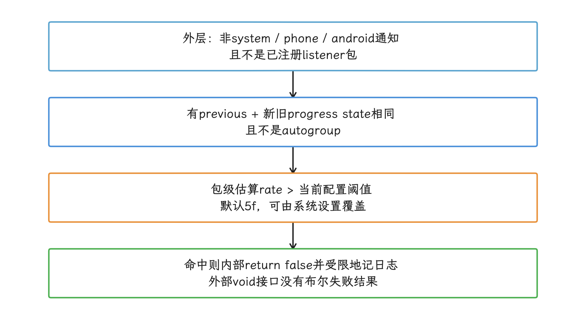

图：任一条件不成立只会跳过这段速率检查；权限、渠道、数量等校验仍然有效。

```java
NotificationRecord previous = findPreviousNotificationLocked(r.getKey());
if (previous != null
        && previous.getNotification().getProgressState()
                == r.getNotification().getProgressState()
        && !isAutogroup) {
    final float appEnqueueRate = mUsageStats.getAppEnqueueRate(pkg);
    if (appEnqueueRate > mMaxPackageEnqueueRate) {
        return false;
    }
}
```

在该外层适用范围内，首次发布没有 `previous`，不会命中这段更新速率检查；新旧 progress state 不同或 `isAutogroup` 为真也会跳过这一分支，其他渠道、权限与数量等校验仍可能拒绝。状态来自 progress/max/indeterminate extras，并不是每次进度数值变化都算状态转换。

<!-- gracker-diagram: ch09-05-10-progress-state -->


图：getProgressState读取进度extras；首次发布、autogroup和状态转换的分支条件不能推广为发布一定成功。

适用分支超限时 NMS 返回 `false`，并受日志时间间隔限制地记录 `Shedding <notification-key>`；Shedding 表示本次更新被丢弃，没有对应日志也不能排除限流。速率由 `NotificationUsageStats` / `RateEstimator` 估算，已接受的入队事件更新到达间隔的指数加权估计，不是“每个整秒精确准许五次”的计数器。外部 AIDL 返回类型是 `void`，发布应用通常收不到异常或失败回调，所以进度值可能跳跃。限流本身不会触发 ANR，它用于阻止高频更新继续增加 NMS 与消费者负载。

<!-- gracker-diagram: ch09-05-11-rate-estimator -->
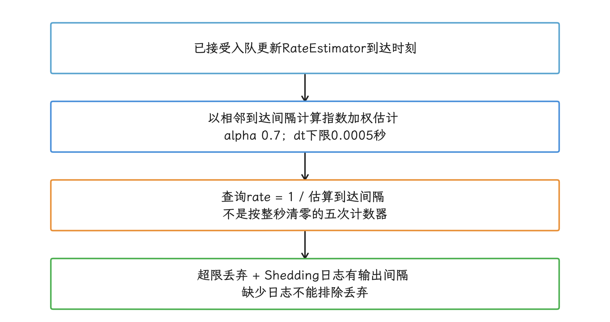

图：数值来自固定源码内部实现，不是应用发布频率契约；速率限制本身不是ANR detector。

同一方法还限制普通应用保留的未完成通知数量。前台服务、user-initiated job（由用户主动发起的任务）和聚合组有各自例外，不能把速率配额、数量配额和 channel 限制混成一个概念。

<!-- gracker-diagram: ch09-05-12-quota-types -->
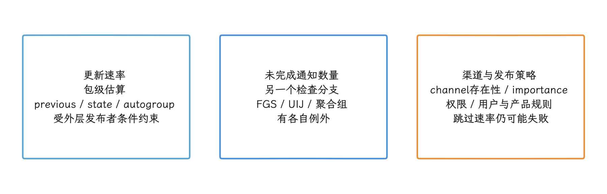

图：降低频率只能减少一部分重复工作；终态仍需明确发布并满足其余校验。

## RemoteViews 的性能开销

### 传输的是布局标识和 action

`RemoteViews` 保存布局标识、应用信息、action（要在远端视图上执行的操作）和 bitmap/collection cache（图片与集合数据缓存）。它会被写入 Parcel；消费者收到后再创建或复用 View 树。

Android 17 的同步 `apply()` 路径可用下面的伪代码表达；`...` 表示省略参数，不是可独立编译的源码：

```java
private View apply(Context context, ViewGroup parent, ...) {
    RemoteViews rvToApply = getRemoteViewsToApply(context, size);
    View result = inflateView(context, rvToApply, directParent, ...);
    rvToApply.performApply(result, rootParent, params);
    return result;
}
```

`writeToParcel()` 会写入 bitmap cache、应用信息、layout ID 和逐个 action。`mActions` 是内存字段，Parcel 中保存的是 action count（数量）、tag（类型标记）和各 action 数据，不存在名为 `mActions` 的 Parcel 字段。

<!-- gracker-diagram: ch09-05-13-rv-transport -->
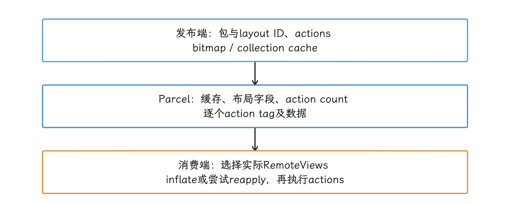

图：传输的是布局描述及操作数据，不是发布端已构建的整棵View树；mActions不是Parcel字段名。

### 布局复杂度会放大 SystemUI 的工作量

自定义布局可能增加两端成本：发布端构造 action 并写入 Parcel，SystemUI 创建或复用 View、应用 action，再由实际窗口 UI 线程进行测量、布局和绘制。正常通知异步绑定在 `@NotifInflation` worker 与 UI 回调之间交接；RemoteViews 的部分准备在 worker，剩余 action 与完成回调在其 Context 的主 looper，同步 fallback 又会增加 UI 回调耗时。不能把整段绑定都算成主线程同步 `apply()`，也不能从窗口线程 flag 推断所有回调都已迁移。

<!-- gracker-diagram: ch09-05-14-rv-async -->
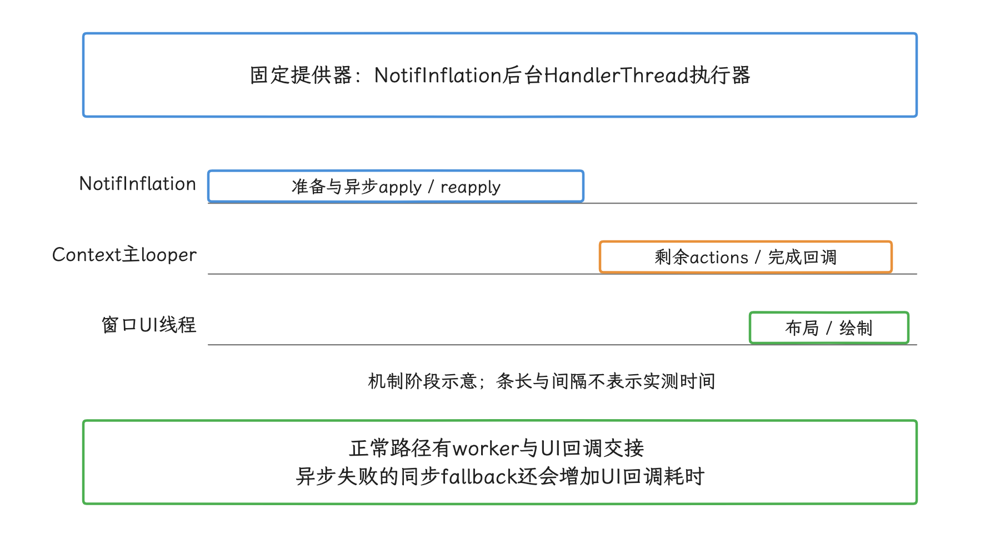

图：阶段可交叠且不是实测比例；窗口线程归属需按目标build确认，不能把所有绑定都算成main同步apply。

工程上优先选择 `BigTextStyle`、`BigPictureStyle`、`MessagingStyle`、`ProgressStyle` 或 `MetricStyle` 等系统样式。标准样式仍通过框架生成的 `RemoteViews` 渲染；它的优势是布局和 action 由系统控制、适配更一致，但仍存在 `RemoteViews` 的处理开销。

### RemoteViews 的 reapply 机制

SystemUI 会先检查复用条件，通过后才能调用 `reapply()` / `reapplyAsync()`。固定版本 `canReapplyRemoteView(newView, oldView)` 在二者非空时比较非空包名、layout ID，并检查旧对象没有 `FLAG_REAPPLY_DISALLOWED`；它没有对新对象做同一 flag 检查。该预检查通过后，RemoteViews 对多布局或 View ID 等条件仍有校验，执行也可能失败并回退，不能把“可尝试 reapply”当作必然成功。

<!-- gracker-diagram: ch09-05-15-rv-reapply-guard -->
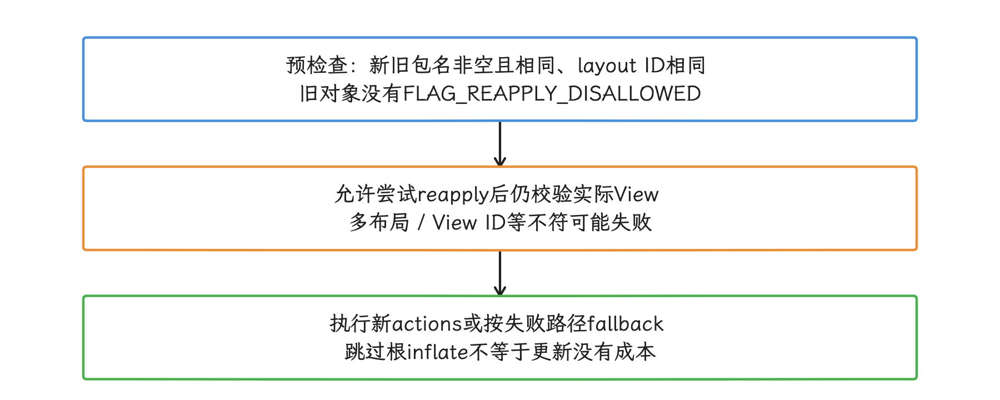

图：固定canReapplyRemoteView还有双方皆null的判等分支；可尝试复用不代表一定成功或action零成本。

`reapply()` 会跳过根布局的 inflate，但仍会执行新对象中的 action。频繁更新进度时，保持模板和布局标识不变有助于复用；`setText`、`setImageViewBitmap` 等 action 的成本仍然存在。需要在目标 build（系统构建版本）的 SystemUI trace 中分别测量 inflate、async apply、reapply 和主线程提交。

### 图片通知的开销落在三段

图片型通知的成本分布在三个位置：

<!-- gracker-diagram: ch09-05-16-image-three-costs -->
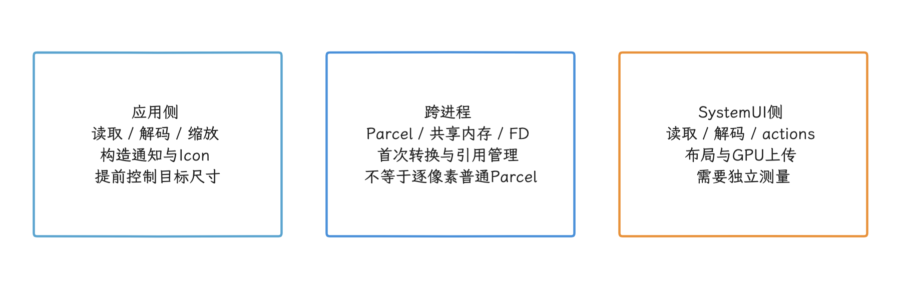

图：同一张图片可能在多个阶段产生工作；共享内存不消除解码、对象创建和渲染成本。

1. 应用侧取图、缩放和构造通知对象；
2. 通过 Parcel、共享内存和 Binder FD（文件描述符）传输；
3. SystemUI 侧加载、apply、布局与渲染。

三种 `Icon` 输入的成本模型不同：

<!-- gracker-diagram: ch09-05-17-icon-inputs -->
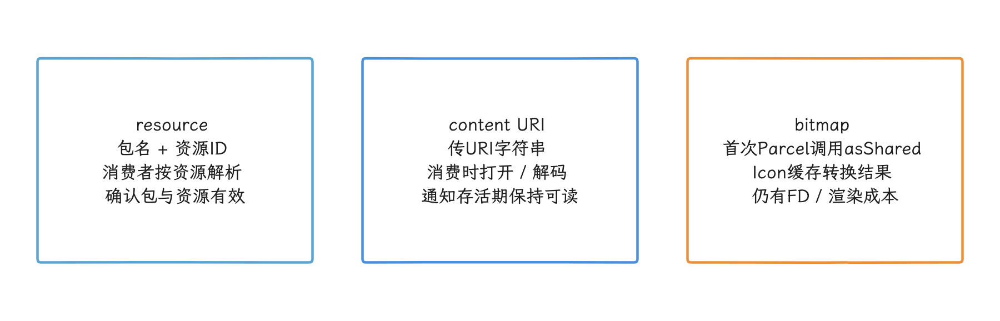

图：不存在适用于所有来源的统一性能排序；授权、图像尺寸与更新频率都影响选择。

- `createWithResource()` 传包名与资源 ID，消费者按资源解析，适合应用内稳定资源；
- `createWithContentUri()` 传 URI 字符串，消费者稍后打开并解码，需要 URI 在通知存活期间可读；
- `createWithBitmap()` 在 `Icon.writeToParcel()` 中调用 `Bitmap.asShared()`。`Icon` 首次需要转换时缓存 `asShared()` 的结果；Bitmap 仅在 ashmem 支持、不可变，并且 gainmap 无需替换时返回自身，其余情况会创建共享副本，也可能转换失败。

共享内存可以避免把每个像素作为普通 Parcel 数据复制，但并非零成本。首次 `asShared()`、FD 管理、接收端对象创建和 GPU 上传仍会产生开销。

<!-- gracker-diagram: ch09-05-18-bitmap-shared -->
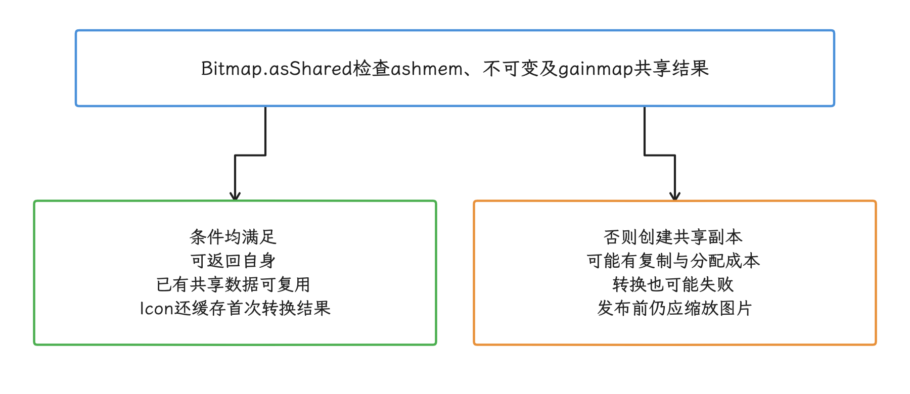

图：gainmap需要替换时不能仅凭bitmap已共享就断言返回自身；共享化不等于整条通知路径零拷贝。

AOSP 没有要求通知 bitmap 必须是 `ARGB_8888`；应根据图像内容选择合适格式，并在发布前缩放到实际需要的尺寸。

## NotificationListenerService 与性能

### NLS 回调的线程模型

`NotificationListenerService.attachBaseContext()` 用 `getMainLooper()` 创建 `MyHandler`。在固定版本的 posted 入口，Binder stub 先执行旧客户端兼容处理，包括可能的图标加载、RemoteViews 补建与 people 转换，再在锁内应用 ranking 更新并投递消息；公开 `onNotificationPosted()` 随后在该主 looper 执行。Binder 接收端并非只做一次空转交接，兼容处理成本也要单独采集。

<!-- gracker-diagram: ch09-05-19-nls-thread-model -->
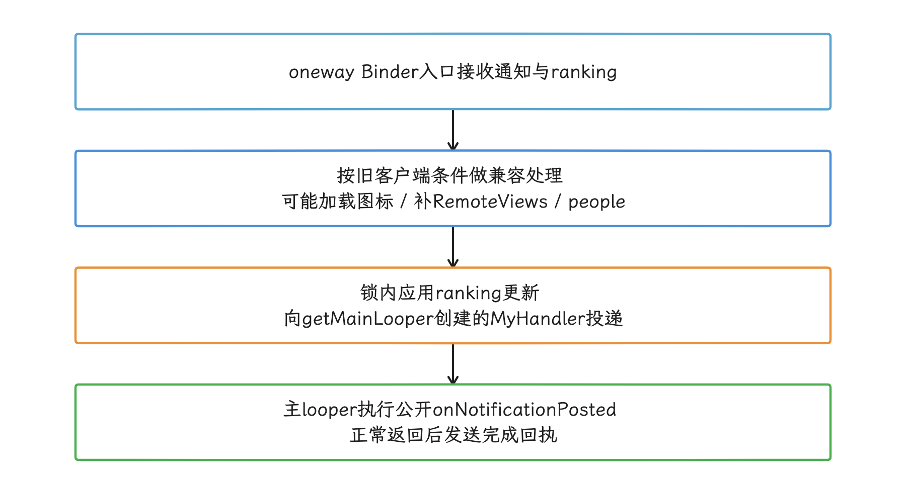

图：兼容工作并非每个客户端都执行；Binder接收段与主线程回调段需要分别测量。

下面的实现把数据库、网络和分析都留在主线程，容易让后续通知回调与应用 UI 消息排队：

```java
public class MyNotificationListener extends NotificationListenerService {
    @Override
    public void onNotificationPosted(
            StatusBarNotification sbn,
            RankingMap rankingMap) {
        saveToDatabase(sbn);
        uploadToServer(sbn);
        analyzeNotification(sbn);
    }
}
```

这段代码会延长该 listener 本次回调的执行时间，也会推迟后续主线程消息。若没有本次等待中的输入连接，仅凭 NLS 长回调不能认定 Input ANR；它可能首先表现为后续回调与主线程消息积压。Input ANR 还需对应输入事件、连接身份和 detector 到期证据，其他组件超时也应各自核对。

<!-- gracker-diagram: ch09-05-20-nls-backlog -->
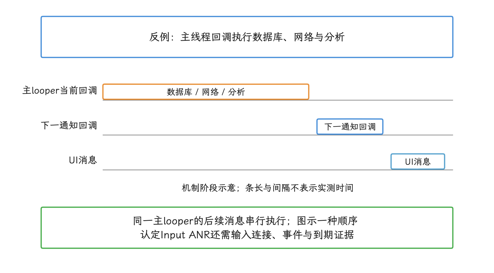

图：图只说明队列依赖，不给出虚构延迟；NLS长任务本身不能证明存在本次Input ANR。

### 回调只做快照与转交

NLS 回调参数来自系统状态，后台任务应复制所需字段，并定义队列容量、覆盖和去重策略。下面的示例用一个 worker 按接受顺序处理允许丢弃的分析样本，并设置有界等待队列；容量 64 是教学参数，不是 Android 阈值。需要导入 `java.util.concurrent` 中对应类型及 `android.util.Log`，业务 DTO 与分析方法由应用提供：

```java
public class MyNotificationListener extends NotificationListenerService {
    // 教学容量；业务需按内存和事件滞后预算配置。
    private final ThreadPoolExecutor worker = new ThreadPoolExecutor(
            1, 1, 0L, TimeUnit.MILLISECONDS,
            new ArrayBlockingQueue<>(64),
            new ThreadPoolExecutor.AbortPolicy());

    @Override
    public void onNotificationPosted(
            StatusBarNotification sbn,
            RankingMap rankingMap) {
        NotificationSnapshot snapshot =
                NotificationSnapshot.copyRequiredFields(sbn, rankingMap);
        try {
            worker.execute(() -> persistAndAnalyze(snapshot));
        } catch (RejectedExecutionException rejected) {
            // 本例只用于允许丢弃的分析样本；不在主线程回退执行。
            Log.w("NlsWorker", "Sample dropped: queue full or service stopped");
        }
    }

    @Override
    public void onDestroy() {
        worker.shutdownNow();
        super.onDestroy();
    }
}
```

`NotificationSnapshot` 是应用自定义 DTO（只承载数据的对象）。复制时只取业务需要的 key、package、post time（发布时间）、文本摘要和当前通知的 ranking；图片、完整 extras、历史 `RankingMap` 与大 `RemoteViews` 不应默认进入后台队列。本例队列满或已关闭时丢弃样本，销毁时取消排队并中断运行任务；业务工作需响应中断，`shutdownNow()` 不保证运行任务已经结束。若业务必须保留移除和最终状态，应另行实现按 key 合并、持久化或重新同步协议，不能把这个分析示例当作无损事件通道。

<!-- gracker-diagram: ch09-05-21-nls-bounded-worker -->
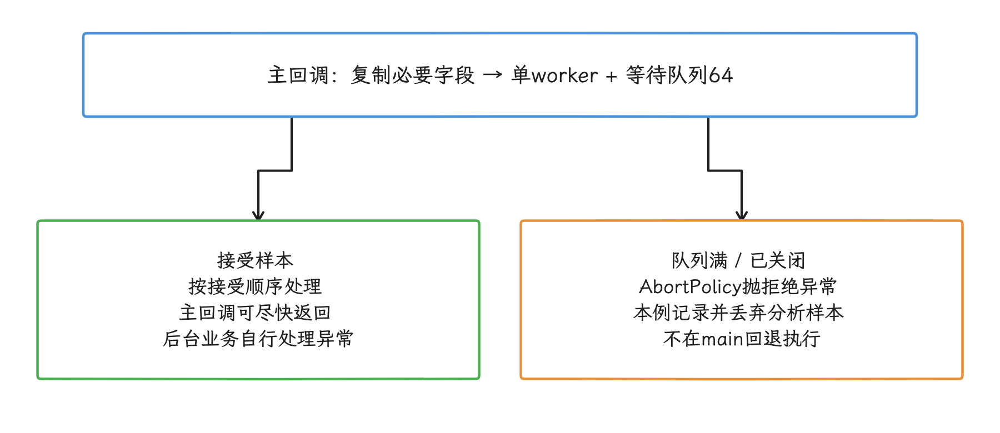

图：64是教学容量；该示例允许丢弃，不提供移除或最终状态无损保证，业务需另行实现合并/持久化/重同步。

<!-- gracker-diagram: ch09-05-22-nls-shutdown -->
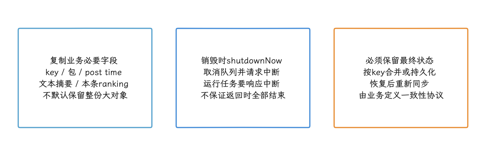

图：快照复制也有成本；普通executor只提供进程内调度，框架完成回执不替业务保证持久执行。

### 回调完成回执与进程冻结

Android 17 对带 `IBinderSession` 的绑定还跟踪 dispatch token。NLS 的 MyHandler 在公开回调正常返回后发送完成回执；NMS 收到后，再按可配置的 `mNlsCompletionDurationMs` 延迟关闭 session 中该次调用，默认延迟为 10 秒。它是回调完成之后的状态记账宽限，不是“回调允许执行 10 秒”的 NLS ANR timer。

<!-- gracker-diagram: ch09-05-23-nls-session -->
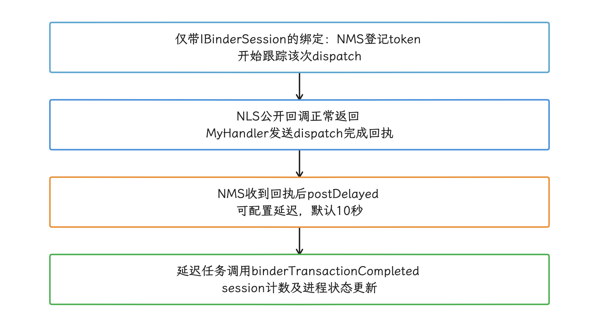

图：默认10秒从回执后开始，是状态记账宽限；系统直接注册listener可能没有session，不能画成独立NLS ANR计时器。

该 session 与允许冻结的绑定及进程状态更新有关，系统直接注册的 listener 可能没有它。把工作交给自己的 executor 后，公开回调已返回，框架的完成回执并不等待后台持久化或网络请求。需要持久执行保证的业务必须使用相应的任务与生命周期协议。

<!-- gracker-diagram: ch09-05-24-nls-background-boundary -->
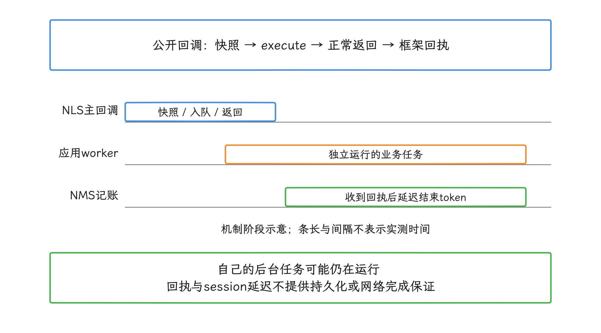

图：只示意允许的交叠；worker完成时间与10秒宽限没有固定先后，持久执行需任务和生命周期协议。

### RankingMap 的成本与可见性

每次 posted callback（通知已发布回调）携带的是该 listener 当前可见通知的 ranking map。NMS 会按 listener 过滤用户、通知类型、锁定模式与敏感内容，再构造 `Ranking[]`。因此：

<!-- gracker-diagram: ch09-05-25-ranking-scope -->
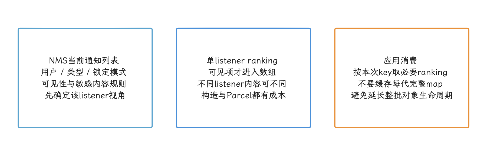

图：它不是全系统通知快照；可见条目和listener数量增加分发工作机会，不能以固定条数推算耗时。

- map 只包含该 listener 可见的通知，并非系统全部通知；
- 不同 listener 的条目数和内容可能不同；
- 构造和 Parcel 成本随可见通知数量与 listener 数量增长；
- 应用缓存旧 map，会让整批 ranking 对象更久不能释放。

如果业务只关心本次 `sbn.getKey()`，在回调里调用 `rankingMap.getRanking(key, reusableRanking)` 取出需要的字段即可。不要为“以后也许会用”保存每一代 map。

## 通知与 ANR 的典型模式

### 模式一：发布应用主线程卡在同步 Binder

trace 位于 `NotificationManager.notify*()`、`BinderProxy.transactNative()` 或 Parcel/bitmap 路径。取证要覆盖应用 slice 和对应的 `system_server` Binder 线程。若发布发生在主线程，长等待可能叠加输入事件并触发应用 Input ANR。

<!-- gracker-diagram: ch09-05-26-pattern-publisher -->
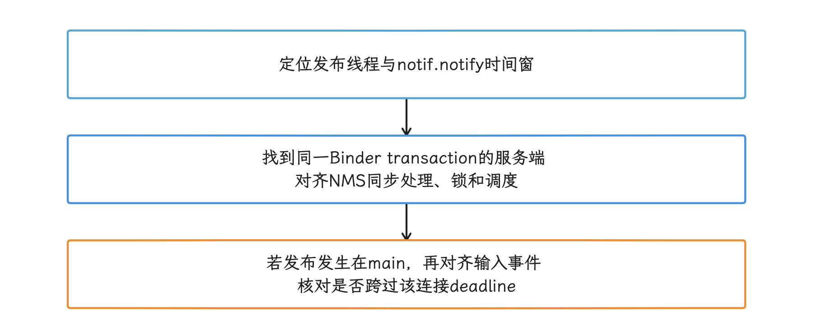

图：单独看到BinderProxy.transactNative只提供等待入口；必须追服务端与输入期限才能闭合应用Input ANR因果。

### 模式二：前台服务转换超时

日志含 `ForegroundServiceDidNotStartInTimeException`、前台转换 timeout record 或 service foreground timeout ANR。检查 Service 回调入口到 `startForeground()` 的所有同步工作，先提交最小合规通知，再构造增强内容。

### 模式三：NLS 主线程回调积压

监听器自己的主线程栈落在数据库、JSON、锁或网络等待上。输入 ANR 还需证明该进程存在等待中的输入事件；没有这项证据时，结论写成 NLS 主线程长任务和回调积压。

<!-- gracker-diagram: ch09-05-27-patterns-fgs-nls -->
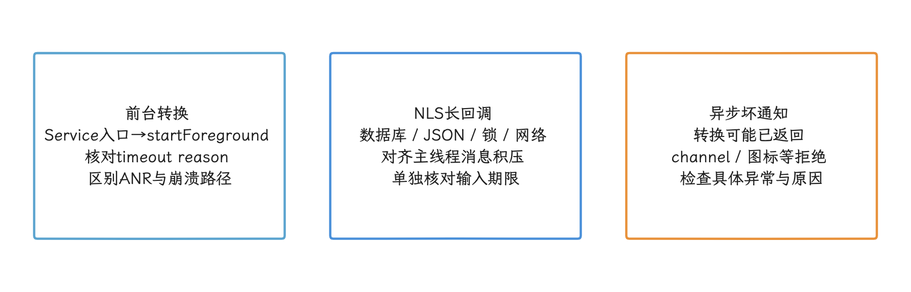

图：前台转换、普通Service执行、输入超时和坏通知不是同一个detector；不能用同一份静态栈相互替代。

### 模式四：高频 update 被限流丢弃

下载、导航、计时和指标通知反复更新同一个 key。应用反复构造对象，NMS 反复检查并向各监听器分发；同一 progress state（进度状态）内的 update 还可能在没有回调通知应用的情况下被丢弃。更新频率应根据用户可见变化、允许信息滞后的最长时间和最终状态发布要求来设计，不应跟随每个底层采样点发布。

<!-- gracker-diagram: ch09-05-28-pattern-update -->
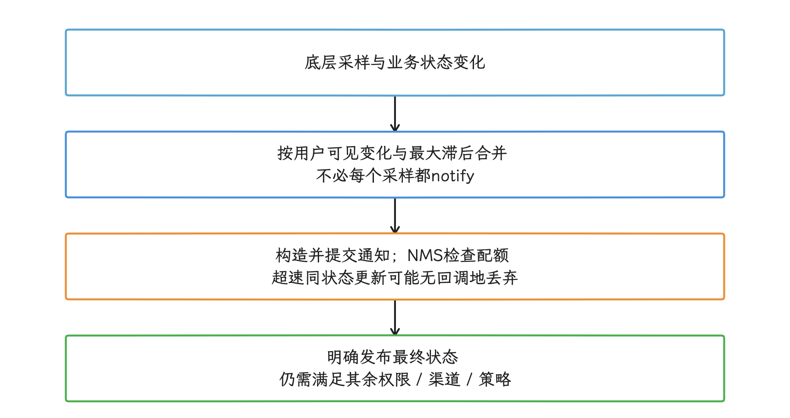

图：这是更新策略设计顺序，不是统一频率建议；状态转换跳过速率分支不保证最终一定上屏。

### 模式五：SystemUI 渲染长任务

发布线程很快返回，通知显示却明显延后；Perfetto 显示 SystemUI 在 apply、图片加载、布局或主线程提交上耗时。若通知面板正接收触摸事件，SystemUI 主线程长任务还可能形成它自己的 Input ANR。

<!-- gracker-diagram: ch09-05-29-pattern-systemui -->
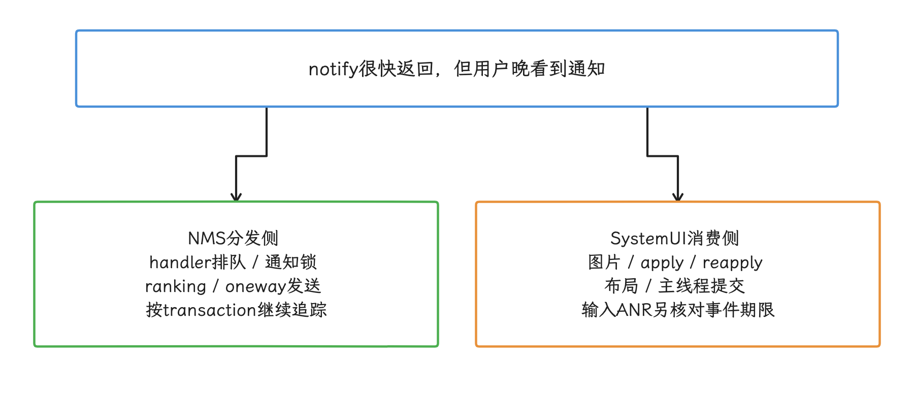

图：晚显示可能来自多个异步阶段；发布端返回时长不能替代显示延迟或消费者主线程时长。

### 模式六：渠道创建进入首次关键启动路径

`createNotificationChannel()` 与 `notify()` 都会进入 NMS。固定 channel 可以幂等创建（重复执行不会改变最终结果），放在可控的初始化阶段完成；首次启动前台服务时，不应同时执行大量 channel 迁移、图片读取和通知发布。必需 channel 也不能为减少启动耗时而延后创建，否则首个通知会因 channel 缺失被拒绝。

<!-- gracker-diagram: ch09-05-30-channel-startup -->
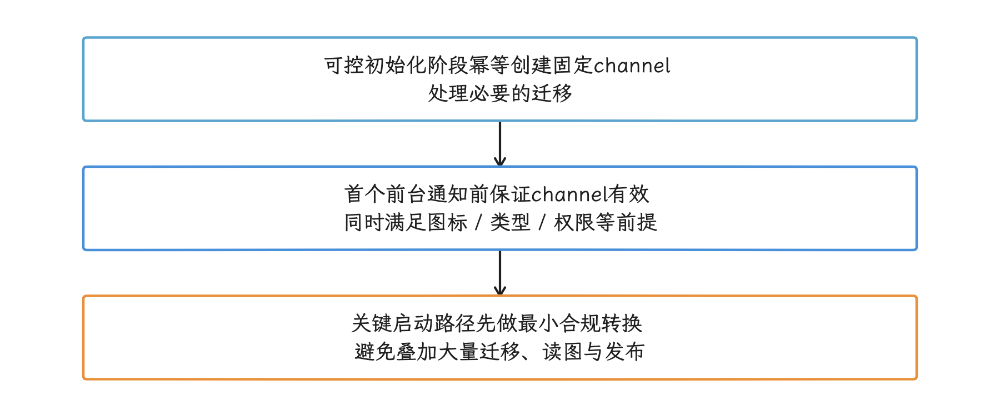

图：channel创建和notify都会进入NMS；优化启动耗时不能以省略首个通知必需的channel为代价。

## Android 17 通知性能变更

### 版本边界

| 版本 | 已确认变化 | 性能诊断含义 |
|---|---|---|
| Android 12（API 31） | 支持范围的基线；NMS 已有通知数量与更新速率保护 | 不把这些保护误写成 Android 17 新增 |
| Android 13（API 33） | `POST_NOTIFICATIONS` 成为 runtime permission（运行时权限） | 发布前处理授权状态；它不改变已获授权通知的 NMS 同步边界 |
| Android 16（API 36） | `Notification.ProgressStyle` 与 promoted ongoing / Live Update API | 进度场景可使用系统样式；是否获得 Live Update 的显著展示位置需要另行判断 |
| Android 17（API 37） | `Notification.MetricStyle`、Metric value 类型、Semantic Coloring | 指标场景新增系统样式，语义颜色由状态栏等系统 surface（展示区域）解释 |

<!-- gracker-diagram: ch09-05-31-versions -->
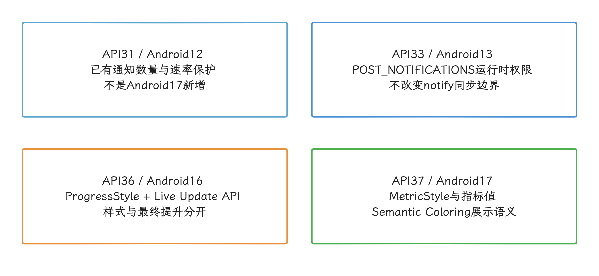

图：图示版本能力；OEM、功能开关和用户设置仍可能影响实际展示，不据此推导执行优先级。

没有 Android 17 一手证据支持“后台 NLS 统一按包限频”，因此不能采用该说法。

### ProgressStyle 与 Live Update 是两个概念

`ProgressStyle` 描述通知内容。Live Update 则表示系统是否把 ongoing（持续进行中）通知提升为 promoted ongoing，并放到更显眼的 surface。它还要满足 manifest permission（清单声明的权限）、channel importance（渠道重要性）、样式和用户设置等条件；OEM 可以增加资格规则。

当前官方指南列出 Standard、`BigTextStyle`、`CallStyle`、`ProgressStyle`、`MetricStyle` 等可申请样式，并要求 ongoing、请求提升、相应权限及其他展示资格。固定源码还排除 group summary、自定义视图和 colorized 请求，并检查 channel importance 大于 MIN、非 bundle channel；MetricStyle 的标题资格可由指标提供，不必一概要求显式 `contentTitle`。通过内容资格也不保证最终提升或固定展示位置，用户可以降级或移除，不能据此推导执行优先级或必然的性能收益。

<!-- gracker-diagram: ch09-05-32-live-eligibility -->
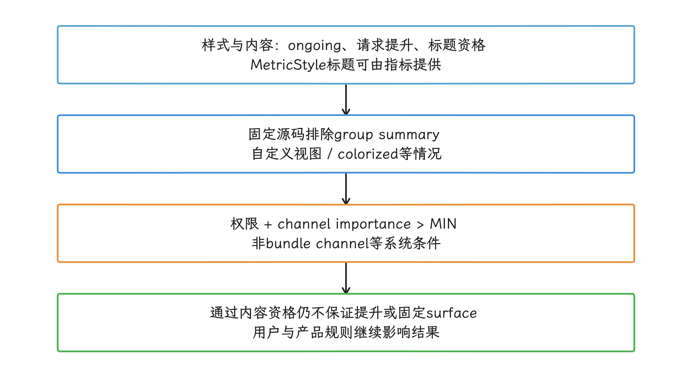

图：ProgressStyle是内容样式，Live Update是提升展示；LOW并非固定源码禁止阈值，提升不等于性能收益。

> ⚠️ 矛盾：本章引用的旧研究摘要把 ProgressStyle 与自动提升混在一起，并把 LOW importance 写为禁止条件；当前源码检查的是 `importance <= MIN`，且提升还受权限、用户与产品规则约束。原始摘要保留，本章按固定源码和当前指南说明。

### MetricStyle 与 Semantic Coloring

`Notification.MetricStyle` 在 API 37 加入，展开状态最多展示三个指标。每个 `Notification.Metric` 包含 label（标签）和一种 `MetricValue`；系统提供整数、浮点、日期、时间、时间差和文本等 value 类型。被提升为 Live Update 时，critical metric（关键指标）可能用于状态栏 chip（胶囊形提示区域）。

下面的 API 37 示例创建一个单指标系统样式：

```java
if (Build.VERSION.SDK_INT >= 37) {
    Notification.Metric steps = new Notification.Metric(
            new Notification.Metric.FixedInt(1979),
            "步数");
    Notification notification =
            new Notification.Builder(context, CHANNEL_ID)
                    .setSmallIcon(R.drawable.ic_stat)
                    .setContentTitle("今日活动")
                    .setStyle(new Notification.MetricStyle()
                            .addMetric(steps))
                    .build();
}
```

`MetricStyle` 至少要包含一个 metric（指标），否则 `build()` 会抛出 `IllegalArgumentException`。源码只绑定前三个 metric，更多条目不会进入展开布局；应用应在构造前把列表限制为三个。

<!-- gracker-diagram: ch09-05-33-metric-count -->
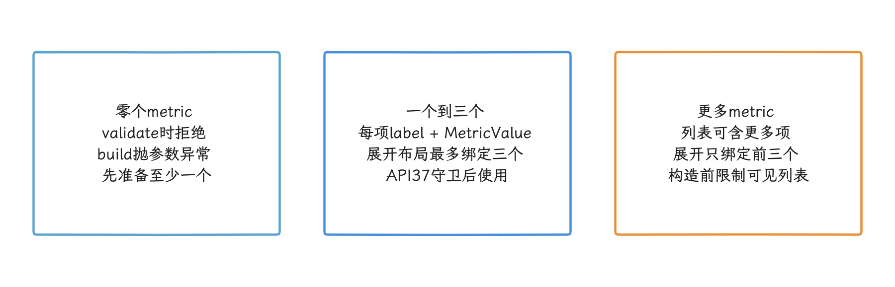

图：最多三项说的是展开布局；不要扩大为所有surface都只读取前三个，critical metric另有选择逻辑。

Android 17 的 semantic style 常量包括 `UNSPECIFIED`、`INFO`、`SAFE`、`CAUTION` 和 `DANGER`。它们表达信息、安全、警示与危险等语义，由系统 surface 选择颜色，应用不能把这些值简化为直接指定绿、红、蓝。源码只在满足 feature flag（功能开关）、promoted ongoing 和非 unspecified 等条件时给 metric value 应用语义色。

<!-- gracker-diagram: ch09-05-34-semantic-color -->
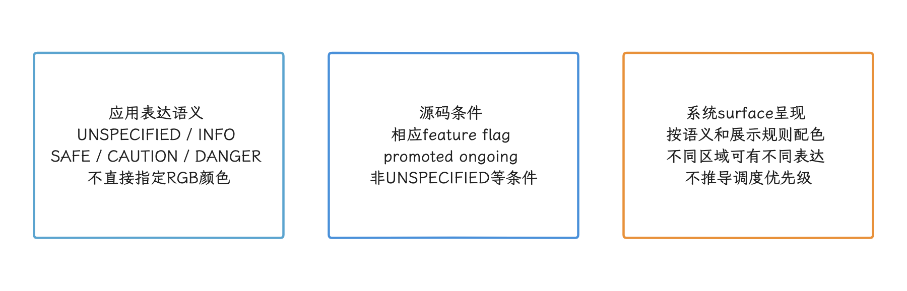

图：语义色与Metric指标不构成速率豁免；只更新metric列表通常不会改变进度extras状态。

`getProgressState()` 读取进度 extras，而不是 MetricStyle 指标列表。只更新指标、没有另外设置进度 extras 时通常保持 NONE；新旧状态相同且符合外层条件的更新仍可进入包级速率检查，系统样式本身不提供配额豁免。

## 在 Perfetto 中诊断通知 ANR

平台内部 slice（带起止时间的事件片段）和线程名会随 build 改变。应用自己的 Trace section（自定义 trace 区间）可以稳定标记通知构造、同步发布、前台转换和 NLS 回调，再结合 Binder 与调度数据追踪系统侧耗时。

### 应用侧标记

下面的 Kotlin 代码把构造与发布分成两个 section，并确保异常时关闭 section：

```kotlin
val notification = try {
    Trace.beginSection("notif.build")
    buildNotification()
} finally {
    Trace.endSection()
}
try {
    Trace.beginSection("notif.notify")
    notificationManager.notify(ID, notification)
} finally {
    Trace.endSection()
}

override fun onNotificationPosted(
    sbn: StatusBarNotification,
    rankingMap: RankingMap
) {
    try {
        Trace.beginSection("nls.callback")
        handOffSnapshot(sbn, rankingMap)
    } finally {
        Trace.endSection()
    }
}
```

`notif.build` 衡量应用构造耗时，`notif.notify` 包含 Parcel 与同步 Binder，`nls.callback` 只应覆盖快照和入队。前台服务可以另加 `notif.startForeground`。

<!-- gracker-diagram: ch09-05-35-trace-markers -->
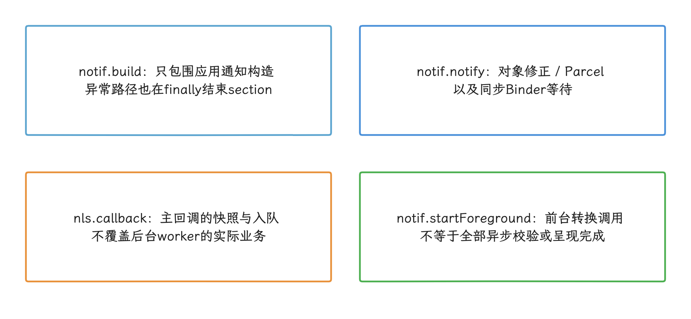

图：每个区间按真实调用边界解释，slice墙钟时长包含CPU、调度等待和阻塞，不能直接当成CPU占用。

### 最小采集配置

下面的 textproto（Perfetto 文本配置格式）请求约 30 秒的采集会话并使用 64 MiB 环形缓冲，包含目标应用 atrace、Binder 与调度事件；覆盖时长仍受事件量、覆盖写和丢包影响：

<!-- gracker-diagram: ch09-05-37-buffer-window -->
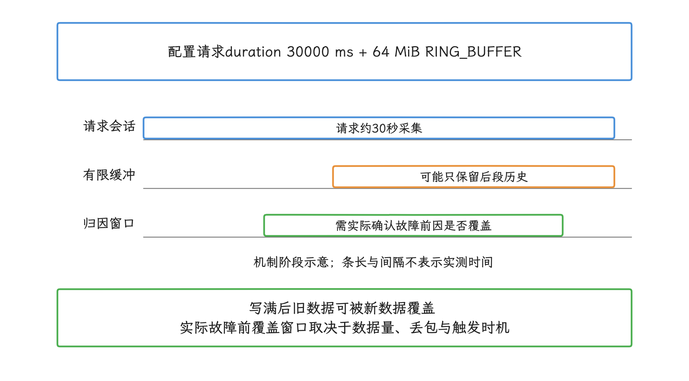

图：图只说明可能的覆盖关系；不声称该配置一定丢失多少秒，也不把duration当成保证留存时长。

```textproto
buffers: {
  size_kb: 65536
  fill_policy: RING_BUFFER
}
data_sources: {
  config {
    name: "linux.ftrace"
    ftrace_config {
      atrace_apps: "your.package"
      atrace_categories: "am"
      atrace_categories: "binder_driver"
      atrace_categories: "gfx"
      atrace_categories: "view"
      atrace_categories: "wm"
      ftrace_events: "sched/sched_switch"
      ftrace_events: "sched/sched_wakeup"
      ftrace_events: "sched/sched_waking"
    }
  }
}
duration_ms: 30000
```

这里的 30 秒只是采集起点，不保证保留完整 30 秒历史；故障前因是否覆盖，要看目标 detector、触发前数据与实际 buffer 丢失/覆盖情况。`atrace_apps` 当前只选择目标应用；要观察 SystemUI 的 APP-tag 自定义 section 或其他系统 tag，应按目标构建追加相应进程和类别，不能默认其私有 section 已全部采到。

<!-- gracker-diagram: ch09-05-36-capture-coverage -->
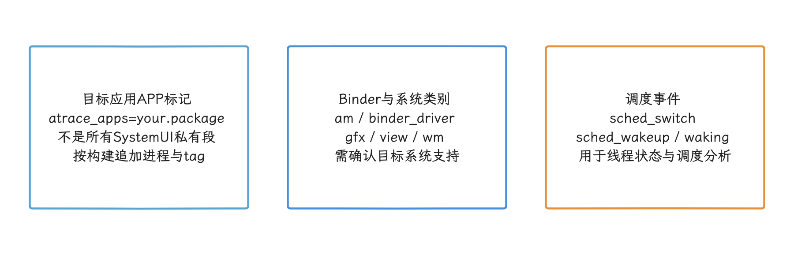

图：类别展开与权限受目标系统影响；配置通过解析不证明设备已成功采到所有事件。

### 查询应用 section

下面的 Perfetto SQL 按耗时列出应用自定义 Trace section：

```sql
SELECT
  process.upid,
  process.pid,
  process.name AS process_name,
  thread.utid,
  thread.tid,
  thread.name  AS thread_name,
  slice.id AS slice_id,
  slice.ts,
  slice.name,
  slice.dur / 1000000.0 AS dur_ms
FROM slice
JOIN thread_track ON slice.track_id = thread_track.id
JOIN thread ON thread_track.utid = thread.utid
JOIN process ON thread.upid = process.upid
WHERE slice.dur >= 0
  AND slice.name IN (
  'notif.build',
  'notif.notify',
  'notif.startForeground',
  'nls.callback'
)
ORDER BY slice.dur DESC;
```

本查询只列出已结束的 section，保留零时长而排除 `dur=-1` 的未结束项；跨进程可能使用同名 section，需以 upid/utid、PID/TID 和时间确认对象。墙钟时长包含执行、调度等待和阻塞，不能替代 CPU 时间。未结束的异常区间要按 §9.2 的观测窗口裁剪继续分析，不能因为这里没列出就认定没有卡顿。

<!-- gracker-diagram: ch09-05-38-sql-identity -->
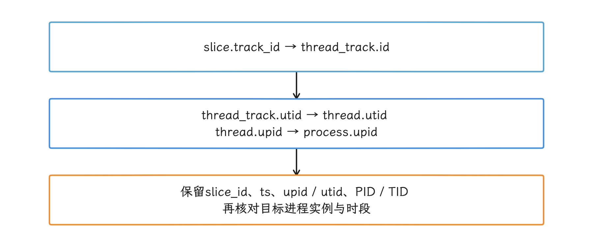

图：同名section可能来自不同进程或线程；查询只是耗时排序入口，不能仅凭名称做跨进程关联。

<!-- gracker-diagram: ch09-05-39-sql-closed-slices -->
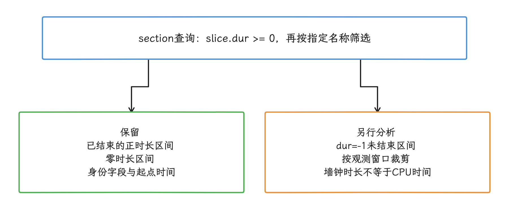

图：该排名查询排除了未结束项；没有出现在结果里不能证明没有卡顿，需结合9.2的窗口裁剪方法。

### 查询主线程状态

下面的查询列出目标进程主线程已结束、持续超过 1 毫秒的状态片段；`is_main_thread` 不依赖线程恰好命名为 main，实际进程实例仍须按 upid/PID 核对：

```sql
SELECT
  process.upid,
  process.pid,
  process.name AS process_name,
  thread.utid,
  thread.tid,
  thread.name  AS thread_name,
  thread_state.ts,
  thread_state.state,
  thread_state.blocked_function,
  thread_state.dur / 1000000.0 AS dur_ms
FROM thread_state
JOIN thread USING (utid)
JOIN process USING (upid)
WHERE process.name = 'your.package'
  AND thread.is_main_thread = 1
  AND thread_state.dur > 1000000
ORDER BY thread_state.dur DESC;
```

长时间 Running 表示本进程正在执行 CPU 工作；`R` 表示线程已经可以运行，却还未获得 CPU；线程处于睡眠状态且 blocked function（阻塞位置）落在 Binder 路径时，需要继续寻找对应的 `system_server` transaction。线程状态只能给出排查方向，仍要用 slice 与调用栈确认具体代码。

<!-- gracker-diagram: ch09-05-40-thread-states -->
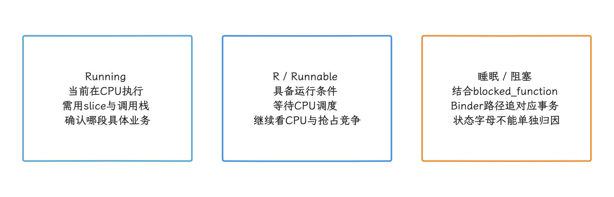

图：查询用is_main_thread适应主线程改名，只列已结束且>1ms区间；仍需按upid/PID确认实际进程实例。

### 三条链分别核对

- 发布链：`notif.notify`、Binder client/server、NMS 同步段返回；
- 分发链：NMS handler、通知锁、ranking 构造与 listener Binder 调用；
- 消费链：SystemUI/NLS Binder 接收、主线程消息、RemoteViews 或业务回调。

<!-- gracker-diagram: ch09-05-41-three-trace-chains -->
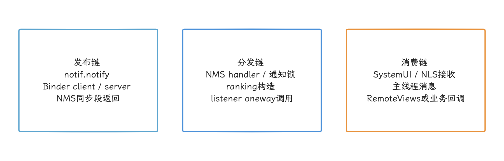

图：以transaction、PID/TID与时间范围关联；平台私有slice名可能不存在，不能靠猜测名称补出调用关系。

不要假定 `notif-handler`、`enqueueNotificationInternal` 之类私有 slice 名一定存在。应用自定义 section、Binder transaction、PID/TID 和时间范围更稳定。

### 使用 dumpsys 辅助诊断

下面的命令保存 NMS 当前状态，并从 system log 搜索被限流丢弃的更新记录：

```bash
adb shell dumpsys notification
adb logcat -b system -d | grep -E \
  'Package enqueue rate|Shedding .* package='
```

`dumpsys` 适合确认当前活跃记录、listener、channel 与策略状态；某次超速更新是否被丢弃，应以 NMS 日志和 trace 时间线为准。若快照采集发生在故障之后，已经移除的通知和短暂积压可能不再可见；Shedding 日志还有输出节流与日志保留限制，搜索不到不等于没有丢弃更新。

<!-- gracker-diagram: ch09-05-42-dumpsys-limits -->
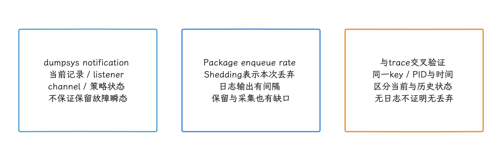

图：这里提供取证方法，没有宣称已在设备复现或采集；负面搜索结果只能按覆盖范围解释。

## 与其他机制的关系

- **§9.1 Service ANR 与超时**：区分 Service 执行 ANR 和前台转换异常。
- **§1.9 Binder IPC 与性能**：`notify()` 的同步返回、listener 的 oneway 回调和 Binder 背压属于不同事务。
- **§6.3 SharedPreferences/DataStore**：NLS 主线程中的 `commit()` 或加载等待会直接延长回调。
- **§1.15 ContentProvider**：URI 图标和 NLS 查询都可能触发 Provider 访问与冷启动。
- **§14.5 Perfetto SQL**：用 Binder、slice 与 thread_state 还原跨进程时间线。

## 常见问题与误区

### 「通知 ANR 只发生在使用 NotificationListenerService 的 App」

发布应用、SystemUI 和带 UI 的监听器，都可能因各自主线程阻塞而触发 Input ANR。NLS dispatch completion 的默认 10 秒是回调完成后延迟更新 Binder session 的记账宽限，不是独立的“通知 ANR timer”。前台转换超时在本章固定源码中有 ANR 及崩溃相关路径，另有异步坏通知崩溃；应按原始 reason/异常和 detector 分开统计，不能一律归为崩溃。

### 「`notify()` 是异步的，不会阻塞主线程」

入口是同步 Binder。应用线程会等 NMS 完成入队前的校验、修正、记录构造和配额检查，并执行到 `mHandler.post()` 之后。它不等待 SystemUI 上屏，也不等待 NLS 用户回调完成。

### 「更新被限流时会抛异常」

超速 update 在 NMS 内返回 `false` 并写系统日志，外部 `enqueueNotificationWithTag()` 没有布尔返回值。应用通常只会看到某次进度没有展示。要可靠发布最终状态，应降低更新频率，并在状态转换时明确发出终态通知，不能依赖异常重试。

### 「自定义通知布局比标准模板性能更好」

标准模板也会生成 `RemoteViews`。它提供系统维护的布局、尺寸和 action 集合，通常更容易保持布局标识不变。自定义布局是否更慢仍需测量；层级、action、图片与复用失败都会增加开销。Live Update 禁止 `customContentView` 属于展示资格规则，不能当作性能基准测试结论。

### 「Icon 构造方式对性能没影响」

resource、URI 和 bitmap 的成本分别落在资源解析、延迟读取与解码、共享内存复制上。bitmap 应预先缩放；URI 要保证授权在通知存活期间有效；resource 要保证接收端能解析对应包和资源。选择依据是图片来源、更新频率和目标尺寸，不存在适用于所有来源的统一性能排序。

<!-- gracker-diagram: ch09-05-43-faq-boundaries -->
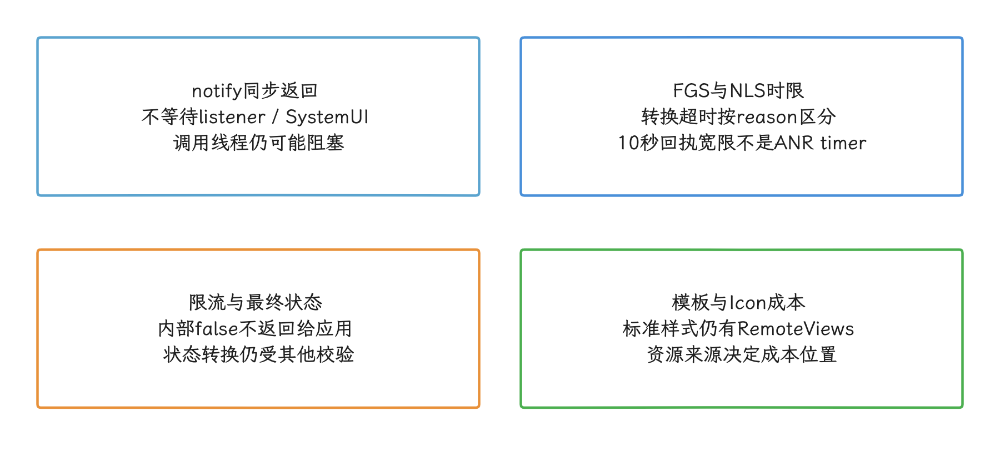

图：这组边界对应本章机制图；具体根因仍须用目标build和故障时段的证据闭环。

## 参考资料

### Android 17 / API 37 源码

- [NotificationManager.java：应用侧 notify 入口](https://android.googlesource.com/platform/frameworks/base/+/android-17.0.0_r1/core/java/android/app/NotificationManager.java)
- [INotificationManager.aidl：同步 enqueue 接口](https://android.googlesource.com/platform/frameworks/base/+/android-17.0.0_r1/core/java/android/app/INotificationManager.aidl)
- [NotificationManagerService.java：同步入队、配额、排序与 listener 分发](https://android.googlesource.com/platform/frameworks/base/+/android-17.0.0_r1/services/core/java/com/android/server/notification/NotificationManagerService.java)
- [NotificationListenerService.java：主线程 Handler 与 RankingMap](https://android.googlesource.com/platform/frameworks/base/+/android-17.0.0_r1/core/java/android/service/notification/NotificationListenerService.java)
- [INotificationListener.aidl：oneway listener 回调](https://android.googlesource.com/platform/frameworks/base/+/android-17.0.0_r1/core/java/android/service/notification/INotificationListener.aidl)
- [Notification.java：ProgressStyle、MetricStyle 与 progress state](https://android.googlesource.com/platform/frameworks/base/+/android-17.0.0_r1/core/java/android/app/Notification.java)
- [RemoteViews.java：Parcel、apply 与 reapply](https://android.googlesource.com/platform/frameworks/base/+/android-17.0.0_r1/core/java/android/widget/RemoteViews.java)
- [Icon.java：resource、URI 与 bitmap Parcel 路径](https://android.googlesource.com/platform/frameworks/base/+/android-17.0.0_r1/graphics/java/android/graphics/drawable/Icon.java)
- [ActiveServices.java：前台服务转换 timeout](https://android.googlesource.com/platform/frameworks/base/+/android-17.0.0_r1/services/core/java/com/android/server/am/ActiveServices.java)
- [ActivityManagerService.java：前台服务 timeout / crash 消息分发](https://android.googlesource.com/platform/frameworks/base/+/android-17.0.0_r1/services/core/java/com/android/server/am/ActivityManagerService.java)

### 官方文档

- [通知开发指南](https://developer.android.com/develop/ui/views/notifications)
- [通知 runtime permission](https://developer.android.com/develop/ui/views/notifications/notification-permission)
- [前台服务超时排查](https://developer.android.com/develop/background-work/services/fgs/troubleshooting)
- [Android 16 ProgressStyle](https://developer.android.com/about/versions/16/features/progress-centric-notifications)
- [Android 17 MetricStyle 指南](https://developer.android.com/develop/ui/views/notifications/metric-style)
- [Live Update 资格与 surface](https://developer.android.com/develop/ui/views/notifications/live-update)
- [Android 17 Semantic Coloring](https://developer.android.com/about/versions/17/features#live-update-semantic-color)
- [ANR 诊断指南](https://developer.android.com/topic/performance/vitals/anr)

- [SystemUI 通知内容绑定与 reapply 条件](https://android.googlesource.com/platform/frameworks/base/+/android-17.0.0_r1/packages/SystemUI/src/com/android/systemui/statusbar/notification/row/NotificationRowContentBinderImpl.kt)
- [NotifInflation 后台 Looper 与执行器](https://android.googlesource.com/platform/frameworks/base/+/android-17.0.0_r1/packages/SystemUI/src/com/android/systemui/util/concurrency/SysUIConcurrencyModule.kt)
- [Bitmap.asShared 与 gainmap 条件](https://android.googlesource.com/platform/frameworks/base/+/android-17.0.0_r1/graphics/java/android/graphics/Bitmap.java)
- [通知接受事件与估算速率](https://android.googlesource.com/platform/frameworks/base/+/android-17.0.0_r1/services/core/java/com/android/server/notification/NotificationUsageStats.java)
- [入队速率指数加权估计](https://android.googlesource.com/platform/frameworks/base/+/android-17.0.0_r1/core/java/android/service/notification/RateEstimator.java)
- [允许冻结的服务绑定 session](https://android.googlesource.com/platform/frameworks/base/+/android-17.0.0_r1/services/core/java/com/android/server/am/psc/ProcessStateController.java)
- [Binder session 调用计数与进程状态更新](https://android.googlesource.com/platform/frameworks/base/+/android-17.0.0_r1/services/core/java/com/android/server/am/psc/BinderSession.java)
- [前台服务通知的异步发布与坏通知结果](https://android.googlesource.com/platform/frameworks/base/+/android-17.0.0_r1/services/core/java/com/android/server/am/ServiceRecord.java)
- [Perfetto 会话时长与环形缓冲语义](https://android.googlesource.com/platform/external/perfetto/+/android-17.0.0_r1/protos/perfetto/config/trace_config.proto)
- [atrace Binder 类别映射](https://android.googlesource.com/platform/frameworks/native/+/android-17.0.0_r1/cmds/atrace/atrace.cpp)
- [Perfetto SQL 表与身份字段](https://perfetto.dev/docs/analysis/sql-tables)
