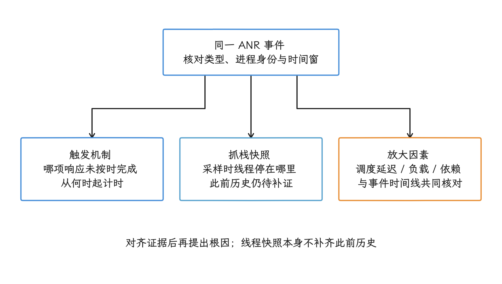
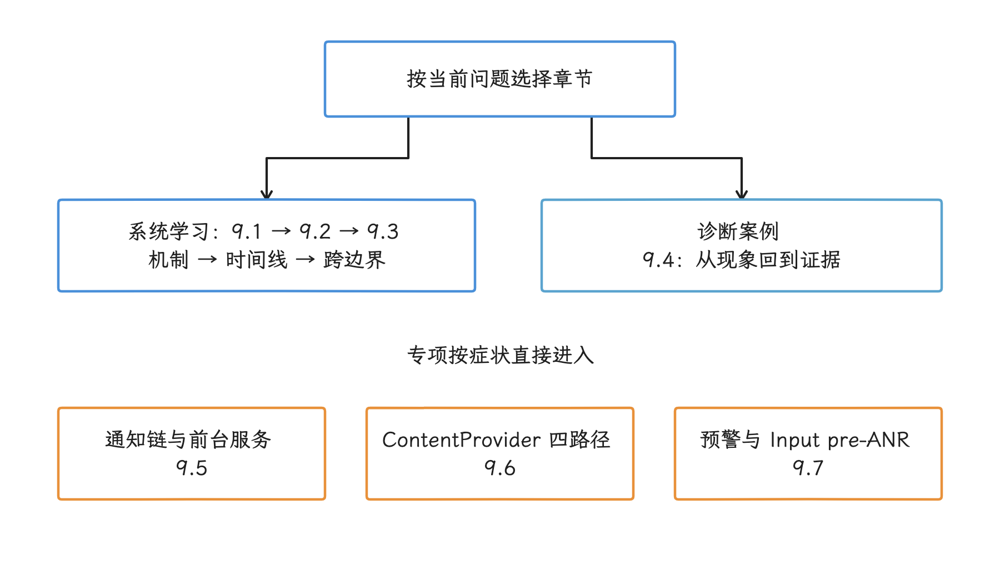

# 第 9 章：ANR

ANR（Application Not Responding，应用无响应）表示系统判定应用没有在规定时间内完成某类关键响应，例如处理输入事件、广播或服务回调。

一份 `traces.txt` 只记录抓取堆栈那一刻的线程状态，单看它还原不出此前发生了什么。

分析应回到超时发生前的时间线：最终堆栈说明采样时线程停在哪里，触发原因解释哪项响应未按时完成，放大因素包括高负载、调度延迟等让问题更容易出现的条件。三者要分别取证，取证时结合超时类型、触发时刻、Binder 等待、锁竞争、系统负载，以及用户可感知的操作时间线。

<!-- gracker-diagram: ch09-overview-three-evidence-roles -->

图：触发机制、线程快照和放大因素分别取证，再按事件身份与时间窗核对；Runnable、高负载和锁等待需要放回上下文解释。参考[官方 ANR 诊断指南](https://developer.android.com/topic/performance/anrs/diagnose-and-fix-anrs)与[Perfetto 调度事件说明](https://perfetto.dev/docs/data-sources/cpu-scheduling)。

## 内容索引

- [9.1 ANR 机制、类型与触发条件](01-anr-mechanism-types-triggers.md)
- [9.2 ANR 与 Kernel Trace 联合诊断](02-anr-kernel-trace-diagnosis.md)
- [9.3 特殊与跨边界 ANR](03-special-anr.md)
- [9.4 ANR 诊断案例集](04-case-studies.md)
- [9.5 Notification 性能与 ANR](05-notification-performance-anr.md)
- [9.6 ContentProvider 超时与 ANR 四路径](06-contentprovider-timeout-anr.md)
- [9.7 Android 17 ANR 预警与 Input pre-ANR](07-android17-anr-prewarning.md)

## 阅读建议

- 系统学习 ANR：按 `9.1 → 9.2 → 9.3` 阅读，其中 9.2 负责时间线和内核证据，9.3 处理跨边界场景。
- 事后堆栈无法解释超时从何处开始：重点查看 `9.1`、`9.2`、`9.7`。
- Notification、前台服务和多进程边界：进入对应专项条目。
- 线上监控、事件写入本地文件与聚合分析：查看 `26.2`。

<!-- gracker-diagram: ch09-overview-reading-routes -->

图：系统学习可按 9.1→9.2→9.3 阅读；案例与专项按问题选择。图中箭头表示阅读建议，章节编号与上方内容索引一一对应。
